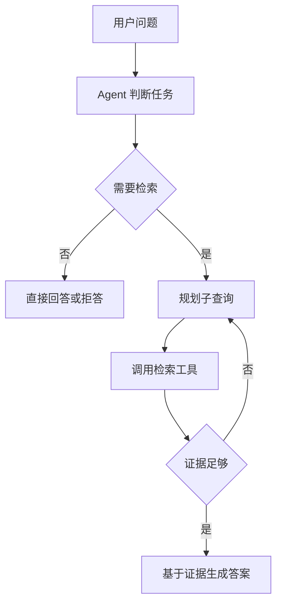

# Agentic-RAG智能体RAG

> [!abstract] 一句话总结
> Agentic RAG 让智能体自己决定是否检索、怎么改写查询、检索几轮、是否需要调用工具验证答案。

## 📌 这是什么

传统 RAG 是固定流水线：检索一次，生成一次。Agentic RAG 是动态流程：模型会根据任务难度规划检索策略，必要时多轮检索、改写问题、查不同数据源、反思答案是否足够。

## 🧩 典型能力

| 能力 | 说明 |
| ---- | ---- |
| Query Planning | 把复杂问题拆成多个子问题 |
| Tool Routing | 选择向量库、搜索、数据库、图谱等工具 |
| Iterative Retrieval | 检索不足时继续改写和补查 |
| Self-Reflection | 判断证据是否足够回答 |
| Answer Synthesis | 汇总多源证据生成答案 |

## ⚙️ 工作流程

## 🎯 适用场景

- 多跳问题、模糊问题、需要跨数据源的问题。
- 法律、金融、医疗等需要证据检查的场景。
- 用户问题无法用一次检索稳定命中。

## ⚠️ 踩坑与注意事项

- [ ] 成本和延迟明显高于固定 RAG。
- [ ] 必须设置最大轮数和终止条件。
- [ ] 工具描述要清晰，否则 Agent 会选错工具。
- [ ] 每轮检索和决策都要记录日志，方便排查。

## 🎯 面试问题

> [!question] 高频问题
> - **Q: Agentic RAG 和普通 RAG 的区别？**
>   - A: 普通 RAG 是固定检索生成链路；Agentic RAG 由 Agent 动态规划、检索、评估和重试。
> - **Q: Agentic RAG 最大风险？**
>   - A: 成本、延迟、不可控循环和可观测性不足。

## 🔗 关联笔记

- [[09-Multi-Query与HyDE]]
- [[19-GraphRAG图谱增强]]
- [[01-RAG基础与全链路]]
- [[../05-Agent-MCP-Skills/01-Agent设计模式详解|Agent设计模式详解]]
- [[_index]]

## 📚 参考资料

- [LangGraph: Agentic RAG](https://docs.langchain.com/oss/python/langgraph/agentic-rag)
- [LlamaIndex Agents](https://docs.llamaindex.ai/en/stable/module_guides/deploying/agents/)
- [LangChain Retrieval Agents](https://python.langchain.com/docs/tutorials/qa_chat_history/)
