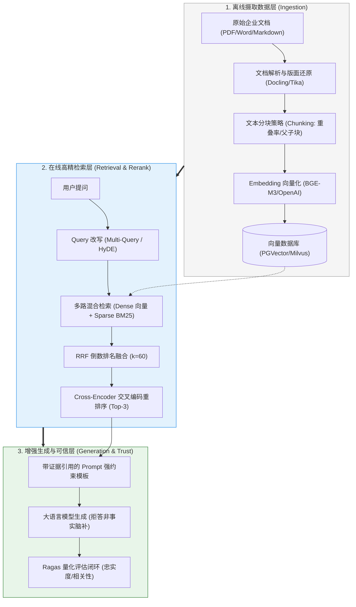

# 🎯 知识库技术 RAG：本章通关总结与复习

> [!abstract] 一句话总结
> 工业级 RAG 的核心不仅是“把文档塞进向量库”，而是**“构建从高质量解析分块、多路混合检索（向量+BM25）、Cross-Encoder 精排到模型强约束生成的可评估、可追溯的证据链”**。

---

## 🗺️ 全章知识拓扑大一统

---

## 📊 核心模块关键结论总览

| 模块分层 | 核心攻坚问题 | 第一性原理关键结论 | 对应笔记精读 |
| :--- | :--- | :--- | :--- |
| **00 宏观心智** | 为什么做私有知识首选 RAG 而非微调？ | 微调修改神经网络权重（适合内化特定格式与风格，但知识更新慢、难以溯源）；RAG 动态注入外部上下文（支持知识近实时更新、细粒度权限隔离与切片级引用溯源）。 | [[00-RAG全景与心智模型]] |
| **01 向量底层** | 向量相似度怎么算？什么时候点积等于余弦？ | 文本语义映射到高维向量空间；**当向量均经过 L2 范数归一化（模长为 1）后，点积在数学上完全等价于余弦相似度**，且省去了除法与开方运算。 | [[01-RAG基础与全链路]] |
| **04 分块策略** | 如何兼顾定位精度与上下文完整度？ | 切分优先尊重标题、段落、表格等自然语义结构，再通过评测调整块大小与重叠率；父子块策略通过“小块检索定位、大块提供生成上下文”实现颗粒度解耦。 | [[04-文本切分策略]] [[10-父子块策略]] |
| **08 混合检索** | 为什么纯向量检索容易漏召回专有符号？ | 密集向量易平滑掉低频的设备型号、错误码与法条编号；结合 BM25 词项匹配与标量精确过滤可补齐短板，并通过 RRF 算法实现多路无量纲排名融合。 | [[08-混合检索-Hybrid-Search]] |
| **09 查询改写** | 用户提问简短、口语化怎么破？ | 针对问答非对称语义鸿沟，Multi-Query 通过多视角同义改写扩大召回覆盖面；HyDE 先生成假设性解答文档，将“以问搜答”转化为处于同一语义流形的“以文搜文”。 | [[09-Multi-Query与HyDE]] |
| **07 重排精排** | 双塔向量粗召回后为什么要加 Rerank？ | 双塔模型（Bi-Encoder）独立编码缺乏词级交互；交叉编码器（Cross-Encoder）将 Query 与候选 Chunk 拼接输入 Transformer 做全注意力计算，显著提升头部排序精度。 | [[07-Rerank重排序]] |
| **15 向量库底座** | pgvector 与专用向量库怎么选？ | 综合现有数据库栈复用度、ACID 事务与关联查询诉求、标量过滤复杂度及分布式扩缩容需求，基于真实业务负载压测选型。 | [[15-向量库选型对比]] |

---

## ⚡ 高频面试 10 连问

> [!important] 高频核心问题直击要害
>
> 1. **RAG 系统的回答质量主要受哪些环节影响？如何定位瓶颈？**
>    - 答：RAG 系统遵循“垃圾进，垃圾出”规律，回答质量取决于离线解析分块、在线检索召回、重排序以及生成约束的端到端协同。工程上绝大多数答非所问源于上游解析失真或检索漏召回，排障时应先验证标准答案所需证据是否成功进入候选池与最终上下文，再优化下游生成提示词。
>
> 2. **什么是混合检索（Hybrid Search）？RRF 算法的计算原理是什么？**
>    - 答：混合检索结合了密集向量检索（Dense，擅长同义词与语义泛化）与稀疏全文检索（Sparse/BM25，擅长型号、编码等精确字面匹配）。RRF（倒数排名融合）公式为 $\sum \frac{1}{k + r(d)}$（经验常数 $k$ 通常取 60），它摒弃了跨系统不可比的绝对分值，纯粹基于各路检索的相对名次倒数累加，使在多路检索中均排名靠前的候选文档获得更高融合权重。
>
> 3. **HyDE（假设性文档嵌入）的底层原理是什么？有哪些适用边界？**
>    - 答：HyDE 先利用大模型根据简短提问生成一篇假设性回答文档，再将该假想文档向量化去检索真实资料，从而将非对称的“以问搜答”转化为处于同一语义流形的“以文搜文”。其主要边界在于面对企业私有缩写或冷门错误码时，模型缺乏先验知识可能生成偏离方向的假想内容；工程上需保留原查询并行检索，且严禁将假想文档混入最终生成证据。
>
> 4. **什么是父子块（Parent-Child Chunking）策略？它解决了什么矛盾？**
>    - 答：它解决了**“检索精度要求 Chunk 尽量小，而模型理解要求上下文尽量大”**的内在矛盾。离线切分时构建细粒度子块（如 200 Token）和完整段落父块（如 1000 Token）；在线向量检索时仅对子块做高精度匹配，命中后通过 `parent_id` 回表取出所属父块并去重后交给大模型，兼顾定位精度与上下文完整度。
>
> 5. **Cross-Encoder Rerank 与 Bi-Encoder Embedding 有何本质区别？**
>    - 答：Bi-Encoder（双塔模型）将 Query 和 Document 各自独立编码成固定向量，文档向量可离线预计算，检索极快但缺乏细粒度词级交互，适合第一阶段粗召回（如 Top-50）；Cross-Encoder（交叉编码器）将两者拼接为 `[CLS] Query [SEP] Doc [SEP]` 一起过 Transformer 做全注意力交互，相关性判别更准但无法预计算，适合第二阶段对少量候选做精排（如筛选出 Top-5）。
>
> 6. **HNSW 索引如何加速向量检索，有什么工程代价？**
>    - 答：HNSW 构建类似跳表的分层近邻图，查询时从顶层稀疏节点快速跨步定位，逐层向下精细收敛至目标邻域，从而在无需遍历全库的情况下实现毫秒级近似最近邻检索。其主要代价是维护多层图边结构占用较高内存，且索引构建耗时较长，工程上需通过调整最大连接数 `M` 和搜索候选集大小 `efSearch` 在内存、延迟与召回率之间取得平衡。
>
> 7. **在向量检索中，后置过滤（Post-filtering）为什么会导致“空结果”故障？**
>    - 答：后置过滤先在全量数据上执行无条件向量检索取出全局 Top-K，再按租户或权限条件剔除不合规记录；若当前租户的数据占比较小，全局 Top-K 候选可能全部属于其他租户，过滤后直接返回空集。正确做法是将标量过滤条件下推至向量引擎内部，采用过滤感知图遍历（Filtered Search）或开启迭代扫描（Iterative Scan）。
>
> 8. **如果线上 RAG 系统回答答非所问，标准排查 SOP 五步法是什么？**
>    - 答：遵循自上而下的五步定位法：① **查文档解析**（是否丢失表格、双栏错序或 OCR 乱码）；② **查文本切分**（核心事实是否被截断在块边界且缺乏标题语境）；③ **查检索召回**（打印粗召回 Top-K，确认证据片段是否进入候选池）；④ **查重排顺序**（证据是否在精排后位列前茅，避免被截断或陷入 Lost in the Middle）；⑤ **查生成约束**（Prompt 是否设置严格的依证据作答与无依据拒答指令）。
>
> 9. **RAG 质量量化评估的核心指标有哪些（以 Ragas 为例）？**
>    - 答：分为检索与生成两个维度：
>      - **检索层指标**：上下文精确率（Context Precision，相关块在召回列表中是否排名靠前）、上下文召回率（Context Recall，召回内容是否覆盖标准答案所需的全部关键事实）；
>      - **生成层指标**：忠实度（Faithfulness，答案陈述是否完全由给定上下文支撑，用于度量幻觉）、答案相关性（Answer Relevancy，回答是否直接切题回应了用户提问）。
>
> 10. **什么是 CAG（缓存增强生成）？它与 RAG 的适用边界如何划分？**
>     - 答：CAG 将规模可控、更新低频的稳定知识预先组织为结构化上下文包，结合平台的 Prompt Caching 能力在多次查询间直接复用前缀，省去实时检索链路以降低延迟。它适用于高频访问的稳定手册或 FAQ；而对于超大规模文档库、高频动态更新数据及细粒度行级权限隔离场景，则应采用 RAG 或“热知识 CAG + 冷知识 RAG”的混合架构。

---

## 🚨 生产落地十项工程规范

1. **按业务特征组合检索**：结合语义问答与精确编号查询需求，合理配置密集向量、BM25 全文检索与标量精确过滤。
2. **优先保障切分语义完整**：按标题、段落和原子结构（表格/代码块）切分，并保留完整标题路径元数据，复杂上下文需求可引入父子块。
3. **复用成熟存储底座**：优先基于团队现有的 PostgreSQL (pgvector) 或 Elasticsearch 压测落地，随数据规模增长再平滑演进至专用分布式向量库。
4. **权限过滤前置下推**：在多路召回、父块回表及原文引用各环节严格校验租户与角色权限，采用引擎内过滤防止越权泄漏与后置过滤空集。
5. **查询改写保留原始基线**：使用 Multi-Query 或 HyDE 扩展召回时同步保留原始 Query 检索，且严禁将 HyDE 假想文档混入生成上下文。
6. **向量模型版本化管理**：切块表记录 `embedding_version`，升级 Embedding 模型时通过新建索引或分区完成双写灰度与全量重建。
7. **建立明确的无依据拒答机制**：在 System Prompt 中强制约束“仅依据参考资料作答”，对检索结果为空或低于置信度阈值的请求触发标准拒答或转人工流程。
8. **全链路贯通引用溯源**：从文档解析阶段起持久化文档 ID、文件名、页码与章节路径，生成后校验引用编号有效性并支持原文定位。
9. **构建端到端量化评估闭环**：沉淀覆盖事实问答、多跳综合与拒答边界的业务评测集，结合 Ragas 指标与人工抽检持续回归调优。
10. **冷热知识分层治理**：对高频稳定的核心手册利用 Prompt Caching / CAG 降低首字延迟与重复计算成本，对长尾动态知识走标准 RAG 检索。

---

## 🔗 下一章通关衔接

你已经掌握了企业级 RAG 的全链路硬核架构！接下来我们将跨越单次问答，进入连续对话世界：

👉 进入下一章：[[../04-多轮对话与上下文工程/_index|04 · 多轮对话与上下文工程]]
- 从单次 RAG 跃迁至真实人机长会话交互；
- 滑动窗口截断、摘要滚动压缩、语义记忆抽取；
- 分布式多租户会话隔离与长期记忆（Long-term Memory）工业级治理！
