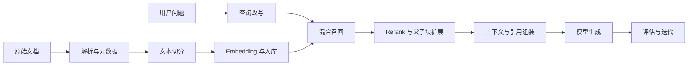

# 知识库技术 RAG：本章总结与复习

> [!abstract] 一句话总结
> 知识库系统要把可靠的解析与索引、可调优的召回与重排、可验证的引用与评估连成闭环，并按数据规模和问题类型选择 RAG 或替代方案。

## 核心知识概览

| 模块 | 核心问题 | 关键结论 | 对应笔记 |
| --- | --- | --- | --- |
| RAG 全链路 | 私有知识如何进入模型回答 | 离线完成解析、切分、Embedding 与入库，在线完成查询改写、召回、重排、上下文组装和生成 | [[01-RAG基础与全链路]] |
| 文档摄取 | 如何保留文本、版面与语义 | 按文档类型解析文本、表格、图片与 OCR，并保留来源、页码、层级等元数据 | [[02-文档解析]]、[[03-多模态RAG与文档智能]]、[[04-文本切分策略]] |
| 向量召回 | 如何获得语义相关候选 | Embedding 必须匹配语言与任务；Top-K、阈值、距离度量和索引参数需通过数据集调优 | [[05-Embedding模型选型]]、[[06-向量检索与TopK]] |
| 召回增强 | 如何提高覆盖率与精度 | Rerank 精排候选，Hybrid Search 融合关键词与向量，Multi-Query、HyDE 和父子块分别改善查询表达与上下文粒度 | [[07-Rerank重排序]]、[[08-混合检索-Hybrid-Search]]、[[09-Multi-Query与HyDE]]、[[10-父子块策略]] |
| 可信与评估 | 如何证明回答有依据且可改进 | 引用必须来自检索元数据；用检索与生成指标、固定测试集和错误分层定位瓶颈 | [[11-引用溯源]]、[[12-RAG评估-Ragas]] |
| 向量数据库 | 如何选择存储与检索基础设施 | Milvus 面向独立向量检索规模，pgvector 适合复用 PostgreSQL；按规模、过滤、运维和一致性选型 | [[13-Milvus入门]]、[[14-pgvector入门]]、[[15-向量库选型对比]] |
| 替代与进阶 | 何时不只用经典 RAG | 稳定小语料可考虑 CAG 或 Long Context，结构化知识可用 LLM Wiki 或 GraphRAG，复杂动态任务再引入 Agentic RAG | [[16-CAG缓存增强生成]]、[[17-LLM-Wiki知识库范式]]、[[18-Long-Context长上下文]]、[[19-GraphRAG图谱增强]]、[[20-Agentic-RAG智能体RAG]] |

## RAG 主流程

## 快速复习

1. RAG 的质量上限首先由文档解析、元数据和切分决定，不应只调模型或 Prompt。
2. Embedding 模型、距离度量与索引必须兼容；更换模型通常意味着重新生成全部向量。
3. Top-K 提高可能增加召回，也会引入噪声、Token 成本和延迟，需配合阈值与 Rerank。
4. Hybrid Search 兼顾语义与精确词匹配；Multi-Query 和 HyDE 用额外推理成本改善难查询召回。
5. 父子块用小块定位、父块补上下文，适合答案依赖较长段落的场景。
6. 引用溯源依赖摄取阶段保存的来源元数据，生成阶段不能凭空补造引用。
7. RAG 评估要拆分检索与生成指标，用真实问题集回归，避免只凭主观示例判断。
8. CAG、Long Context、LLM Wiki、GraphRAG 和 Agentic RAG 各有边界，复杂度必须由明确收益支撑。

## 自测问题

1. 如何区分一次错误回答是解析、切分、召回、重排还是生成阶段造成的？
2. Hybrid Search、Multi-Query、HyDE、Rerank 和父子块分别解决什么问题，会增加什么成本？
3. Milvus 与 pgvector 的典型适用场景有何不同，选型前必须确认哪些约束？
4. 哪些语料和问题适合 CAG、Long Context、GraphRAG 或 Agentic RAG，而不是经典 RAG？
5. 如何构建同时衡量检索质量、答案忠实度和引用正确性的回归测试集？

## 下一章衔接

下一章进入 [[04-多轮对话与上下文工程/_index|多轮对话与上下文工程]]：把单次知识检索扩展到连续会话，重点处理窗口裁剪、摘要记忆、语义记忆、结构化记忆、会话隔离与长期记忆治理。

## 相关编号双链

- 基础与摄取：[[01-RAG基础与全链路]] · [[02-文档解析]] · [[03-多模态RAG与文档智能]] · [[04-文本切分策略]]
- 检索与增强：[[05-Embedding模型选型]] · [[06-向量检索与TopK]] · [[07-Rerank重排序]] · [[08-混合检索-Hybrid-Search]] · [[09-Multi-Query与HyDE]] · [[10-父子块策略]]
- 可信与基础设施：[[11-引用溯源]] · [[12-RAG评估-Ragas]] · [[13-Milvus入门]] · [[14-pgvector入门]] · [[15-向量库选型对比]]
- 替代与进阶：[[16-CAG缓存增强生成]] · [[17-LLM-Wiki知识库范式]] · [[18-Long-Context长上下文]] · [[19-GraphRAG图谱增强]] · [[20-Agentic-RAG智能体RAG]]

