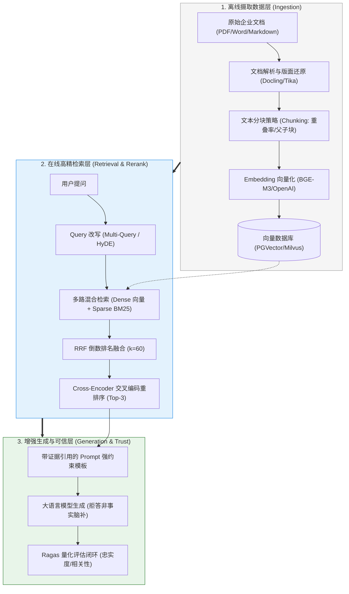

# 🎯 知识库技术 RAG：本章通关总结与复习

> [!abstract] 一句话总结
> 工业级 RAG 的核心不仅是“把文档塞进向量库”，而是**“构建从高质量解析分块、多路混合检索（向量+BM25）、Cross-Encoder 精排到模型强约束生成的全链路确定性证据闭环”**。

---

## 🗺️ 全章知识拓扑大一统

---

## 📊 核心模块关键结论总览

| 模块分层 | 核心攻坚问题 | 第一性原理关键结论 | 对应笔记精读 |
| :--- | :--- | :--- | :--- |
| **00 宏观心智** | 为什么做私有知识首选 RAG 而非微调？ | 微调改的是神经元权重（学风格/慢更新/不可溯源/幻觉依旧）；RAG 改的是外部注意力上下文（秒级更新/100% 来源溯源/零幻觉）。 | [[00-RAG全景与心智模型]] |
| **01 向量底层** | 向量相似度怎么算？什么时候点积等于余弦？ | 语义映射到高维坐标空间；**在做过 L2 范数归一化后，点积绝对等价于余弦相似度**，能消除昂贵除法大幅提升 GPU/CPU 计算速度。 | [[01-RAG基础与全链路]] |
| **04 分块策略** | 为什么固定字数切块是灾难的根源？ | 缺乏重叠率（Overlap）会导致关键事实被硬生生切断在裂缝中；父子块（Parent-Child）用小块保证精准定位，用大父块提供完整上下文。 | [[04-文本切分策略]] [[10-父子块策略]] |
| **08 混合检索** | 为什么纯向量检索会频发漏召回？ | 密集向量压缩抹平了低频特有编码；BM25 关键词检索以逆文档频率（IDF）对设备型号、订单号提供确定性命中；RRF 算法解决分数不可比。 | [[08-混合检索-Hybrid-Search]] |
| **09 查询改写** | 用户问得太短、口语化怎么破？ | 存在问答非对称语义鸿沟；HyDE 假设性文档嵌入让模型先脑补假答案，以“文搜文”抹平鸿沟；Multi-Query 多角度改写扩大召回面。 | [[09-Multi-Query与HyDE]] |
| **07 重排终审** | 双塔向量召回后为什么必须加 Rerank？ | 双塔粗排各自独立编码缺乏细粒度交互；Cross-Encoder 将 Query 与 Chunk 拼在一起做全注意力交叉计算，准确率提升显著。 | [[07-Rerank重排序]] |
| **15 向量库底座** | pgvector 与 Milvus 到底怎么选？ | 百万级以内且重业务事务选 **PostgreSQL + pgvector**，秒级单表 JOIN；千万级以上高吞吐存算分离选 **Milvus / Qdrant**。 | [[15-向量库选型对比]] |

---

## ⚡ 大厂面试 30 秒绝杀 10 连问

> [!important] 高频核心问题直击要害
>
> 1. **RAG 系统的回答质量主要受哪些环节影响？大模型自身占多大比重？**
>    - 答：RAG 的行业铁律是 **“Garbage In, Garbage Out”**。回答质量 70% 取决于文档解析与切分（Chunking）的干净程度，20% 取决于混合检索与 Rerank 的召回精度，大模型自身的推理生成能力只占最后 10%。
>
> 2. **什么是混合检索（Hybrid Search）？RRF 算法的计算原理是什么？**
>    - 答：混合检索结合了密集向量检索（Dense，擅长语义同义泛化）与稀疏全文检索（Sparse/BM25，擅长精确型号/编码命中）。RRF（倒数排名融合）公式为 $\sum \frac{1}{60 + r(d)}$，它摒弃了不可比的绝对分值，纯粹基于多路检索的相对名次倒数相加，给予双路前列候选极高的置信加权。
>
> 3. **HyDE（假设性文档嵌入）的底层原理是什么？在什么场景下严禁使用？**
>    - 答：HyDE 让 LLM 先根据 Query 脑补生成一篇假想答案，拿着假想文档去向量库检索，将非对称的“以问搜答（Query-to-Doc）”转化为对称的“以文搜文（Doc-to-Doc）”。**禁忌场景**：涉及企业内部专有暗号、冷门错误码或极度生僻领域时，大模型先验知识为零，假想答案必然产生严重偏差，导致检索全盘跑偏。
>
> 4. **什么是父子块（Parent-Child Chunking）策略？它解决了什么矛盾？**
>    - 答：它解决了**“检索精度要求 Chunk 尽量小，而模型理解要求上下文尽量大”**的核心物理矛盾。离线切分时切为 200 Token 的子块和 1000 Token 的父块；向量检索时只对子块做高精度比对命中，命中后通过元数据索引自动取出其所属的完整大父块递给大模型，兼顾定位精度与语义完整度。
>
> 5. **Cross-Encoder Rerank 与 Bi-Encoder Embedding 有何本质区别？**
>    - 答：Bi-Encoder（双塔模型）将 Query 和 Document 分别独立编码成固定向量，计算速度快但缺乏交互注意力，适合首轮大规模粗排；Cross-Encoder（交叉编码器）将两者拼接为 `[CLS] Query [SEP] Doc [SEP]` 输入深层 Transformer，所有 Token 之间进行无死角交叉自注意力交互，打分极准，适合用于 Top-30 候选中精选 Top-3。
>
> 6. **向量数据库的 HNSW 索引是如何实现对数级检索加速的？**
>    - 答：HNSW（分层可导航小世界图）将跳表（SkipList）的多层思想移植到了拓扑图上。顶层为长跨度稀疏边，负责在大尺度空间极速跳跃导航；底层为短跨度密集边，负责局部精细收敛，将高维搜索时间复杂度硬生生降到了 $O(\log N)$。
>
> 7. **在向量检索中，后置过滤（Post-filtering）为什么会导致严重的“空结果”事故？**
>    - 答：后置过滤是在全库无差别检索出全局 Top-K 相似向量后，再在应用层按租户/权限过滤。当当前租户数据在全库占比极低（如 0.5%）时，全局前 10 名极大概率全是其他大租户的数据，后置过滤一刀切完直接返回 0 条，造成“明明库里有文档却查不出来”的假象。必须采用**单阶段联合过滤（In-graph Filtering）**，在图游走每一步动态结合标量索引剪枝。
>
> 8. **如果线上 RAG 系统回答答非所问，标准排查 SOP 五步法是什么？**
>    - 答：① 查解析（原文件表格特殊字符是否丢失）；② 查分块（事实是否被硬切成两半，缺少 overlap）；③ 查召回（Top-K 候选集里是否有正确答案，若没有则需引入 BM25）；④ 查排序（正确答案是否排在末尾触发了 Lost in the Middle，需引入 Rerank）；⑤ 查生成（Prompt 是否包含强拒答约束，模型是否产生自作聪明的幻觉）。
>
> 9. **RAG 质量量化评估的核心指标有哪些（以 Ragas 为例）？**
>    - 答：分为两大维度：
>      - **检索层质量**：上下文相关性（Context Relevance，检索内容与问题的相关度）、上下文召回率（Context Recall，检索内容是否覆盖标准答案所需的全部事实）；
>      - **生成层质量**：忠实度（Faithfulness，答案中陈述的事实是否能 100% 推导自参考资料，度量幻觉程度）、答案相关性（Answer Relevance，答案是否正面直接解答了用户问题）。
>
> 10. **什么是 CAG（缓存增强生成）？它与 RAG 的适用边界如何划分？**
>     - 答：CAG（Cache-Augmented Generation）基于现代大模型的超长上下文与 **Prompt Caching（提示词前缀缓存）** 技术。它不切分、不存向量库，而是把数万字的稳定企业手册直接一次性作为前缀写入上下文并缓存在大模型服务端。后续所有问答直接享受 1 折读取与极低延迟，适用于**文档总量不大（<10万字）、内容稳定、极度要求全局上下文完整理解**的场景；文档超大且秒级频繁变动时依然必须选 RAG。

---

## 🚨 生产落地十诫（Architectural Commandments）

1. **一戒纯向量裸奔上生产**：必须采用**密集向量 + BM25 混合检索**，并用 RRF 融合或 Rerank 终审，彻底杜绝精准型号漏召回。
2. **二戒忽略分块重叠率**：文本分块严禁无缝硬截断，必须配置 10%~15% 的 Overlap，复杂场景优先采用父子块。
3. **三戒小规模过度引入 Milvus 集群**：文档量在 100 万以内时，首选单机 PostgreSQL + pgvector，架构最简、支持事务与关系表秒级 JOIN。
4. **四戒使用后置标量过滤**：多租户权限隔离必须依托向量数据库的单阶段联合过滤（In-graph Filtering），防止高选择性下召回假空。
5. **五戒生僻冷门领域盲用 HyDE**：模型先验为零的私有编码或暗号，HyDE 生成的假想答案会把检索带进深渊。
6. **六戒忽略 Embedding 维度一致性**：更换向量模型必须全量重构向量表索引，严禁新旧模型混用同一张表。
7. **七戒无 Prompt 强拒答约束**：Prompt 中必须明确声明“严格依据参考资料回答，未提及则如实说明不知”，从源头掐灭大模型自我脑补。
8. **八戒丢弃文档元数据**：摄取阶段必须完整记录文件名、页码、段落 ID 和部门租户，生成阶段必须做到精确角标引用溯源。
9. **九戒凭感觉肉眼调优 RAG**：必须搭建由标准问答对组成的固定 Golden Dataset，使用 Ragas 工具进行量化评分（忠实度、召回率）回归。
10. **十戒静态文档无缓存优化**：对于高频访问的固化手册，优先结合 Prompt Caching 冻结前缀，降本 90% 并降低首字延迟。

---

## 🔗 下一章通关衔接

你已经掌握了企业级 RAG 的全链路硬核架构！接下来我们将跨越单次问答，进入连续对话世界：

👉 进入下一章：[[../04-多轮对话与上下文工程/_index|04 · 多轮对话与上下文工程]]
- 从单次 RAG 跃迁至真实人机长会话交互；
- 滑动窗口截断、摘要滚动压缩、语义记忆抽取；
- 分布式多租户会话隔离与长期记忆（Long-term Memory）工业级治理！
