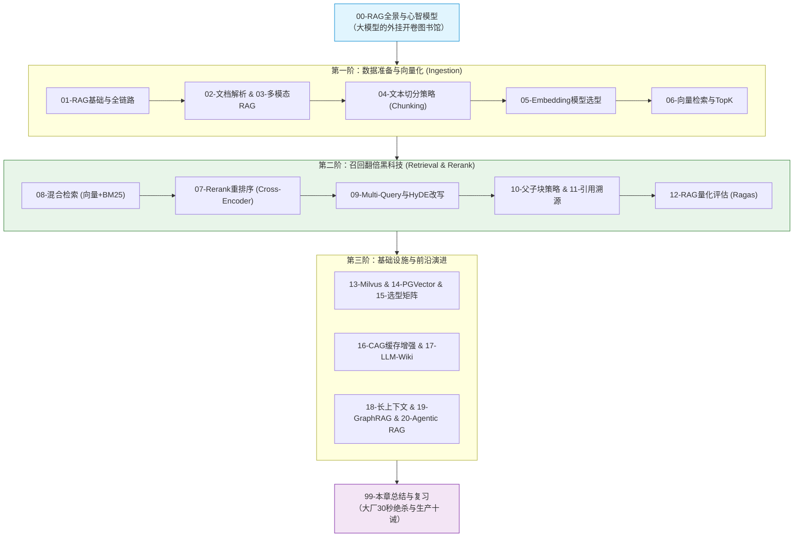

# 📚 03 · 知识库技术（RAG / CAG / LLM Wiki）

> [!info] 本区说明
> 对应学习路径 **阶段三**。系统掌握让大语言模型安全、可靠、低延迟地消费企业私有知识的技术全景：从经典 RAG 双飞轮架构到向量库选型，再到混合检索、Rerank 与 Agentic RAG 进阶方案。

---

## 🗺️ 通关全景学习路线

---

## 📚 知识笔记清单

### 00 · 全景心智
- [[00-RAG全景与心智模型]] 🌟（开卷考试心智模型、RAG vs 微调第一性原理、双飞轮全景图）

### 01 · 经典 RAG 核心链路
- [[01-RAG基础与全链路]]（高维几何距离推导、时序图与工业五步排障 SOP）
- [[02-文档解析]]（PDF/Word/Markdown 结构提取与表格保留）
- [[03-多模态RAG与文档智能]]（图文混排与 OCR 识别）
- [[04-文本切分策略]]（固定分块、滑动窗口、语义分块与重叠率）
- [[05-Embedding模型选型]]（多语言模型评测、MTEB 榜单与维度对齐）
- [[06-向量检索与TopK]]（ANN 近似最近邻与相似度阈值过滤）

### 02 · 召回增强与重排序
- [[07-Rerank重排序]]（交叉编码器 Cross-Encoder 终审评分）
- [[08-混合检索-Hybrid-Search]]（Dense 语义向量 + Sparse BM25，RRF 融合算法）
- [[09-Multi-Query与HyDE]]（假设性文档以文搜文，抹平问答语义鸿沟）
- [[10-父子块策略]]（小块定位高精召回，大块注入完整上下文）
- [[11-引用溯源]]（基于元数据的高亮溯源与证据链审计）
- [[12-RAG评估-Ragas]]（忠实度、答案相关性、上下文精度量化基准）

### 03 · 向量存储基础设施
- [[13-Milvus入门]]（分布式存算分离向量数据库实战）
- [[14-pgvector入门]]（PostgreSQL 插件单表事务与 HNSW 索引）
- [[15-向量库选型对比]]（PGVector vs Milvus vs Qdrant vs ES 选型矩阵）

### 04 · 替代与前沿进阶
- [[16-CAG缓存增强生成]]（基于 Prompt Caching 的无检索直连范式）
- [[17-LLM-Wiki知识库范式]]（动态维护的自演进企业知识中枢）
- [[18-Long-Context长上下文]]（大海捞针 Needle-In-A-Haystack 真实边界）
- [[19-GraphRAG图谱增强]]（知识图谱实体关联与跨文档多跳推理）
- [[20-Agentic-RAG智能体RAG]]（智能体自主规划、检索自检与反思纠错）

### 99 · 本章通关总结
- [[99-本章总结与复习]]（全章核心拓扑、大厂 30 秒必杀 10 连问、生产落地十诫）

---

## 🔗 相关链接

- 上级总览：[[10-AI应用开发/00-总览/学习仪表盘]]
- 前置章节：[[10-AI应用开发/02-框架-SpringAI与LangChain4j/_index|02 · Java AI 框架]]
- 下一章节：[[10-AI应用开发/04-多轮对话与上下文工程/_index|04 · 多轮对话与上下文工程]]
