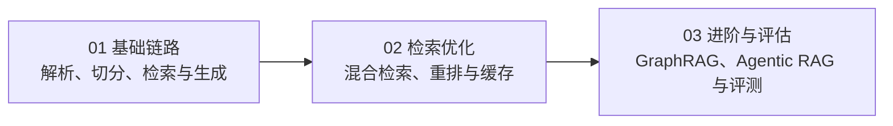

# 📚 知识库技术与 RAG

> [!abstract] 学习主线
> 先理解文档如何入库、问题如何检索并生成回答，再学习检索优化与其他知识组织方式，最后用评估方法检查效果。

## 🗺️ 学习路线

## 📖 内容导航

### 1. [[01-RAG核心原理与全链路实战|RAG 核心原理与全链路]]

- 从差旅制度问答理解入库和在线问答的步骤。
- 学习 Word/PDF 和图片解析、按标题或标记切分、父子块与元数据。
- 了解 pgvector、Milvus、向量索引和权限过滤。
- 用简短的 Spring AI 代码串起入库、检索和问答。

### 2. [[02-RAG工业级进阶与检索调优|检索优化与知识组织]]

- 理解关键词与向量检索如何互补，以及 RRF 融合、重排和查询改写。
- 了解按目录和章节读取文档、LLM-Wiki 与常规检索如何结合。
- 区分长上下文、提示词缓存和 CAG 的作用与适用条件。

### 3. [[03-前沿演进与质量评估|进阶方案与质量评估]]

- 了解 GraphRAG 的实体关系、局部查询和全局查询。
- 理解 Agentic RAG 如何在预算和权限约束下调整检索。
- 用召回、排序、忠实度和引用检查定位问题。

## 🔗 关联学习

- 前置：[[../02-框架-SpringAI与LangChain4j/SpringAI/_index|Spring AI 基础与核心组件]]
- 实践：[[../08-项目实战/03-项目-企业知识库RAG系统|企业知识库 RAG 项目]]
- 后续：[[../04-多轮对话与上下文工程/_index|多轮对话与上下文工程]]、[[../05-Agent-MCP-Skills/_index|Agent、MCP 与 Skills]]
- 上级：[[../00-总览/学习仪表盘|AI 应用开发仪表盘]]
