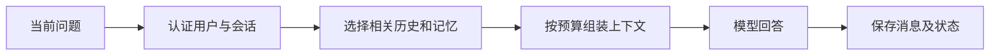

# 🧠 多轮对话与记忆全景

> [!abstract] 一句话总结
> 多轮对话需要让模型在当前请求中获得相关历史。应用可以自己管理历史，也可以使用服务提供的会话机制；记忆系统负责选择、更新和保护这些信息。

## 🎯 从一个问题开始

用户先说“项目用 Java 和 PostgreSQL”，随后问“刚才的数据库怎么部署？”第二个问题中的“数据库”依赖前文。单次模型调用不会自动知道应用没有提供的消息：应用需要传入相关历史，或使用会话 API 在服务端维护上下文。

## 🧩 几种记忆各管什么？

| 方式 | 保存或提供什么 | 适用与局限 |
| :--- | :--- | :--- |
| 滑动窗口 | 最近几轮原始消息 | 能保留近期上下文，较早内容可能被淘汰 |
| 摘要记忆 | 较早对话的目标、结论和待办 | 节省空间，但可能遗漏条件或产生错误 |
| 结构化记忆 | 已确认的偏好、预算等字段 | 便于查询和修改，要保存来源与有效期 |
| 语义检索记忆 | 按当前问题召回的历史事实 | 适合长期信息，可能漏召回或取到过期内容 |
| 分层组合 | 按任务选择上述记忆 | 更灵活，但需要管理预算、冲突和删除 |

以上方法不是必须全部使用。先从近期窗口和持久化开始，出现长会话或跨会话需求时，再根据评估加入摘要与检索。

## ⚙️ 一次多轮请求怎么走？

先检查会话归属，再选择有权访问的近期消息和相关事实；为系统规则、当前问题、工具结果与回答预留空间。模型输出后保存结果，出现中断时明确是否保留部分内容。记忆更新不能把模型的推测直接当成用户确认的事实。

## ⚠️ 需要提前想清楚的边界

- **预算**：按消息数量截断不等于按 Token 裁剪，工具调用与结果需要保持完整。
- **隔离**：会话 ID 不是权限凭证，用户身份和检索过滤由服务端确定。
- **并发**：同一会话的多个请求可能乱序或覆盖，需明确串行、版本检查或重试策略。
- **更新和删除**：用户修改偏好后，检查旧摘要、缓存和向量记录是否仍会被召回。

## 🧭 怎么学习？

1. [[01-滑动窗口记忆]]、[[02-Token窗口裁剪]]：理解如何保留近期上下文。
2. [[03-摘要记忆]]、[[04-语义检索记忆]]、[[05-结构化记忆]]、[[06-分层记忆]]：理解长期信息如何选择与更新。
3. [[07-会话隔离与并发安全]]、[[08-对话持久化]]：处理隔离、顺序和恢复。
4. [[09-意图识别]]、[[10-话题切换检测]]、[[11-会话状态机]]：组织任务中的判断与状态。

> [!question]- 多轮对话为什么不能只保存最新一条用户消息？
> 当前问题可能包含“它”“上一个方案”等指代。缺少相关历史时，模型无法确定用户指的是什么，应提供必要上下文或追问。

## 🔗 关联与资料

- 上下文预算：[[../01-LLM基础与Prompt/14-上下文窗口预算管理|窗口预算管理]]。
- [Spring AI：Chat Memory](https://docs.spring.io/spring-ai/reference/api/chat-memory.html)。
