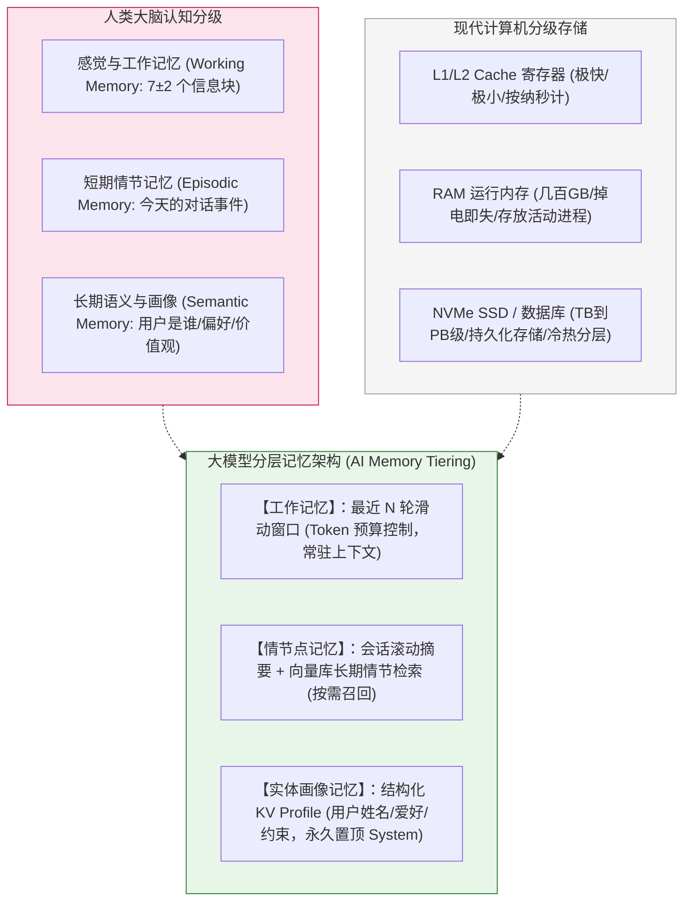
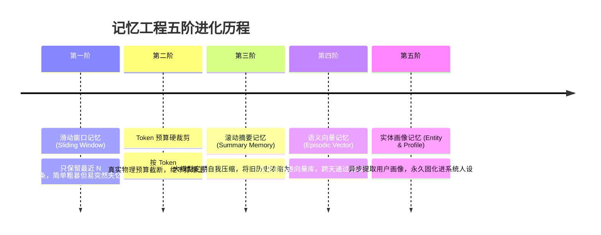
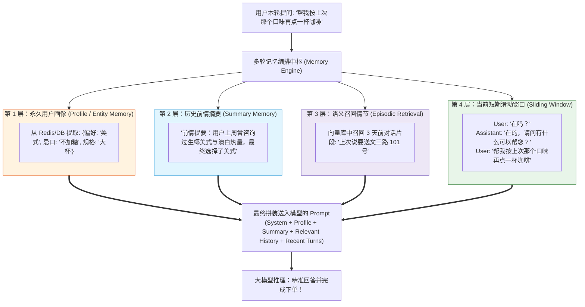
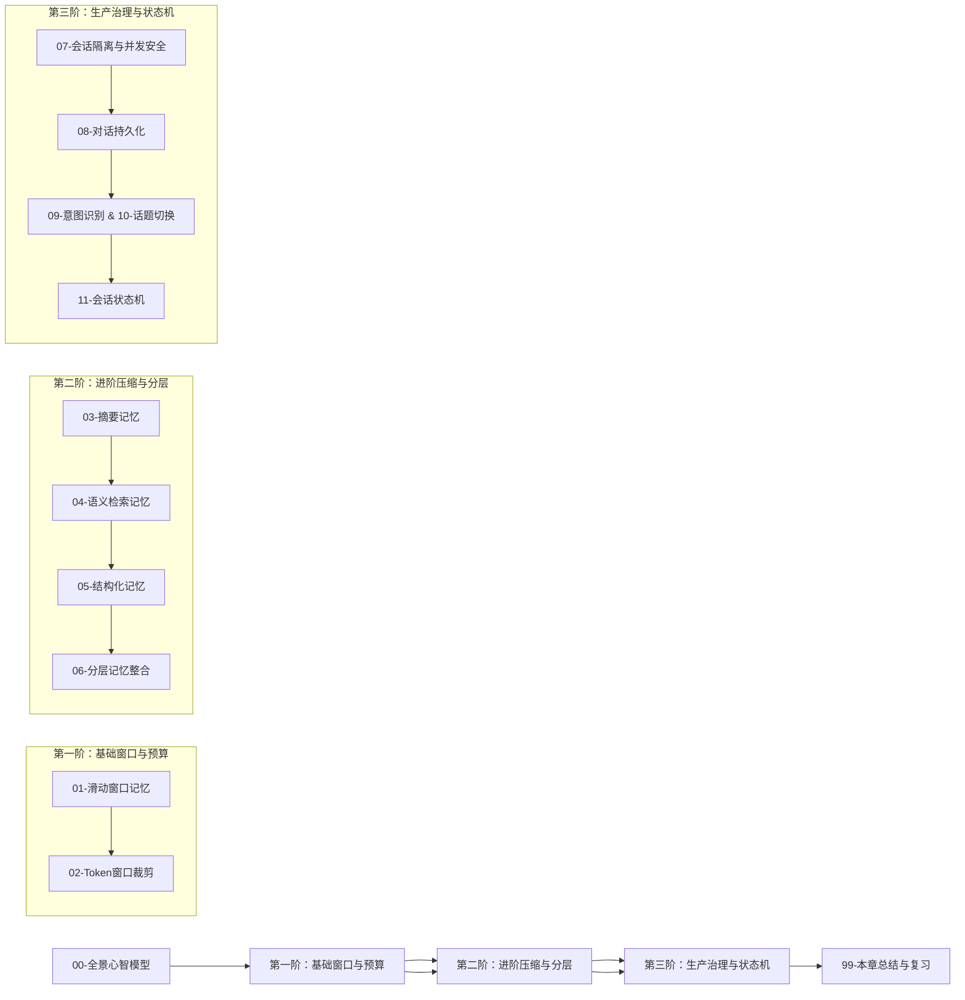

# 🧠 多轮对话与记忆全景心智模型

> [!abstract] 一句话总结
> 大模型本质是一个**“无状态的绝对健忘症患者”**；工程侧的多轮对话与记忆系统，本质是**“模拟人类大脑的分级记忆体系（工作记忆 $\to$ 情节记忆 $\to$ 语义画像）并在每一次请求前动态重建上下文”**的艺术。

---

## 🗣️ 白话版（先建立直觉）

先认清一个残酷的物理事实：
**大模型（LLM）本身没有任何长期记忆！**
每次你调用 `POST /v1/chat/completions` 时，底层 GPU 的显存只会加载模型权重和你这次发过去的 Prompt。
一旦这个请求处理完、回答返回给你，**大模型的大脑就会当场被彻底“格式化”**！
哪怕你一秒钟前刚跟他深情表白过，下一秒发过去一个“喂”，对于他来说，你就是一个素未谋面的陌生人！

那为什么 ChatGPT、Claude 好像能记得我们刚才聊了什么？
因为**宿主程序（你的后端代码）在背后当“保姆”**：
你在第 5 轮说了一句：“继续刚才的方案”。
后端程序悄悄翻出你前面聊的 4 轮对话记录，把你刚才说的话、大模型刚才给的方案，连同这句“继续刚才的方案”**整整齐齐地打包成一大串历史文本**，一次性全都重新喂给大模型！
大模型看了一眼这厚厚的一叠聊天记录，装模作样地回答：“好的，关于上一个方案，我们接着看第二步...”。

**大模型的“记忆”，全靠后端工程师在每一次交互前“帮它恢复记忆”！**
但是，如果对话聊了 100 轮，把 100 轮全打包喂进去：
1. **费用暴增**：每一轮都在为前 100 轮的重复 Token 全额买单，账单呈平方级（$O(N^2)$）爆炸；
2. **延迟暴增**：Prefill 预填充阶段耗时极长，用户等得暴躁；
3. **模型变笨**：触发上下文衰减（Lost in the Middle），模型在前言不搭后语的历史堆砌中迷失。

因此，**多轮对话工程的核心不是“无脑保存全部历史”，而是“构建一套像人类大脑一样懂得遗忘、懂得摘要、懂得长短期分层的记忆管理系统”！**

---

## 📌 第一性原理：计算机存储分级 vs 人类记忆 vs AI 记忆体系

大模型记忆工程的设计思想，完全继承了**现代计算机分级存储体系（Cache $\to$ RAM $\to$ SSD）**与**认知心理学**的对应模型：

---

## 🧩 工业级记忆系统的五大演进阶梯

从最幼稚的做法到顶尖生产架构，记忆系统经历了解题思路的层层跃迁：

| 记忆模式 | 工作机理 | 优势 | 劣势与边界 | 典型场景 |
| :--- | :--- | :--- | :--- | :--- |
| **1. 滑动窗口 (Window)** | 取最近 $K$ 条或最近 $M$ 个 Token | 实现极简、开销小、最近上下文最清晰 | 只要聊超额，前文承诺与重要背景瞬间丢失 | 简单客服、单次任务咨询 |
| **2. 滚动摘要 (Summary)** | 当历史达阈值，调用后台小模型总结一段“前情提要”与新消息拼接 | 保留了宏观事件因果，突破了 Token 限制 | 细节丢失严重（具体数字、代码、料号被抹平） | 长篇角色扮演、长故事创作 |
| **3. 向量检索记忆 (Episodic)** | 每一轮对话切块向量化入库，根据当前 Query 相似度动态召回历史 | 支持跨越数月、数千轮的历史追溯 | 破坏了对话的时间序列因果，容易断章取义 | 终身个人助理、私人健康顾问 |
| **4. 结构化画像 (Profile)** | 异步抽取实体三元组：`{生日: "05-12", 咖啡: "不加糖", 职位: "架构师"}` | 极其轻量、高精准度、永久不忘 | 只能记录确定性事实，无法承载讨论过程 | 会员系统、CRM 智能销售助手 |
| **5. 复合分层记忆 (Hybrid)** | **上述四者的有机组合！** 画像置顶 + 摘要承前 + 窗口启后 + 向量兜底 | **当前工业界最佳实践！** 兼顾细节、大局与长期个性化 | 系统工程复杂度较高 | **企业级 Copilot / 智能体** |

---

## 🗺️ 复合分层记忆系统（Hybrid Memory）架构全景图

在顶尖的企业级 Agent 或智能客服中，送给大模型的最终 Prompt 绝不是一堆聊天记录，而是**精心编排的分层多宝盒**：

---

## ⚖️ 多轮对话中的四大核心技术挑战

除了记忆的存储与检索，在工程落地时还必须解决四座大山：

1. **分布式并发与会话冲突（Concurrency & State Isolation）**：
   - 用户手抖连点 2 次发送，两条并发请求到达微服务集群的不同节点，如何保证会话历史不发生覆盖、乱序或死锁？（依靠分布式锁与会话版本号机制，见 [[07-会话隔离与并发安全]]）；
2. **指代消解与意图飘移（Coreference & Topic Shift）**：
   - 用户说：“算了，不聊这个了，换个话题”，系统如何敏锐检测到话题切换，及时清空短期窗口，防止前文残留干扰？（见 [[10-话题切换检测]]）；
3. **冷热持久化与 TTL 淘汰（Persistence & Tiering）**：
   - 活跃对话放 Redis 高速读写（5 分钟无操作自动降级），全量历史异步落 MySQL / MongoDB 供日后审计与客诉回溯（见 [[08-对话持久化]]）；
4. **Token 预算动态精算（Context Budget Allocation）**：
   - 无论历史多长，必须为模型输出预留出绝对安全的 Token 空间，绝不让滑动窗口挤占输出配额（见 [[02-Token窗口裁剪]]）。

---

## 🧭 本章通关路线指引

> [!TIP]
> 学习心法：切忌一开始就上复杂的向量记忆和全自动摘要。在 90% 的真实业务中，**“精准的 Token 滑动窗口 + 结构化用户 Profile”** 就能解决 95% 的问题！复杂的分层记忆只用在真正的长周期 Agent 助理产品中。
