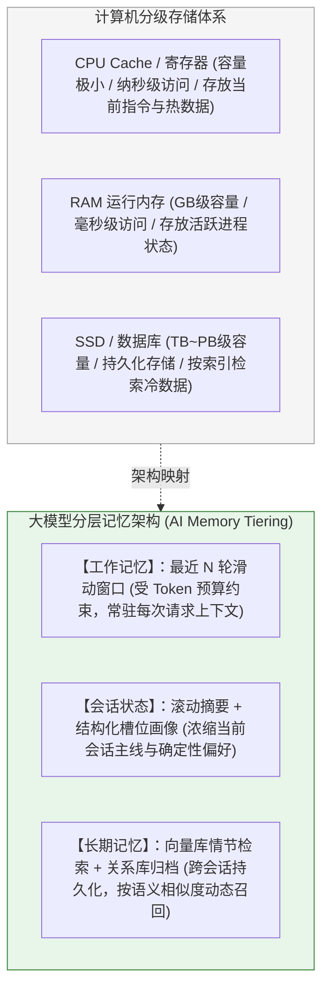
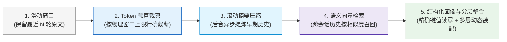
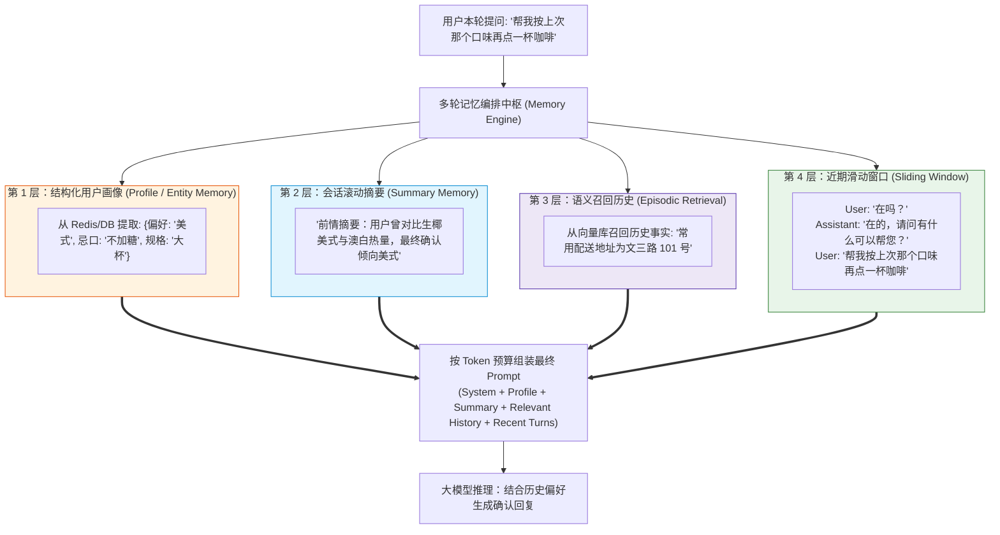
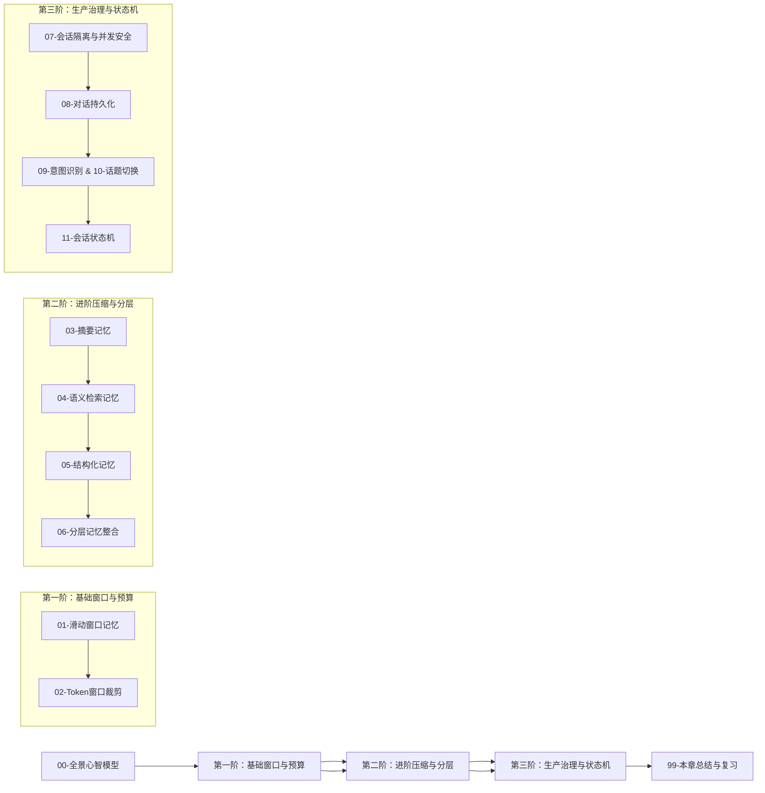

# 🧠 多轮对话与记忆全景心智模型

> [!abstract] 一句话总结
> 大语言模型推理接口本身是**无状态（Stateless）**的；工程侧的多轮对话与记忆系统，本质是**“根据信息的时效性与访问特征实施冷热分层存储（工作窗口 $\to$ 会话摘要 $\to$ 语义检索 $\to$ 结构化画像），并在每次请求前按 Token 预算动态组装上下文”**的系统工程。

---

## 🗣️ 白话版（先建立直觉）

大语言模型的单次推理调用不会修改模型参数权重。模型在多轮对话中能否感知前文信息，完全取决于应用在本次请求中组装并传入的上下文消息列表（或由服务端会话 API 代为维护的上下文状态）。

多轮对话工程不仅要持久化历史消息，更要决定每次请求向模型发送哪些内容。若每轮都将完整历史原样重发，会导致 Token 消耗与推理延迟随轮数急剧增加，并引入陈旧噪声干扰模型注意力；因此生产系统通常结合近期滑动窗口、历史滚动摘要、结构化用户画像与按需向量检索来动态构建上下文。

---

## 📌 第一性原理：计算机分级存储与 AI 记忆分层映射

大模型记忆工程的设计思想与现代计算机的分级存储体系（寄存器/Cache $\to$ 内存 RAM $\to$ 磁盘/数据库）高度同构，核心都是在**容量、延迟与信息密度**之间做分层折中：

---

## 🧩 工业级记忆系统的演进路径

从基础原型到生产级架构，多轮对话记忆机制按复杂度与能力边界分为五个演进阶段：

| 记忆模式 | 工作机理 | 优势 | 局限与边界 | 典型场景 |
| :--- | :--- | :--- | :--- | :--- |
| **1. 滑动窗口 (Window)** | 取最近 $K$ 条或最近 $M$ 个 Token 的原始消息 | 实现简单、开销小、近期指代关系最清晰 | 超出窗口后早期背景与约束直接丢失 | 简单客服、单次短任务咨询 |
| **2. 滚动摘要 (Summary)** | 当历史达到阈值，调用轻量模型总结一段“前情提要”与近期消息拼接 | 保留宏观事件因果，突破单次窗口长度限制 | 压缩过程易丢失具体数字、编码等细节 | 长篇咨询、多阶段任务辅助 |
| **3. 向量检索记忆 (Episodic)** | 将历史对话或抽取出的事实向量化入库，按当前 Query 相似度动态召回 | 支持跨天、跨会话的长周期历史追溯 | 打散了对话的连续时间序列，对短句代词不敏感 | 长期个人助理、跨周期项目顾问 |
| **4. 结构化画像 (Profile)** | 抽取确定性字段：`{偏好语言: "Java", 部署方式: "私有化", 预算上限: 20000}` | 读写精准、体积轻量、便于业务代码直接判断 | 仅适合记录结构化事实，无法承载开放式讨论过程 | 会员服务、CRM 销售助手、表单导办 |
| **5. 复合分层记忆 (Hybrid)** | **多机制协同**：结构化画像 + 滚动摘要 + 向量按需召回 + 近期滑动窗口 | **生产级主流架构**：兼顾近期细节、全局主线与长期个性化 | 需统筹设计各层 Token 预算分配与冲突覆盖规则 | **企业级 Copilot / 复杂智能体** |

---

## 🗺️ 复合分层记忆系统（Hybrid Memory）架构全景图

在企业级 Agent 或智能客服系统中，送入大模型的最终 Prompt 并非简单拼接全量聊天记录，而是**按职责分层组装的结构化上下文**：

---

## ⚖️ 多轮对话中的四项核心工程问题

除了记忆的存储与检索，在生产环境落地时还需重点解决以下四项工程问题：

1. **分布式并发与会话隔离（Concurrency & State Isolation）**：
   - 用户连续快速点击发送，多条并发请求到达微服务集群的不同节点时，如何保证同一会话的历史不发生覆盖、乱序或串台？（依托联合命名空间、分布式会话锁与版本号校验，见 [[07-会话隔离与并发安全]]）；
2. **指代消解与话题切换（Coreference & Topic Shift）**：
   - 用户提出“换个话题”或转向无关任务时，系统如何准确识别上下文边界并重置当前任务槽位，防止前序任务残留干扰？（见 [[10-话题切换检测]]）；
3. **冷热分层持久化与审计（Persistence & Tiering）**：
   - 活跃会话存放于 Redis 保障低延迟读写（配合 TTL 自动过期），全量历史与上下文快照异步落库至 MySQL / PostgreSQL 供会话恢复、评测与合规审计（见 [[08-对话持久化]]）；
4. **Token 预算动态分配（Context Budget Allocation）**：
   - 在模型上下文窗口上限内，合理划分 System 指令、记忆片段、近期窗口与模型预留输出（`max_tokens`）的配额，防止输入超限或输出被截断（见 [[02-Token窗口裁剪]]）。

---

## 🧭 本章通关路线指引

> [!TIP]
> 学习与落地建议：先实现多租户会话隔离与基于 Token 预算的滑动窗口，再根据会话长度与跨周期个性化需求，逐步引入滚动摘要、结构化画像与长期向量检索。
