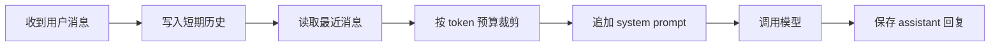

# 滑动窗口记忆

> [!abstract] 一句话总结
> 滑动窗口记忆只保留最近 N 轮或最近 K 个 token 的对话，把短期上下文稳定塞进模型窗口，适合客服、问答助手、表单补全这类近期依赖强的多轮对话。

## 📌 这是什么

滑动窗口记忆的核心是“最近消息优先”：每次调用模型前，从会话历史里取最新的若干条 user / assistant / tool 消息，和 system prompt 一起组装成请求。

- 输入：`conversationId`、当前用户消息、历史消息列表、窗口大小。
- 输出：本次模型可见的消息数组。
- 边界：窗口太小会丢前文约束，窗口太大会增加成本和延迟。
- 适用：用户问题依赖刚刚几轮上下文，例如“刚才那个方案再便宜一点”。
- 不适用：长期偏好、跨会话事实、需要召回几天前信息的场景。

## 🤔 解决什么问题 / 为什么需要

- **控制上下文长度**：LLM 每次请求只能看到传入消息，滑动窗口用固定上限避免历史无限增长。
- **保留最近指代关系**：处理“它”“上一个”“继续”等多轮指代时，最近消息通常最有价值。
- **降低请求成本和延迟**：只带必要的短期上下文，不把全量聊天记录都传给模型。
- **实现简单可靠**：可以先用 Redis List 或数据库按时间倒序取消息，后续再叠加摘要、向量检索。

## 🧩 核心数据结构

| 字段 | 示例 | 说明 |
| ---- | ---- | ---- |
| `conversationId` | `c_123` | 会话隔离主键，必须来自登录用户或业务单据。 |
| `messageId` | `m_456` | 消息唯一 ID，用于幂等和 trace。 |
| `role` | `user` / `assistant` / `tool` | 组装 Prompt 时必须保持顺序和角色。 |
| `content` | `帮我总结上一段` | 原始消息内容。 |
| `tokenCount` | `128` | 裁剪时比按条数更准确。 |
| `createdAt` | `2026-07-04T10:00:00` | Redis / DB 排序依据。 |

Redis 可以用 `LPUSH chat:{conversationId}:messages` 写入新消息，`LTRIM` 保留最近 20 到 50 条；数据库则用 `(conversation_id, created_at)` 索引按时间查询。

## ⚙️ 工作原理 / 流程



1. 写入当前 user 消息，保证失败重试不会重复写入，可用 `messageId` 做幂等。
2. 从 Redis List 或 DB 查询最近消息，按 `createdAt ASC` 还原对话顺序。
3. 预留 system prompt、工具结果和模型输出 token，再从最新消息向前累加。
4. 调用模型后保存 assistant 消息，并记录本次真正传入的 message ids。

## 💻 Spring AI / Redis 落地点

```java
record ChatMessage(String id, String conversationId, String role, String content, int tokenCount) {}

List<Message> buildWindow(String conversationId, String userText) {
    redis.opsForList().rightPush("chat:" + conversationId + ":messages",
        new ChatMessage(UUID.randomUUID().toString(), conversationId, "user", userText, estimate(userText)));
    redis.opsForList().trim("chat:" + conversationId + ":messages", -40, -1);

    List<ChatMessage> history = redis.opsForList()
        .range("chat:" + conversationId + ":messages", -40, -1);

    return tokenBudgetCut(history, 6_000).stream()
        .map(m -> switch (m.role()) {
            case "user" -> new UserMessage(m.content());
            case "assistant" -> new AssistantMessage(m.content());
            default -> new SystemMessage(m.content());
        })
        .toList();
}
```

Spring AI 中可以把窗口结果传给 `ChatClient.prompt().messages(messages).call()`。如果使用 `MessageChatMemoryAdvisor`，要确认底层 `ChatMemory` 的存储策略是否满足窗口大小、TTL 和多实例共享要求。

## 🔍 VectorStore 关系

滑动窗口不是向量记忆。它负责短期连续对话，VectorStore 负责跨时间召回语义相关信息。常见组合是：

- 最近 10 轮来自 Redis 滑动窗口。
- 长期偏好、历史结论、知识片段来自 VectorStore `similaritySearch`。
- 最终 Prompt 顺序：system -> 长期记忆摘要 -> 检索片段 -> 最近窗口 -> 当前问题。

## ⚠️ 踩坑与注意事项

- 按消息条数裁剪不等于按 token 裁剪，一条长日志可能撑爆窗口。
- Redis `LTRIM` 只保留短期历史，不能当审计存储；重要对话要异步落库。
- 多实例并发写入同一会话时，要避免消息顺序错乱，可用 Redis Stream 或 DB 自增序列。
- 工具调用结果通常很长，进入窗口前应压缩成业务结论。
- system prompt 不应参与窗口淘汰，否则安全约束可能丢失。

## 🎯 面试问题

> [!question] 高频问题
> - Q: 滑动窗口记忆和摘要记忆怎么选？
>   - A: 滑动窗口保留最近原文，适合短期指代；摘要记忆压缩较早历史，适合长会话延续。生产里常把两者组合使用。
> - Q: Redis List 如何实现窗口？
>   - A: 每条消息写入 `chat:{conversationId}:messages`，写入后 `LTRIM key -N -1` 保留最近 N 条，请求前按顺序读取并按 token 预算二次裁剪。
> - Q: 线上用户说“你忘了刚才说的”，怎么排查？
>   - A: 查 trace 中传给模型的 message ids、窗口大小、token 估算、裁剪日志和并发写入顺序，确认相关消息是否被传入。

## ✅ 精通检查清单

- 能解释滑动窗口为什么解决的是短期上下文，不是长期记忆。
- 能设计 Redis List / Stream / DB 三种存储方案的取舍。
- 能写出按 token 从后往前裁剪消息的代码。
- 能说明和摘要记忆、语义检索记忆如何组合。
- 能用 trace 复盘一次模型调用实际看到了哪些历史消息。

## 🔗 关联笔记

- [[_index]]
- [[02-Token窗口裁剪]]
- [[03-摘要记忆]]
- [[04-语义检索记忆]]
- [[10-AI应用开发/00-总览/学习仪表盘]]

## 📚 参考资料

- [Spring AI Reference](https://docs.spring.io/spring-ai/reference/)
- [Redis Lists](https://redis.io/docs/latest/develop/data-types/lists/)
