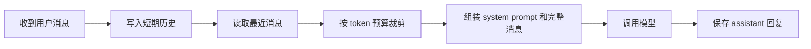

# 滑动窗口记忆

> [!abstract] 一句话总结
> 滑动窗口记忆只保留最近 N 轮或最近 K 个 token 的对话，把短期上下文稳定塞进模型窗口，适合客服、问答助手、表单补全这类近期依赖强的多轮对话。

## 🎯 本节定位

本篇介绍如何保留最近几轮对话，前置知识见 [[../01-LLM基础与Prompt/_index|01 区]] 和 [[../03-知识库技术-RAG/_index|03 区 RAG]]。后续可阅读 [[02-Token窗口裁剪]]、[[03-摘要记忆]]、[[04-语义检索记忆]] 和 [[06-分层记忆]]，了解裁剪、压缩、召回与组合。

## 📌 这是什么

滑动窗口记忆的核心是“最近消息优先”：每次调用模型前，从会话历史里取最新的若干条 user / assistant / tool 消息，和 system prompt 一起组装成请求。
- 输入：`conversationId`、当前用户消息、历史消息列表、窗口大小。
- 输出：本次模型可见的消息数组。
- 边界：窗口太小会丢前文约束，窗口太大会增加成本和延迟。
- 适用：用户问题依赖刚刚几轮上下文，例如“刚才那个方案再便宜一点”。
- 不适用：长期偏好、跨会话事实、需要召回几天前信息的场景。

## 🤔 解决什么问题 / 为什么需要

- LLM 每次请求只能看到传入的消息，限制历史数量可以避免上下文无限增长。
- 理解“它”“上一个”“继续”等指代时，最近几轮对话通常很重要。
- 不必每次传入全部历史，可以降低请求成本和延迟。
- 可以先用 Redis List 或数据库读取最近消息，再按需加入摘要和向量检索。

## 🧩 核心数据结构

| 字段 | 示例 | 说明 |
| ---- | ---- | ---- |
| `conversationId` | `c_123` | 会话标识，由服务端管理，并校验当前用户是否有权访问。 |
| `messageId` | `m_456` | 消息唯一 ID，用于幂等和 trace。 |
| `role` | `user` / `assistant` / `tool` | 组装 Prompt 时必须保持顺序和角色。 |
| `content` | `帮我总结上一段` | 原始消息内容。 |
| `tokenCount` | `128` | 裁剪时比按条数更准确。 |
| `sequenceNo` | `42` | 会话内顺序号，作为消息排序依据。 |
| `createdAt` | `2026-07-04T10:00:00` | 创建时间，适合展示和审计，不单独承担严格排序。 |

Redis 可以用 `LPUSH` 将新消息写入列表头部，再用 `LTRIM key 0 N-1` 保留最新 N 条；读取结果是从新到旧，组装模型输入前要恢复为从旧到新。数据库可用会话内顺序号排序，并校验用户归属。

## ⚙️ 工作原理 / 流程



1. 使用客户端或网关生成的幂等 `messageId` 写入 user 消息，配合数据库唯一约束或 Redis 原子去重防止网络重试产生重复记录。
2. 从 Redis List 或数据库读取最近消息，并按会话内单调递增的 `sequence_no` 严格还原消息顺序（避免多节点时钟偏差或同毫秒并发导致排序错乱）。
3. 预留 system prompt、工具结果和模型输出 token，再从最新消息向前累加。
4. 调用模型后保存 assistant 消息，并记录本次真正传入的 message ids。

## 🧪 Redis 窗口怎么保留最新消息？

假设列表从左到右是 `[C, B, A]`，C 最新。`LPUSH` 写入 D 后变成 `[D, C, B, A]`；若窗口保留 3 条，`LTRIM key 0 2` 后得到 `[D, C, B]`。读取后按 `[B, C, D]` 的时间顺序组装上下文。
如果使用 `LPUSH` 却执行 `LTRIM key -3 -1`，这个例子会留下 `[C, B, A]`，把最新的 D 裁掉。另一种方案是 `RPUSH` 把新消息写到尾部，再用 `LTRIM key -N -1` 保留尾部；写入方向和裁剪方向必须配套。
并发写入、去重与裁剪要考虑原子性，消息数量窗口也不能代替 Token 预算；相关命令含义见 [Redis List](https://redis.io/docs/latest/develop/data-types/lists/)。

## 💻 Spring AI / Redis 落地点

下面是 Spring AI 消息窗口配置片段，假设依赖和聊天模型已经配置。它按消息数量限制窗口，不能代替 Token 预算或应用侧权限校验。工具调用与结果需要按完整轮次保留，具体行为以所用版本为准：

```java
ChatMemory memory = MessageWindowChatMemory.builder()
        .maxMessages(20)
        .build();
```

如果使用 `MessageChatMemoryAdvisor`，每次调用需要提供 `ChatMemory.CONVERSATION_ID`，并确认底层存储策略满足持久化和多实例要求。窗口记忆不等于完整聊天历史。

## 🔍 VectorStore 关系

滑动窗口不是向量记忆。它负责短期连续对话，VectorStore 负责跨时间召回语义相关信息。常见组合是：
- 最近 10 轮来自 Redis 滑动窗口。
- 长期偏好、历史结论、知识片段来自 VectorStore `similaritySearch`。
- 最终 Prompt 顺序：system -> 长期记忆摘要 -> 检索片段 -> 最近窗口 -> 当前问题。

如果当前用户消息已经写入最近窗口，组装时要避免重复追加。

## ⚠️ 踩坑与注意事项

- 按消息条数裁剪不等于按 token 裁剪，一条长日志可能撑爆窗口。
- Redis `LTRIM` 只保留短期历史，不能当审计存储；重要对话要异步落库。
- 多实例并发写入同一会话时，要避免消息顺序错乱，可用 Redis Stream 或 DB 自增序列。
- 工具结果过长时可按接口要求压缩，同时保留调用与结果的对应关系及必要字段。
- system prompt 不应参与窗口淘汰，否则安全约束可能丢失。

## 🎯 面试问题

> [!question]- 滑动窗口记忆和摘要记忆怎么选？
> 滑动窗口保留最近原文，适合短期指代；摘要记忆压缩较早历史，适合长会话延续。生产里常把两者组合使用。

> [!question]- Redis List 如何实现窗口？
> 如果用 `LPUSH` 写入列表头部，应使用 `LTRIM key 0 N-1` 保留最近 N 条，读取后恢复为旧到新；如果用 `RPUSH` 写入尾部，才配合 `LTRIM key -N -1`。最终还要按 Token 预算二次裁剪。

> [!question]- 线上用户说“你忘了刚才说的”，怎么排查？
> 查 trace 中传给模型的 message ids、窗口大小、token 估算、裁剪日志和并发写入顺序，确认相关消息是否被传入。

## ✅ 精通检查清单

- 能解释滑动窗口为什么解决的是短期上下文，不是长期记忆。
- 能设计 Redis List / Stream / DB 三种存储方案的取舍。
- 能写出按 token 从后往前裁剪消息的代码。
- 能说明和摘要记忆、语义检索记忆如何组合。
- 能用 trace 复盘一次模型调用实际看到了哪些历史消息。

## 🔗 关联笔记

- [[_index]]
- [[02-Token窗口裁剪]]
- [[03-摘要记忆]]
- [[04-语义检索记忆]]
- [[../00-总览/学习仪表盘]]

## 📚 参考资料

- [Spring AI Chat Memory](https://docs.spring.io/spring-ai/reference/api/chat-memory.html)
- [Redis Lists](https://redis.io/docs/latest/develop/data-types/lists/)
