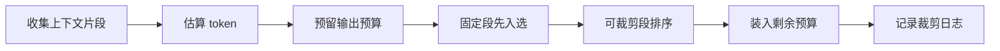

# Token窗口裁剪

> [!abstract] 一句话总结
> Token窗口裁剪是在模型上下文上限内选择“本次最该让模型看到的信息”，通常要同时保住 system prompt、当前问题、最近对话和高相关记忆。

## 🎯 本节定位

本篇在 [[01-滑动窗口记忆]] 的基础上介绍多来源上下文的统一裁剪，窗口与预算概念见 [[../01-LLM基础与Prompt/14-上下文窗口预算管理|01 区·上下文窗口预算管理]]。摘要压缩、检索预算和分层组装分别见 [[03-摘要记忆]]、[[04-语义检索记忆]]、[[06-分层记忆]]。

## 📌 这是什么

Token窗口裁剪不是简单截字符串，而是按消息角色、业务优先级和 token 预算选择上下文。
- 输入：模型上下文上限、预期输出 token、system prompt、历史消息、检索记忆、工具结果。
- 输出：可安全放入模型请求的消息列表。
- 关键约束：必须预留输出 token，否则模型可能中途截断。
- 优先级示例：system prompt > 当前用户问题 > 必要工具结果 > 最近关键对话 > 可替代背景材料；具体顺序要结合任务调整。

## 🤔 解决什么问题 / 为什么需要

- 请求超限可能失败，也可能被 SDK 或网关截断。
- 优先保留关键约束，避免被无关的长文本挤占空间。
- 控制 Token 数量有助于控制费用和延迟。
- 记录裁剪前后的 Token 分布，便于排查模型为何没有看到某段历史。

## 🧩 核心数据结构

| 字段 | 示例 | 说明 |
| ---- | ---- | ---- |
| `segmentId` | `hist_m_1` | 上下文片段 ID，便于 trace。 |
| `source` | `window` / `summary` / `vector` / `tool` | 来源决定优先级。 |
| `role` | `system` / `user` / `assistant` | 传给模型的消息角色。 |
| `priority` | `100` | 数值越高越不容易被丢弃。 |
| `tokenCount` | `350` | 用 tokenizer 或估算器计算。 |
| `content` | `...` | 实际内容。 |

裁剪算法常用 `ContextSegment` 列表：先放固定段，再对可裁剪段排序，从高优先级和近时间开始装箱。

## ⚙️ 工作原理 / 流程



1. 读取模型的 `contextWindow`，例如 8k、32k、128k。
2. 预留 `maxOutputTokens` 和安全余量，例如 15%。
3. system prompt、当前问题、强约束片段直接入选。
4. 滑动窗口消息从新到旧累加，语义检索片段按 score 排序累加。
5. 对长工具结果先摘要，再决定是否进入 Prompt。

## 🧮 具体怎么分配预算？

假设某模型的窗口同时容纳输入和输出，窗口大小为 4096 Token，计划最多输出 800 Token，再留 200 Token 安全余量，则本次输入预算是 `4096 - 800 - 200 = 3096`。如果系统规则、当前问题与工具定义共占 1200，剩余 1896 才能用于历史、摘要和检索资料；这些数字只是示例。
先保留任务必需的内容，再按相关性和完整轮次装入剩余预算。若必需内容本身已超过 3096，不能继续硬塞：需要缩短固定内容、调整输出预算、换支持更大窗口的模型，或明确告知请求超限。

> [!example] 工具消息不要拆开
> 历史中一轮包含“用户提问 → 模型请求工具 → 工具返回 → 模型回答”。裁剪时应作为一组处理；只留工具结果或只留工具请求，可能让上下文不完整，也可能不符合模型接口要求。

## 💻 Spring AI / Redis / VectorStore 落地点

下面是流程示意片段；相关类型和方法由应用自行实现，省略配置与错误处理。

```java
List<ContextGroup> groups = groupByCompleteTurn(history);
List<ContextGroup> selected = selectWithinBudget(groups, inputBudget);
```

- Redis：保存最近消息及 `tokenCount`，避免每次重新估算。
- VectorStore：检索结果带 `score`、`docId`、`chunkId`，低分片段先丢弃。
- Spring AI：在调用 `ChatClient` 前完成裁剪，不要依赖模型或 SDK 自动处理超长上下文。

## 🔍 观测指标

- `prompt_tokens_before_cut`
- `prompt_tokens_after_cut`
- `dropped_segment_count`
- `dropped_sources`
- `context_build_latency_ms`
- `model_max_output_tokens`

这些指标要和 `conversationId`、`requestId` 关联，方便复盘。

## ⚠️ 踩坑与注意事项

- 字符数不等于 token 数，中英文、代码、JSON 的 token 密度差异明显。
- 只按时间裁剪会把高相关旧事实丢掉，最好叠加优先级和检索分数。
- RAG 片段过长会挤掉用户当前问题，chunk 大小要和模型窗口匹配。
- 函数调用参数和工具结果也占 token，不能只统计自然语言消息。
- 裁剪日志不能记录敏感明文，生产环境可记录 ID、长度和来源。

## 🎯 面试问题

> [!question]- 如何设计 token 裁剪优先级？
> 先固定 system prompt 和当前问题，再保留必要工具结果、最近对话、高分检索片段，最后丢弃低分背景和过旧闲聊。

> [!question]- 为什么不能直接截断字符串？
> 会破坏消息角色、JSON 结构和工具调用结果，也可能截掉高优先级指令，导致模型行为不可控。

> [!question]- 如何证明裁剪策略有效？
> 记录裁剪前后 token、丢弃片段来源、回答命中率和超限错误率，用回归样例比较不同策略。

## ✅ 精通检查清单

- 能区分模型窗口、输入 token、输出 token 和安全余量。
- 能写出按优先级和 token 预算选择上下文的算法。
- 能解释 Redis 中为什么要缓存 `tokenCount`。
- 能说明 VectorStore 召回片段如何参与预算竞争。
- 能通过 trace 说清一次请求丢弃了哪些上下文。

## 🔗 关联笔记

- [[_index]]
- [[01-滑动窗口记忆]]
- [[04-语义检索记忆]]
- [[03-摘要记忆]]
- [[../00-总览/学习仪表盘]]

## 📚 参考资料

- [Spring AI Reference](https://docs.spring.io/spring-ai/reference/)
- [OpenAI Platform Docs](https://platform.openai.com/docs/)
