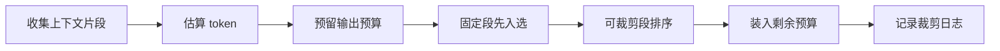

# Token窗口裁剪

> [!abstract] 一句话总结
> Token窗口裁剪是在模型上下文上限内选择“本次最该让模型看到的信息”，通常要同时保住 system prompt、当前问题、最近对话和高相关记忆。

## 🎯 本节定位

- **本章第 2 课，上下文预算分配**。前置 [[01-滑动窗口记忆]]（窗口怎么留）；窗口与预算概念见 [[../01-LLM基础与Prompt/14-上下文窗口预算管理|01 区·上下文窗口预算管理]]，本篇讲多来源上下文的统一裁剪。
- **延伸阅读（本课不展开）**：摘要压缩见 [[03-摘要记忆]]、检索片段竞争预算见 [[04-语义检索记忆]]、多层统一组装见 [[06-分层记忆]]。

## 📌 这是什么

Token窗口裁剪不是简单截字符串，而是按消息角色、业务优先级和 token 预算选择上下文。

- 输入：模型上下文上限、预期输出 token、system prompt、历史消息、检索记忆、工具结果。
- 输出：可安全放入模型请求的消息列表。
- 关键约束：必须预留输出 token，否则模型可能中途截断。
- 优先级：system prompt > 当前用户问题 > 必要工具结果 > 最近关键对话 > 可替代背景材料。

## 🤔 解决什么问题 / 为什么需要

- **避免超过模型窗口**：请求超限会失败，或被 SDK / 网关静默截断。
- **保留高价值信息**：让模型看到关键约束，而不是被低价值长文本挤占。
- **稳定成本**：token 越多，费用和延迟越高，裁剪策略能让接口延迟可预期。
- **方便排查**：记录裁剪前后 token 分布，可以解释模型为什么漏看某段历史。

## 🧩 核心数据结构

| 字段 | 示例 | 说明 |
| ---- | ---- | ---- |
| `segmentId` | `hist_m_1` | 上下文片段 ID，便于 trace。 |
| `source` | `window` / `summary` / `vector` / `tool` | 来源决定优先级。 |
| `role` | `system` / `user` / `assistant` | 传给模型的消息角色。 |
| `priority` | `100` | 数值越高越不容易被丢弃。 |
| `tokenCount` | `350` | 用 tokenizer 或估算器计算。 |
| `content` | `...` | 实际内容。 |

裁剪算法常用 `ContextSegment` 列表：先放固定段，再对可裁剪段排序，从高优先级和近时间开始装箱。

## ⚙️ 工作原理 / 流程



1. 读取模型的 `contextWindow`，例如 8k、32k、128k。
2. 预留 `maxOutputTokens` 和安全余量，例如 15%。
3. system prompt、当前问题、强约束片段直接入选。
4. 滑动窗口消息从新到旧累加，语义检索片段按 score 排序累加。
5. 对长工具结果先摘要，再决定是否进入 Prompt。

## 💻 Spring AI / Redis / VectorStore 落地点

```java
record ContextSegment(String id, String source, Message message, int priority, int tokens) {}

List<Message> cut(List<ContextSegment> segments, int modelWindow, int outputReserve) {
    int budget = modelWindow - outputReserve - 512;
    List<ContextSegment> fixed = segments.stream()
        .filter(s -> s.priority() >= 100)
        .toList();
    int used = fixed.stream().mapToInt(ContextSegment::tokens).sum();

    List<ContextSegment> selected = new ArrayList<>(fixed);
    List<ContextSegment> candidates = segments.stream()
        .filter(s -> s.priority() < 100)
        .sorted(Comparator.comparingInt(ContextSegment::priority).reversed())
        .toList();
    for (ContextSegment s : candidates) {
        if (used + s.tokens() <= budget) {
            selected.add(s);
            used += s.tokens();
        }
    }

    return selected.stream().map(ContextSegment::message).toList();
}
```

- Redis：保存最近消息及 `tokenCount`，避免每次重新估算。
- VectorStore：检索结果带 `score`、`docId`、`chunkId`，低分片段先丢弃。
- Spring AI：在调用 `ChatClient` 前完成裁剪，不要依赖模型或 SDK 自动处理超长上下文。

## 🔍 观测指标

- `prompt_tokens_before_cut`
- `prompt_tokens_after_cut`
- `dropped_segment_count`
- `dropped_sources`
- `context_build_latency_ms`
- `model_max_output_tokens`

这些指标要和 `conversationId`、`requestId` 关联，方便复盘。

## ⚠️ 踩坑与注意事项

- 字符数不等于 token 数，中英文、代码、JSON 的 token 密度差异明显。
- 只按时间裁剪会把高相关旧事实丢掉，最好叠加优先级和检索分数。
- RAG 片段过长会挤掉用户当前问题，chunk 大小要和模型窗口匹配。
- 函数调用参数和工具结果也占 token，不能只统计自然语言消息。
- 裁剪日志不能记录敏感明文，生产环境可记录 ID、长度和来源。

## 🎯 面试问题

> [!question] 高频问题
> - Q: 如何设计 token 裁剪优先级？
>   - A: 先固定 system prompt 和当前问题，再保留必要工具结果、最近对话、高分检索片段，最后丢弃低分背景和过旧闲聊。
> - Q: 为什么不能直接截断字符串？
>   - A: 会破坏消息角色、JSON 结构和工具调用结果，也可能截掉高优先级指令，导致模型行为不可控。
> - Q: 如何证明裁剪策略有效？
>   - A: 记录裁剪前后 token、丢弃片段来源、回答命中率和超限错误率，用回归样例比较不同策略。

## ✅ 精通检查清单

- 能区分模型窗口、输入 token、输出 token 和安全余量。
- 能写出按优先级和 token 预算选择上下文的算法。
- 能解释 Redis 中为什么要缓存 `tokenCount`。
- 能说明 VectorStore 召回片段如何参与预算竞争。
- 能通过 trace 说清一次请求丢弃了哪些上下文。

## 🔗 关联笔记

- [[_index]]
- [[01-滑动窗口记忆]]
- [[04-语义检索记忆]]
- [[03-摘要记忆]]
- [[../00-总览/学习仪表盘]]

## 📚 参考资料

- [Spring AI Reference](https://docs.spring.io/spring-ai/reference/)
- [OpenAI Platform Docs](https://platform.openai.com/docs/)
