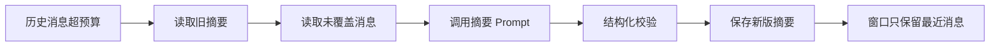

# 摘要记忆

> [!abstract] 一句话总结
> 摘要记忆把较早的多轮对话压缩成可继续使用的状态说明，用少量 token 保留目标、约束、已达成结论和未完成事项。

## 🎯 本节定位

- **本章第 3 课，长会话压缩**。前置 [[01-滑动窗口记忆]]、[[02-Token窗口裁剪]]（窗口淘汰后较早历史无处安放）；本篇把被裁掉的历史变成可复用的摘要。
- **延伸阅读（本课不展开）**：可精确读取的字段化见 [[05-结构化记忆]]、跨会话召回见 [[04-语义检索记忆]]，组合架构见 [[06-分层记忆]]。

## 📌 这是什么

摘要记忆不是普通聊天总结，而是面向下一轮推理的“会话状态压缩”。它应该回答：用户现在要什么、已经确认了什么、哪些信息不能忘、下一步该接着哪里做。

- 输入：超过窗口的历史消息、旧摘要、当前会话元数据。
- 输出：新版摘要，通常放在 system prompt 后、最近窗口前。
- 触发时机：每 N 轮、token 超阈值、话题阶段结束、会话即将休眠。
- 保留重点：用户偏好、业务参数、已选方案、拒绝过的方案、待办问题。

## 🤔 解决什么问题 / 为什么需要

- **延长长对话连续性**：早期上下文被窗口淘汰后，模型仍能知道关键结论。
- **减少重复询问**：用户已经提供的约束被摘要保留下来。
- **控制成本**：把几千 token 历史压缩成几百 token 状态。
- **支持会话恢复**：用户隔天回来时，可以先加载摘要再接续最近几轮。

## 🧩 核心数据结构

| 字段 | 示例 | 说明 |
| ---- | ---- | ---- |
| `summaryId` | `sum_001` | 摘要版本 ID。 |
| `conversationId` | `c_123` | 所属会话。 |
| `coveredMessageIdTo` | `m_200` | 摘要覆盖到哪条消息，避免重复总结。 |
| `summaryText` | `用户正在比较三套部署方案...` | 给模型读取的摘要正文。 |
| `facts` | `{budget: "2万以内"}` | 可选结构化事实。 |
| `updatedAt` | `2026-07-04T10:00:00` | 恢复会话时排序。 |

Redis 可保存当前摘要：`chat:{conversationId}:summary`；数据库保存摘要版本，便于回滚和审计。

## ⚙️ 工作原理 / 流程



1. 判断 `historyTokens > threshold` 或 `messageCount > N`。
2. 取旧摘要和未覆盖消息，要求模型输出固定格式。
3. 校验摘要中是否包含目标、约束、决策、待办、风险。
4. 持久化 `coveredMessageIdTo` 游标与摘要版本号；后台异步写回时通过版本号校验（CAS）防止延迟的旧任务覆盖新摘要，下次触发时仅需增量总结游标之后的新消息。
5. 构造下一轮 Prompt：system -> summary -> recent window -> current question。

## 💻 Spring AI / Redis 落地点

```java
String summaryPrompt = """
请把以下对话压缩成面向下一轮对话的记忆。
必须保留：用户目标、已确认约束、关键事实、未完成问题、不能重复推荐的内容。
输出不超过 500 字。
旧摘要：{oldSummary}
新增对话：{newMessages}
""";

String newSummary = chatClient.prompt()
    .system("你是对话状态压缩器，只输出摘要，不回答用户问题。")
    .user(u -> u.text(summaryPrompt)
        .param("oldSummary", oldSummary)
        .param("newMessages", messagesText))
    .call()
    .content();

redis.opsForValue().set("chat:" + conversationId + ":summary", newSummary, Duration.ofDays(7));
```

如果摘要中抽取了结构化事实，可以同步写入 Hash：`chat:{conversationId}:facts`，例如 `budget`、`locale`、`productType`。

## 🔍 VectorStore 关系

摘要适合压缩一个会话内部的连续状态；VectorStore 适合跨会话、跨文档召回。长周期产品可以把“稳定事实”从摘要中抽取出来写入 VectorStore：

- 文档内容：`用户偏好：部署方式倾向私有化，预算 2 万以内。`
- metadata：`userId`、`memoryType=preference`、`sourceConversationId`、`confidence`。
- 查询时用当前问题检索，再和当前摘要一起进入 Prompt。

## ⚠️ 踩坑与注意事项

- 摘要会丢细节，不适合保存合同条款、金额明细、法律文本等必须精确引用的内容。
- 模型摘要可能“脑补”未出现的信息，必须要求只基于对话内容输出。
- 每轮都总结会增加延迟，应该按阈值或阶段触发。
- 旧摘要反复被再摘要会漂移，重要事实要结构化存储或保留原始消息。
- 摘要文本不要混入高优先级指令，避免用户间接污染系统行为。

## 🎯 面试问题

> [!question] 高频问题
> - Q: 摘要记忆和滑动窗口记忆怎么配合？
>   - A: 摘要承接较早历史，滑动窗口保留最近原文；Prompt 中通常先放摘要，再放最近几轮。
> - Q: 如何避免摘要漂移？
>   - A: 保留原始消息、记录摘要覆盖范围、对关键事实做结构化存储，并定期用原文重新生成摘要。
> - Q: 摘要应该什么时候触发？
>   - A: token 超阈值、阶段结束、会话休眠前、最近窗口即将淘汰关键消息时触发。

## ✅ 精通检查清单

- 能写出增量摘要的数据结构和触发条件。
- 能说明摘要正文应包含哪些字段，不应包含哪些信息。
- 能把摘要与 Redis 窗口、数据库审计、VectorStore 长期记忆组合。
- 能解释摘要漂移和事实抽取的风险。
- 能设计摘要质量的回归样例。

## 🔗 关联笔记

- [[_index]]
- [[01-滑动窗口记忆]]
- [[05-结构化记忆]]
- [[04-语义检索记忆]]
- [[../00-总览/学习仪表盘]]

## 📚 参考资料

- [Spring AI Reference](https://docs.spring.io/spring-ai/reference/)
- [OpenAI Platform Docs](https://platform.openai.com/docs/)
