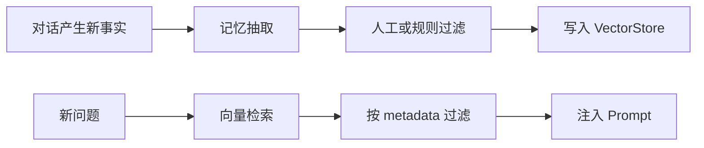

# 语义检索记忆

> [!abstract] 一句话总结
> 语义检索记忆把可长期复用的对话事实向量化保存，下一轮按语义相似度召回相关片段，而不是只依赖最近聊天记录。

## 🎯 本节定位

- **本章第 4 课，跨会话长期召回**。前置：向量检索与 TopK 来自 [[10-AI应用开发/03-知识库技术-RAG/06-向量检索与TopK|03 区·向量检索与TopK]]，预算竞争见 [[02-Token窗口裁剪]]；本篇把 RAG 思路用到用户记忆上。
- **延伸阅读（本课不展开）**：事实字段化见 [[05-结构化记忆]]、多层组合见 [[06-分层记忆]]、召回隔离见 [[07-会话隔离与并发安全]]、删除与审计见 [[08-对话持久化]]。

## 📌 这是什么

语义检索记忆是 RAG 思路在用户记忆上的应用：把用户偏好、历史决策、任务背景、已确认事实写入 VectorStore，查询时用当前问题召回相关记忆片段。

- 输入：可记忆片段、embedding 模型、metadata。
- 输出：与当前问题语义相关的记忆列表。
- 适用：跨会话偏好、长期项目背景、历史决策原因。
- 不适用：刚刚几轮的指代关系，短期上下文仍应由滑动窗口承担。

## 🤔 解决什么问题 / 为什么需要

- **跨会话记忆**：用户几天后回来，系统仍能召回之前确认的偏好和项目背景。
- **按相关性选择历史**：不把全部历史塞给模型，而是只取与当前问题相近的片段。
- **支持个性化**：同样的问题可以根据用户历史偏好给不同回答。
- **可控遗忘**：通过 metadata、TTL、删除接口实现用户记忆删除和隐私管理。

## 🧩 核心数据结构

| 字段 | 示例 | 说明 |
| ---- | ---- | ---- |
| `memoryId` | `mem_123` | 记忆片段 ID。 |
| `userId` | `u_1` | 隔离不同用户。 |
| `content` | `用户偏好 Java/Spring 技术栈` | 向量化文本。 |
| `embedding` | `[0.01, ...]` | 向量，由 VectorStore 管理。 |
| `memoryType` | `preference` / `fact` / `decision` | 检索和展示时过滤。 |
| `confidence` | `0.82` | 抽取置信度，低置信度可不入库。 |
| `sourceMessageIds` | `m1,m2` | 可回溯原始对话。 |

metadata 至少应包含 `userId`、`tenantId`、`memoryType`、`createdAt`、`deleted=false`。

## ⚙️ 工作原理 / 流程



1. 对 assistant 回复后的一段对话做记忆抽取，输出候选事实。
2. 过滤临时闲聊、敏感信息和低置信度内容。
3. 用 Spring AI `VectorStore.add(List<Document>)` 写入。
4. 查询时使用 `SearchRequest` 设置 `topK`、相似度阈值和 metadata filter。
5. 把召回结果作为“可参考的用户记忆”，不要让它覆盖当前用户最新输入。

## 💻 Spring AI / VectorStore 落地点

```java
Document memory = new Document(
    "用户偏好使用 Java、Spring Boot 和 Redis 实现 AI 应用。",
    Map.of(
        "userId", userId,
        "memoryType", "preference",
        "sourceConversationId", conversationId,
        "confidence", 0.91
    )
);
vectorStore.add(List.of(memory));

List<Document> memories = vectorStore.similaritySearch(
    SearchRequest.builder()
        .query(userQuestion)
        .topK(5)
        .similarityThreshold(0.72)
        .filterExpression("userId == '" + userId + "' && memoryType != 'expired'")
        .build()
);
```

Redis 可缓存本轮召回结果：`chat:{conversationId}:retrieved_memories:{requestId}`，用于 trace 和复盘。

## 🔍 Prompt 注入方式

```text
以下是从用户长期记忆中检索到的片段，只能作为偏好和背景参考。
如果它们与用户当前输入冲突，以当前输入为准。

1. [preference, score=0.84] 用户偏好 Java/Spring 技术栈。
2. [decision, score=0.79] 上次已决定先用 Redis 保存短期会话。
```

必须带上“当前输入优先”的规则，否则旧记忆可能覆盖用户的新决定。

## ⚠️ 踩坑与注意事项

- 只按相似度不按用户过滤会造成串号，这是严重数据隔离事故。
- 把整段聊天直接入库会召回大量噪声，最好先抽取稳定事实再向量化。
- topK 太大会挤占 Prompt，topK 太小会漏召回，需要结合评测集调阈值。
- 用户修改偏好时要写新记忆并让旧记忆失效，不能只追加。
- 向量库删除可能是异步的，隐私删除要有状态标记和后台校验。

## 🎯 面试问题

> [!question] 高频问题
> - Q: 语义检索记忆和普通 RAG 有什么区别？
>   - A: 普通 RAG 多检索知识文档；语义记忆检索用户或会话产生的事实，重点是用户隔离、更新、遗忘和冲突处理。
> - Q: 如何防止召回错误记忆？
>   - A: metadata 过滤、相似度阈值、rerank、当前输入优先、低置信度不入库，并记录召回 trace。
> - Q: 用户说“忘掉我的偏好”怎么做？
>   - A: 标记相关 memory 为 deleted 或 expired，执行向量库删除，清 Redis 缓存，并保留删除审计但不保留敏感内容。

## ✅ 精通检查清单

- 能设计记忆抽取、过滤、入库、召回、注入的完整链路。
- 能写出 Spring AI `VectorStore` 的 add 和 similaritySearch 使用方式。
- 能说明 metadata filter 为什么是隔离底线。
- 能处理旧记忆和当前输入冲突。
- 能设计记忆删除和过期策略。

## 🔗 关联笔记

- [[_index]]
- [[05-结构化记忆]]
- [[06-分层记忆]]
- [[08-对话持久化]]
- [[10-AI应用开发/00-总览/学习仪表盘]]

## 📚 参考资料

- [Spring AI Vector Databases](https://docs.spring.io/spring-ai/reference/api/vectordbs.html)
- [OpenAI Platform Docs](https://platform.openai.com/docs/)
