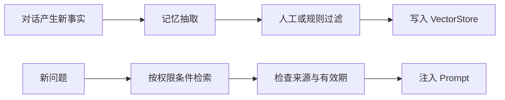

# 语义检索记忆

> [!abstract] 一句话总结
> 语义检索记忆把可长期复用的对话事实向量化保存，下一轮按语义相似度召回相关片段，而不是只依赖最近聊天记录。

## 🎯 本节定位

本篇将 RAG 思路用于用户记忆；向量检索基础见 [[../03-知识库技术-RAG/01-RAG核心原理与全链路实战|03 区·向量检索与TopK]]，上下文预算见 [[02-Token窗口裁剪]]。字段化、分层、隔离与删除分别见 [[05-结构化记忆]]、[[06-分层记忆]]、[[07-会话隔离与并发安全]] 和 [[08-对话持久化]]。

## 📌 这是什么

语义检索记忆是 RAG 思路在用户记忆上的应用：把用户偏好、历史决策、任务背景、已确认事实写入 VectorStore，查询时用当前问题召回相关记忆片段。
- 输入：可记忆片段、embedding 模型、metadata。
- 输出：与当前问题语义相关的记忆列表。
- 适用：跨会话偏好、长期项目背景、历史决策原因。
- 不适用：刚刚几轮的指代关系，短期上下文仍应由滑动窗口承担。

## 🤔 解决什么问题 / 为什么需要

- 用户再次提问时，可以跨会话召回已确认的偏好和项目背景。
- 根据当前问题选择相关片段，避免每次都传入全部历史。
- 根据已确认的用户偏好调整回答。
- 删除记忆时，可按元数据定位相关记录，并同步处理向量和缓存。

## 🧩 核心数据结构

| 字段 | 示例 | 说明 |
| ---- | ---- | ---- |
| `memoryId` | `mem_123` | 记忆片段 ID。 |
| `userId` | `u_1` | 隔离不同用户。 |
| `content` | `用户偏好 Java/Spring 技术栈` | 向量化文本。 |
| `embedding` | `[0.01, ...]` | 向量，由 VectorStore 管理。 |
| `memoryType` | `preference` / `fact` / `decision` | 检索和展示时过滤。 |
| `confidence` | `0.82` | 模型给出的参考值，不能直接视为事实正确概率。 |
| `sourceMessageIds` | `m1,m2` | 可回溯原始对话。 |

metadata 至少应包含 `userId`、`tenantId`、`memoryType`、`createdAt`、`deleted=false`。

## ⚙️ 工作原理 / 流程



1. 对 assistant 回复后的一段对话做记忆抽取，输出候选事实。
2. 过滤临时闲聊、敏感信息和低置信度内容。
3. 用 Spring AI `VectorStore.add(List<Document>)` 写入。
4. 查询时使用 `SearchRequest` 设置 `topK`、相似度阈值和 metadata filter。
5. 把召回结果作为“可参考的用户记忆”，不要让它覆盖当前用户最新输入。

## 💻 Spring AI / VectorStore 落地点

下面是检索片段，假设向量库和已认证用户已准备好。`accessPolicy.memoryFilter` 是应用自行实现的方法，负责生成租户和用户过滤条件，不能直接信任客户端传入的过滤条件。

```java
var filter = accessPolicy.memoryFilter(authenticatedUser);
var request = SearchRequest.builder().query(userQuestion)
        .topK(5).filterExpression(filter).build();
List<Document> memories = vectorStore.similaritySearch(request);
```

Redis 可缓存本轮召回结果：`chat:{conversationId}:retrieved_memories:{requestId}`，用于 trace 和复盘。

## 🔍 将记忆放入 Prompt

```text
以下是从用户长期记忆中检索到的片段，只能作为偏好和背景参考。
如果它们与用户当前偏好冲突，应以当前明确表达为参考；必要时向用户确认。

1. [preference, score=0.84] 用户偏好 Java/Spring 技术栈。
2. [decision, score=0.79] 上次已决定先用 Redis 保存短期会话。
```

应让应用区分旧偏好与当前输入，并在含糊或涉及重要决定时确认；当前用户输入也不能覆盖系统规则和服务端权限控制。

## ⚠️ 踩坑与注意事项

- 只按相似度不按用户过滤会造成串号，这是严重数据隔离事故。
- 把整段聊天直接入库会召回大量噪声，最好先抽取稳定事实再向量化。
- topK 太大会挤占 Prompt，topK 太小会漏召回，需要结合评测集调阈值。
- 用户修改偏好时要写新记忆并让旧记忆失效，不能只追加。
- 向量库删除可能是异步的，隐私删除要有状态标记和后台校验。

## 🎯 面试问题

> [!question]- 语义检索记忆和普通 RAG 有什么区别？
> 普通 RAG 多检索知识文档；语义记忆检索用户或会话产生的事实，重点是用户隔离、更新、遗忘和冲突处理。

> [!question]- 如何防止召回错误记忆？
> metadata 过滤、相似度阈值、rerank、当前输入优先、低置信度不入库，并记录召回 trace。

> [!question]- 用户说“忘掉我的偏好”怎么做？
> 标记相关 memory 为 deleted 或 expired，执行向量库删除，清 Redis 缓存，并保留删除审计但不保留敏感内容。

## ✅ 精通检查清单

- 能设计记忆抽取、过滤、入库、召回、注入的完整链路。
- 能写出 Spring AI `VectorStore` 的 add 和 similaritySearch 使用方式。
- 能说明 metadata filter 为什么是隔离底线。
- 能处理旧记忆和当前输入冲突。
- 能设计记忆删除和过期策略。

## 🔗 关联笔记

- [[_index]]
- [[05-结构化记忆]]
- [[06-分层记忆]]
- [[08-对话持久化]]
- [[../00-总览/学习仪表盘]]

## 📚 参考资料

- [Spring AI Vector Databases](https://docs.spring.io/spring-ai/reference/api/vectordbs.html)
- [OpenAI Platform Docs](https://platform.openai.com/docs/)
