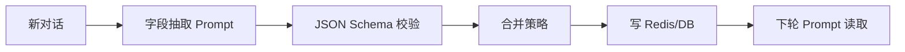

# 结构化记忆

> [!abstract] 一句话总结
> 结构化记忆把对话中稳定、可校验的事实存成字段，而不是只保存自然语言摘要，适合预算、偏好、身份、任务状态等需要精确读取和更新的信息。

## 🎯 本节定位

- **本章第 5 课，精确事实字段化**。前置 [[03-摘要记忆]]（摘要不可精确读取的短板）、[[04-语义检索记忆]]；本篇让记忆能被业务代码直接读写。
- **延伸阅读（本课不展开）**：层级组合见 [[06-分层记忆]]、字段驱动的流程见 [[11-会话状态机]]、槽位更新见 [[09-意图识别]]。

## 📌 这是什么

结构化记忆是把“用户说过什么”转成业务可读写的数据模型。例如用户说“预算别超过两万，优先私有化部署”，系统写入 `budgetMax=20000`、`deployMode=private`。

- 输入：一段对话、字段 schema、抽取规则。
- 输出：JSON / Redis Hash / 数据库行。
- 适用：需要精确判断、筛选、展示、更新的记忆。
- 不适用：开放式背景、长文本理由、语义模糊的经验片段。

## 🤔 解决什么问题 / 为什么需要

- **减少模型重复推理**：常用事实直接读字段，不必每次从历史文本中猜。
- **便于业务规则判断**：预算、地区、权限、阶段可直接参与代码分支。
- **支持用户编辑**：结构化字段能在设置页展示、修改、删除。
- **提高可测试性**：JSON schema 和字段校验能发现抽取错误。

## 🧩 核心数据结构

```json
{
  "userId": "u_1",
  "conversationId": "c_123",
  "preferences": {
    "techStack": ["Java", "Spring AI", "Redis"],
    "answerStyle": "直接给实现步骤"
  },
  "constraints": {
    "budgetMax": 20000,
    "deployMode": "private"
  },
  "taskState": {
    "currentGoal": "实现多轮对话记忆",
    "missingSlots": ["向量库选型"]
  },
  "updatedAt": "2026-07-04T10:00:00"
}
```

Redis Hash 适合高频读取：`memory:{userId}:profile`；关系库适合审计和版本；VectorStore 可存结构化字段的自然语言影子文本用于语义召回。

## ⚙️ 工作原理 / 流程



1. 定义 schema，例如 `budgetMax` 必须是数字，`deployMode` 枚举为 `public/private/hybrid`。
2. 用模型或规则抽取候选字段。
3. 对 JSON 做 schema 校验和业务校验。
4. 合并旧值：新输入明确覆盖旧值；不确定值进入 `pendingConfirmation`。
5. 下轮构造 Prompt 时只注入相关字段，不把全量 profile 全塞进去。

## 💻 Spring AI / Redis 落地点

```java
record UserMemory(
    List<String> techStack,
    Integer budgetMax,
    String deployMode,
    List<String> missingSlots
) {}

UserMemory memory = chatClient.prompt()
    .system("从对话中抽取用户记忆，只输出符合 schema 的 JSON；没有依据的字段返回 null。")
    .user(conversationText)
    .call()
    .entity(UserMemory.class);

// 仅当抽取出非空新值时执行增量更新；字段清除或删除应走显式的删除指令分支
if (memory.budgetMax() != null) {
    redis.opsForHash().put("memory:" + userId + ":profile", "budgetMax", memory.budgetMax());
}
if (memory.deployMode() != null) {
    redis.opsForHash().put("memory:" + userId + ":profile", "deployMode", memory.deployMode());
}
```

Spring AI 的结构化输出能力可直接映射到 record / POJO；生产中仍要补 Bean Validation 和字段白名单。

## 🔍 VectorStore 关系

结构化记忆适合精确读取，VectorStore 适合语义召回。常见做法是双写：

- Redis Hash：`budgetMax=20000`，用于业务判断。
- VectorStore 文本：`用户预算上限为 20000 元，偏好私有化部署。`，用于自然语言问题召回。
- metadata：`memoryType=structured_profile`、`field=budgetMax`、`userId=u_1`。

双写时要用同一个 `memoryId`，更新结构化字段时同步让旧向量失效。

> **工程建议**：结构化画像字段应记录来源消息 ID、确认状态与有效期，将单次任务的临时要求与用户的长期偏好区分存储；同时需注意模型直接输出的 `confidence` 数值仅反映生成倾向，关键业务字段的覆盖更新应结合明确的用户确认指令。

## ⚠️ 踩坑与注意事项

- 模型会把“可能”“考虑一下”误抽成确定事实，字段需要 `confidence` 或确认状态。
- 不要把敏感字段随意写入长期记忆，例如身份证号、密钥、医疗信息。
- 字段覆盖要有规则，用户说“预算改成三万”应更新旧值而不是追加两个预算。
- JSON schema 只能校验形状，不能保证事实来自原文。
- Prompt 中注入结构化记忆时要说明“若与当前用户输入冲突，以当前输入为准”。

## 🎯 面试问题

> [!question] 高频问题
> - Q: 结构化记忆和摘要记忆有什么区别？
>   - A: 摘要是自然语言压缩，适合保留上下文；结构化记忆是字段化状态，适合业务判断、编辑和校验。
> - Q: 如何处理字段冲突？
>   - A: 明确新输入覆盖旧值，模糊输入进入待确认状态，所有更新记录来源消息和更新时间。
> - Q: 为什么结构化记忆还要写 VectorStore？
>   - A: 字段适合精确查询，向量影子文本适合自然语言召回，两者服务不同访问方式。

## ✅ 精通检查清单

- 能定义用户偏好、约束、任务状态三类字段。
- 能写出抽取、校验、合并、存储流程。
- 能说明 Redis Hash、关系库、VectorStore 各自保存什么。
- 能处理字段覆盖、确认和删除。
- 能给结构化输出设计失败兜底。

## 🔗 关联笔记

- [[_index]]
- [[03-摘要记忆]]
- [[04-语义检索记忆]]
- [[11-会话状态机]]
- [[../00-总览/学习仪表盘]]

## 📚 参考资料

- [Spring AI Structured Output](https://docs.spring.io/spring-ai/reference/api/structured-output-converter.html)
- [Redis Hashes](https://redis.io/docs/latest/develop/data-types/hashes/)
