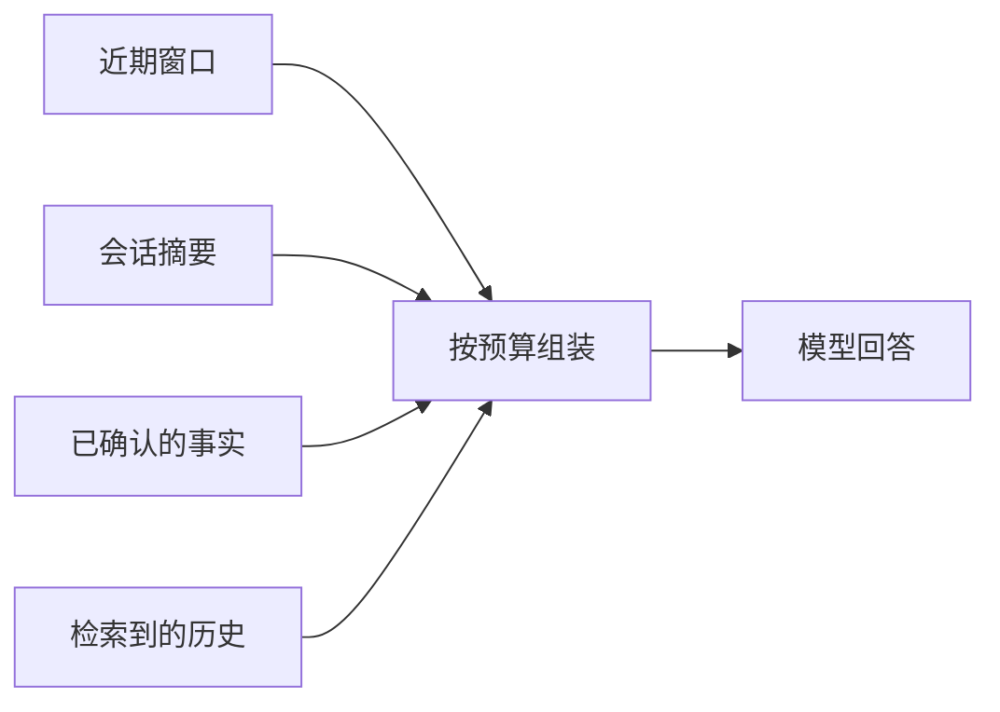

# 🏛️ 分层记忆

> [!abstract] 一句话总结
> 分层记忆把近期对话、会话摘要、用户事实和相关历史分开管理，按当前任务及预算选取内容，而不是把全部聊天记录重复发给模型。

## 🎯 为什么要分层？

用户刚说“把上面的方案改成 Java”，需要保留最近的对话；用户以前确认“项目只能使用 PostgreSQL”，则可能需要跨会话保留。前者适合近期窗口，后者可作为经确认的长期约束。分层能减少上下文浪费，但会引入更新、冲突和删除的管理成本。

## 🧩 常见记忆层

| 层次 | 保存什么 | 需要注意 |
| :--- | :--- | :--- |
| 近期窗口 | 最近的原始消息和工具调用 | 按完整轮次裁剪，预留输出预算 |
| 会话摘要 | 已达成结论、未解决问题 | 摘要会遗漏或写错，需保留原始记录 |
| 结构化事实 | 用户确认的偏好、约束及来源 | 按用户授权更新、过期和删除 |
| 语义检索记忆 | 按问题召回的相关历史 | 过滤租户和用户，旧信息可能不再适用 |

## ⚙️ 一次请求怎么组装？

1. 由服务端验证用户和会话归属，读取近期消息及已有摘要。
2. 根据当前问题检索用户有权访问的历史事实，检查有效期和来源。
3. 为系统规则、当前问题、工具及输出预留预算，再选择相关记忆；不要拆开工具调用与其结果。
4. 模型回答后记录结果；对新增的长期事实，按产品规则确认并更新，不能把模型猜测直接当成用户事实。

## 🗣️ 跟着一条请求看组装结果

用户新开一轮说“把上面的方案改成 Java”。近期窗口提供“上面的方案”指向什么；会话摘要说明此前已经决定做订单查询；经确认的长期约束说明项目使用 PostgreSQL。如果当前问题与旧摘要无关，也不必把所有历史都带上。
随后用户明确说“这次改用 MySQL”，应用需要区分本次临时要求和长期偏好：可以先按本次请求处理，是否更新长期记忆应依据产品规则或向用户确认；系统和业务权限规则仍由服务端执行。

## ⚠️ 冲突与删除

当旧偏好与用户当前明确要求冲突，应区分本次要求与长期偏好的更新，并遵守系统规则和服务端权限。用户要求删除时，除主存储外还要考虑索引、缓存及异步副本；先定义各处保留期限和删除验证方式。

> [!question]- 为什么不只保存摘要？
> 摘要节省空间，但可能丢失细节和来源。近期原文能保留连续语境，重要长期事实还需要单独管理和核验。

## 🔗 关联与资料

- [[01-滑动窗口记忆]]、[[03-摘要记忆]]、[[04-语义检索记忆]]、[[05-结构化记忆]]。
- [Spring AI：Chat Memory](https://docs.spring.io/spring-ai/reference/api/chat-memory.html)。
