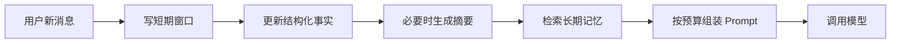

# 分层记忆

> [!abstract] 一句话总结
> 分层记忆把对话上下文拆成短期窗口、会话摘要、结构化事实和长期向量记忆，让不同生命周期的信息进入不同存储和 Prompt 位置。

## 🎯 本节定位

- **本章第 6 课，记忆机制收尾**。前置 [[01-滑动窗口记忆]]～[[05-结构化记忆]] 全部五种记忆；本篇把它们组织成一套组合架构，是本章前半的“总装图”。
- **延伸阅读（本课不展开）**：隔离与并发见 [[07-会话隔离与并发安全]]、持久化见 [[08-对话持久化]]，智能控制见 [[09-意图识别]]～[[11-会话状态机]]。

## 📌 这是什么

分层记忆不是一种单独算法，而是一套组合架构。它承认“记忆”有不同生命周期：刚刚说过的话、当前会话目标、用户稳定偏好、业务系统事实，不能都用同一种存储处理。

- 短期层：最近 N 轮原文，解决指代和连续追问。
- 摘要层：当前会话的压缩状态，解决长对话延续。
- 结构化层：预算、偏好、槽位、任务阶段，解决精确读写。
- 语义层：跨会话长期片段，解决相关历史召回。

## 🤔 解决什么问题 / 为什么需要

- **避免一种记忆打天下**：Redis 窗口、摘要、字段、向量库各有边界。
- **控制 Prompt 质量**：每层只注入本轮相关内容，不让低价值历史挤占窗口。
- **支持更新和遗忘**：结构化字段可覆盖，向量记忆可失效，短期窗口可 TTL。
- **便于排查**：能知道回答依据来自最近对话、摘要、用户画像还是向量召回。

## 🧩 核心数据结构

| 层级 | 存储 | Key / 表 | 内容 | 生命周期 |
| ---- | ---- | ---- | ---- | ---- |
| 短期窗口 | Redis List / Stream | `chat:{cid}:messages` | 最近原始消息 | 分钟到数天 |
| 会话摘要 | Redis String + DB | `chat:{cid}:summary` | 目标、约束、结论、待办 | 一个会话 |
| 结构化事实 | Redis Hash + DB | `memory:{uid}:profile` | 偏好、预算、槽位 | 长期，可编辑 |
| 语义记忆 | VectorStore | `user_memory` collection | 可召回事实片段 | 长期，可删除 |
| 审计原文 | DB | `chat_message` | 全量消息 | 按合规策略 |

## ⚙️ 工作原理 / 流程



1. 当前消息先写 Redis 和数据库，得到可追踪 `messageId`。
2. 用规则或模型抽取结构化字段，更新用户画像。
3. 达到阈值时把较早历史压缩进摘要。
4. 使用当前问题到 VectorStore 检索长期记忆。
5. Token 裁剪时按层级优先级组装：system -> profile -> summary -> retrieved memory -> recent window -> current question。

## 💻 Spring AI / Redis / VectorStore 落地点

```java
record MemoryBundle(
    Map<Object, Object> profile,
    String summary,
    List<Document> retrievedMemories,
    List<Message> recentMessages
) {}

MemoryBundle loadMemory(String userId, String conversationId, String question) {
    Map<Object, Object> profile = redis.opsForHash().entries("memory:" + userId + ":profile");
    String summary = redis.opsForValue().get("chat:" + conversationId + ":summary");
    List<Message> recent = loadWindowMessages(conversationId);
    List<Document> memories = vectorStore.similaritySearch(
        SearchRequest.builder()
            .query(question)
            .topK(5)
            .filterExpression("userId == '" + userId + "' && deleted == false")
            .build()
    );
    return new MemoryBundle(profile, summary, memories, recent);
}
```

Spring AI 的 `ChatClient` 前可以加一个 `MemoryAssembler`，专门负责加载各层、排序、裁剪和 trace。

## 🔍 Prompt 组装策略

```text
System: 固定行为和安全约束
Profile: 与本轮相关的结构化用户字段
Conversation Summary: 当前会话压缩状态
Long-term Memories: VectorStore 召回的长期片段
Recent Messages: 最近原文窗口
User: 当前问题
```

结构化字段和长期记忆都要声明“若与当前输入冲突，以当前输入为准”。

## ⚠️ 踩坑与注意事项

- 每层都注入会导致 Prompt 过长，必须有相关性过滤和 token 预算。
- 结构化字段与向量记忆双写后，要处理更新一致性。
- 摘要层不能替代审计原文，合规场景必须保存原始消息。
- 长期记忆跨租户过滤一旦漏掉，会造成数据泄漏。
- 分层越多 trace 越重要，否则线上回答依据不可解释。

## 🎯 面试问题

> [!question] 高频问题
> - Q: 为什么需要分层记忆？
>   - A: 因为短期指代、长会话状态、精确用户字段、跨会话语义召回的生命周期和访问方式不同，单一 Redis 或单一向量库都无法同时做好。
> - Q: Prompt 中各层顺序怎么排？
>   - A: 固定规则先于记忆，稳定画像和摘要先于检索片段，最近原文靠近当前问题，当前用户输入优先级最高。
> - Q: 如何排查分层记忆带来的错误回答？
>   - A: 查看本轮 `MemoryBundle`、每层 token 占比、VectorStore 召回分数、字段版本和最终 Prompt trace。

## ✅ 精通检查清单

- 能画出短期、摘要、结构化、向量、审计五层。
- 能说明每层存储介质、生命周期和读取方式。
- 能实现 `MemoryAssembler` 的加载和裁剪职责。
- 能处理层间冲突和更新一致性。
- 能为每层设计独立 trace 字段。

## 🔗 关联笔记

- [[_index]]
- [[01-滑动窗口记忆]]
- [[03-摘要记忆]]
- [[05-结构化记忆]]
- [[04-语义检索记忆]]
- [[10-AI应用开发/00-总览/学习仪表盘]]

## 📚 参考资料

- [Spring AI Reference](https://docs.spring.io/spring-ai/reference/)
- [Redis Data Types](https://redis.io/docs/latest/develop/data-types/)
