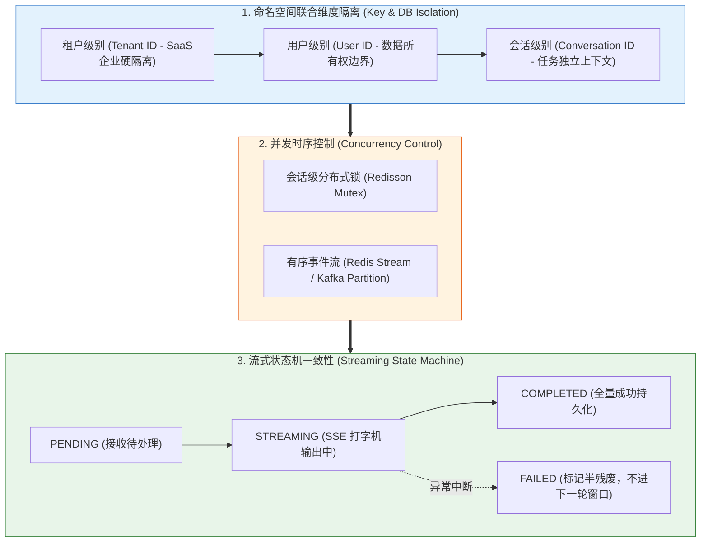
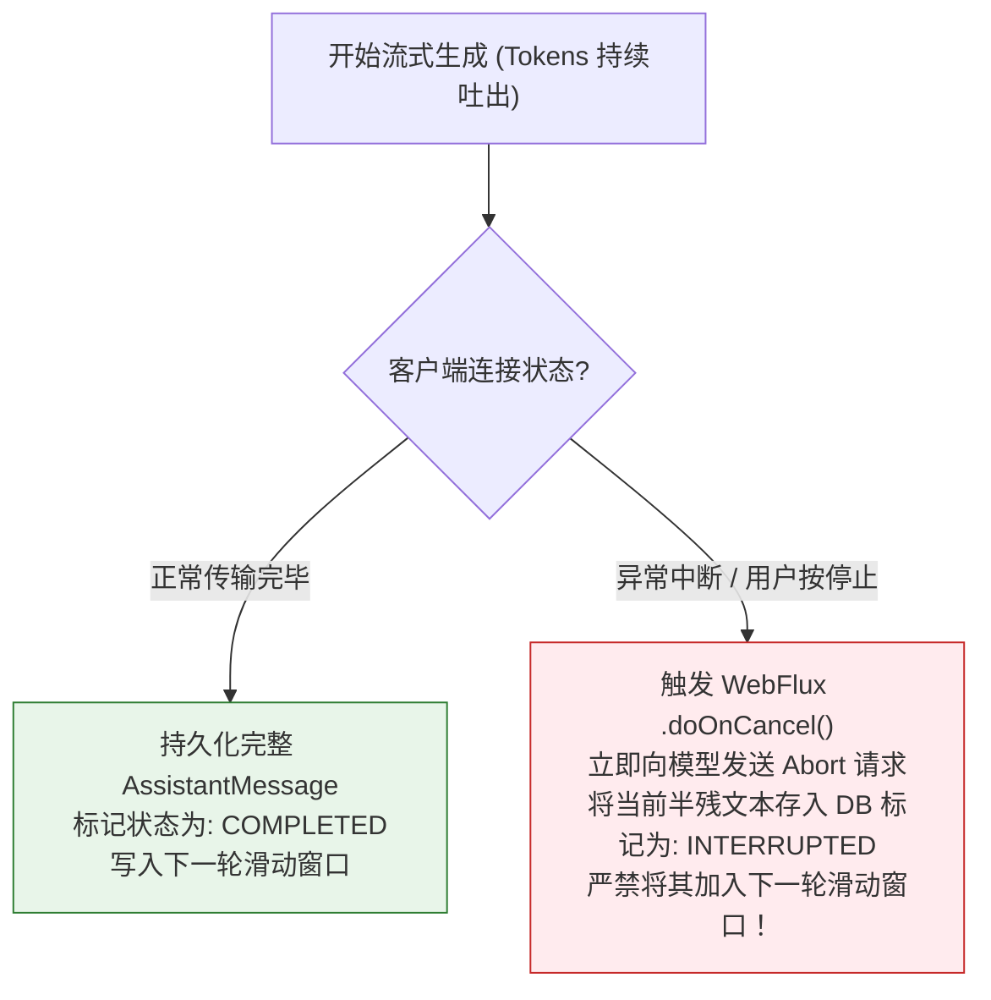

# 🔒 会话隔离与并发安全：高可用企业级对话治理

> [!abstract] 一句话总结
> 在多租户与分布式微服务架构中，会话治理的核心铁律是**“数据层通过联合维度严格物理隔离，并发层通过会话级分布式锁或消息有序队列杜绝乱序覆盖，流式状态机保障异常断流下的数据一致性”**。

---

## 🗣️ 白话版（先建立直觉）

想象你是一家三甲医院门诊系统的架构师：
- **灾难场景一：不同病人病历拿串了（租户与用户隔离失效）**
  张三来问：“我上周开的降压药怎么吃？”
  系统如果只根据 `conversationId` 检索，甚至在向量数据库里没有根据 `userId` 强行过滤，正好抓出了李四的病历：“每天三次，每次胰岛素 10 单位”。张三看后一针打下去，直接休克送急救！
- **灾难场景二：连击发送导致人格分裂（并发竞争覆盖）**
  用户网络卡顿，手抖连续点了两次“发送”：
  - 消息 A（00:00:01到达）：“我想退掉刚才买的手机”；
  - 消息 B（00:00:02到达）：“算了，我还是留着用吧”。
  如果后端没有并发控制，两个线程同时从 Redis 读出旧历史、并发请求大模型。结果处理较慢的消息 A 最终把处理较快的消息 B 覆盖掉了！页面刷新后，系统还在喋喋不休地教用户怎么退款，用户彻底抓狂！

在分布式集群中，用户请求随时飘在不同的 Pod 节点上。**做 AI 对话系统，绝不能把它当成玩具，必须像处理金融交易一样对待并发安全！**

---

## 📌 第一性原理：四层立体隔离与安全防线



### 1. Redis Key 的工业级命名规范
严禁使用简单的 `chat:{conversationId}`，必须层层防越权：
$$\text{Redis Key} = \text{chat:}\{\text{tenantId}\}\text{:}\{\text{userId}\}\text{:}\{\text{conversationId}\}\text{:messages}$$

### 2. 向量检索的强制标量拦截
在任何向 `VectorStore` 发起的多轮情节召回中，**Filter 表达式必须强制注入当前用户身份**：
```sql
tenantId == 'TENANT_01' && userId == 'USER_9988' && deleted == false
```
即使语义相似度再高，别人的记忆一条也休想渗透进来！

---

## 💻 工业级代码实战：Spring Boot + Redisson 会话锁闭环

```java
package com.example.ai.concurrency;

import lombok.extern.slf4j.Slf4j;
import org.redisson.api.RLock;
import org.redisson.api.RedissonClient;
import org.springframework.ai.chat.client.ChatClient;
import org.springframework.stereotype.Service;

import java.util.concurrent.TimeUnit;

@Slf4j
@Service
public class SecureChatExecutionService {

    private final RedissonClient redissonClient;
    private final ChatClient chatClient;

    public SecureChatExecutionService(RedissonClient redissonClient, ChatClient.Builder builder) {
        this.redissonClient = redissonClient;
        this.chatClient = builder.build();
    }

    /**
     * 具备租户鉴权、防串台与分布式并发锁的安全对话入口
     */
    public String executeSafeChat(String tenantId, String currentUserId, String conversationId, String userMessage) {
        // 1. 严格业务属主鉴权校验（严防水平越权）
        validateConversationOwnership(tenantId, currentUserId, conversationId);

        // 2. 获取会话级精细化分布式锁（粒度细化到具体的 conversationId）
        String lockKey = "lock:ai:chat:" + tenantId + ":" + conversationId;
        RLock sessionLock = redissonClient.getLock(lockKey);

        try {
            // 尝试加锁：最多等待 2 秒（应对网络抖动连发），锁持有时间上限 30 秒（防节点崩溃死锁）
            boolean acquired = sessionLock.tryLock(2, 30, TimeUnit.SECONDS);
            if (!acquired) {
                log.warn("检测到并发请求竞争，拒绝执行 -> 会话ID: {}", conversationId);
                throw new IllegalStateException("当前会话正在思考上一条消息，请勿频繁重复点击！");
            }

            log.info("成功获取会话锁，开始安全处理对话 -> 会话: {}", conversationId);

            // 3. 执行安全的记忆装配与模型调用
            return chatClient.prompt()
                    .user(userMessage)
                    .call()
                    .content();

        } catch (InterruptedException e) {
            Thread.currentThread().interrupt();
            throw new RuntimeException("处理被意外中断", e);
        } finally {
            // 4. 安全释放锁（仅持有当前锁的线程才能释放，防误解锁）
            if (sessionLock.isHeldByCurrentThread()) {
                sessionLock.unlock();
                log.debug("会话锁安全释放 -> 会话: {}", conversationId);
            }
        }
    }

    private void validateConversationOwnership(String tenantId, String userId, String conversationId) {
        // 查询 DB 校验该会话的所属人是否确为当前用户，若不符抛出 AccessDeniedException
    }
}
```

---

## ⚡ 流式断流（SSE Drop）的一致性治理

在生产环境中，用户频繁在模型流式生成到一半时**关闭浏览器网页、点击“停止生成”或遭遇网络断开**：



> [!IMPORTANT]
> **致命陷阱防范**：
> 如果不加状态标记，直接把只输出了半句话的回答（如：“我们公司的退款政策是：首先您需要准备身份证并...”）存入 Redis 滑动窗口，下一轮对话大模型看到这半句话，就会陷入严重的注意力混乱或死循环胡诌！
> **未完成的半残消息，只能用于历史记录展示，绝对不能进入大模型下一轮的输入窗口！**

---

## ⚠️ 生产避坑指南与致命陷阱

### 1. 致命漏洞：信任前端传过来的 `userId`
- **灾难复现**：前端在请求 Body 里传 `{ userId: "1001", conversationId: "c_99" }`。黑客只需抓包把 `userId` 改成 `1002`，就能肆意偷窥老板的全部历史会话！
- **铁律**：`userId` 与 `tenantId` 必须从网关解析出的 **JWT Token 或服务端 Session** 中提取，严禁信任任何入参字段！

### 2. 致命死锁：分布式锁未设 LeaseTime（持有上限）
- 如果后端服务在调大模型时遭遇长时间阻塞或宿主机被 OOM Killer 杀掉，且分布式锁没有设置自动过期时间，该用户的这个会话就会被**永久锁定**，再也无法发起任何提问！

---

## 🎯 大厂高频面试 30 秒绝杀

> [!question] 面试高频问题 3 连击
> 
> **Q1：在高并发多租户环境下，如何从架构层面彻底杜绝大模型会话“串台”（拿错别人历史）？**
> - **答（满分绝杀）**：
>   构建四道隔离防线：
>   1. **参数来源防伪造**：租户 ID 与用户 ID 严禁从请求体直接获取，必须严格由网关鉴权从强签名的 JWT 中提取；
>   2. **存储键命名空间隔离**：Redis 缓存 Key 必须严格采用 `chat:{tenantId}:{userId}:{conversationId}` 的联合命名空间；
>   3. **向量检索硬过滤**：在 VectorStore 相似度检索时，代码层必须强制附带标量过滤表达式（`tenantId == T && userId == U`），杜绝跨用户召回；
>   4. **会话属主事前校验**：在加载任何历史记忆前，必须通过关系型数据库校验当前会话确实归属于当前登录用户，否则直接拒绝访问。
>
> **Q2：用户手抖快速连续点击发送，同一会话的并发请求如何做保序与防覆盖？**
> - **答（满分绝杀）**：
>   根据业务吞吐量有两种经典设计模式：
>   - **模式一（强互斥拦截）**：基于 Redisson 对 `conversationId` 加细粒度分布式锁，设置微小的等待时间（如 1 秒）与合理的持有时间。若上一条消息正在生成，后一条请求直接被礼貌拦截并提示排队，从根本上杜绝并发写冲突；
>   - **模式二（消息事件流排队）**：将用户的消息按会话 ID 路由并推入 Redis Stream 或 Kafka 的单一分区（Partition），由单线程消费者严格按 FIFO 顺序串行驱动大模型生成，天然保证严格的时序性。
>
> **Q3：在 SSE 流式长连接传输中，用户中途关闭浏览器导致连接中断，后端如何保障状态一致性？**
> - **答（满分绝杀）**：
>   引入三态状态机（`PENDING` $\to$ `STREAMING` $\to$ `COMPLETED` / `ABORTED`）。在响应式管道中挂载 `.doOnCancel()` 回调：当检测到下游连接断开时，立即中断向上游大模型的网络连接以节省 Token。对于只生成了一半的碎片内容，数据库中将其状态标记为 `ABORTED`，并在组装下一轮滑动窗口的 SQL/Redis 查询中显式添加 `status == 'COMPLETED'` 条件，坚决不让半残截断的回答污染后续对话的注意力上下文。

---

## 🪝 一分钟复盘记忆卡

```
┌────────────────────────────────────────────────────────┐
│               会话隔离与并发安全 极速通关卡             │
├────────────────────────────────────────────────────────┤
│  1. 隔离四要素：Tenant + User + Conversation 联合主键  │
│  2. 向量防渗透：Vector 检索必须强制注入 userId 标量过滤│
│  3. 并发防覆盖：Redisson 细粒度会话锁，拒绝对话乱序   │
│  4. 流式断流防线：半残回答标记 ABORTED，禁入下轮窗口   │
│  5. 安全红线：鉴权只信 JWT/Session，绝不信前端入参    │
└────────────────────────────────────────────────────────┘
```

---

## 🔗 关联笔记

- [[00-多轮对话与记忆全景心智模型]] - 记忆工程宏观心智
- [[06-分层记忆]] - 分层记忆装配中的隔离实战
- [[08-对话持久化]] - 消息历史的状态持久化与归档设计
- [[11-会话状态机]] - 基于状态流转管理复杂长会话
- [[_index]] - 返回多轮对话专题索引
