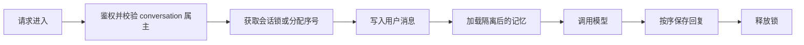

# 会话隔离与并发安全

> [!abstract] 一句话总结
> 会话隔离与并发安全保证同一用户的不同会话不会串上下文，不同用户不会串数据，同一会话的并发消息不会乱序覆盖。

## 📌 这是什么

多轮对话系统的状态通常散落在 Redis、数据库、VectorStore 和模型调用 trace 中。隔离做错会导致“拿错历史”，并发做错会导致“顺序错乱”。

- 用户隔离：`tenantId + userId` 必须参与所有数据过滤。
- 会话隔离：每个 `conversationId` 只加载自己的窗口、摘要和状态机。
- 请求隔离：每次调用都有 `requestId`，保存本次上下文快照。
- 并发安全：同一会话多条消息同时到达时，要有顺序控制或互斥策略。

## 🤔 解决什么问题 / 为什么需要

- **防止隐私泄漏**：VectorStore 检索和 Redis key 漏 user filter 会把别人的记忆注入 Prompt。
- **防止上下文串线**：用户同时开两个任务，不能互相污染摘要和槽位。
- **防止乱序回答**：并发请求 A、B 同时写入，模型可能先回复 B 再覆盖 A。
- **支持可复盘**：每次请求保存上下文快照，线上问题能定位是哪层状态错了。

## 🧩 核心数据结构

| 字段 | 示例 | 说明 |
| ---- | ---- | ---- |
| `tenantId` | `t_1` | SaaS 场景必须参与隔离。 |
| `userId` | `u_1` | 用户级记忆和权限边界。 |
| `conversationId` | `c_123` | 会话窗口、摘要、状态机主键。 |
| `requestId` | `r_789` | 单次模型调用 trace。 |
| `sequenceNo` | `42` | 会话内消息顺序。 |
| `lockKey` | `lock:chat:c_123` | 同一会话互斥处理。 |

Redis key 建议包含租户和用户：`chat:{tenantId}:{userId}:{conversationId}:messages`，避免只用自增 ID。

## ⚙️ 工作原理 / 流程



1. 从 token 中取 `tenantId`、`userId`，不要相信前端传来的 userId。
2. 校验 `conversationId` 属于当前用户。
3. 同一会话使用 Redis lock、队列或 DB 乐观锁保证顺序。
4. VectorStore 检索必须带 metadata filter。
5. 保存 `request_context_snapshot`，记录本次加载了哪些消息、摘要和记忆。

## 💻 Spring AI / Redis / VectorStore 落地点

```java
String lockKey = "lock:chat:" + tenantId + ":" + userId + ":" + conversationId;
Boolean locked = redis.opsForValue().setIfAbsent(lockKey, requestId, Duration.ofSeconds(30));
if (!Boolean.TRUE.equals(locked)) {
    throw new IllegalStateException("当前会话正在处理上一条消息，请稍后重试");
}

try {
    assertConversationOwner(conversationId, tenantId, userId);
    List<Document> memories = vectorStore.similaritySearch(
        SearchRequest.builder()
            .query(question)
            .filterExpression("tenantId == '" + tenantId + "' && userId == '" + userId + "'")
            .topK(5)
            .build()
    );
    // build prompt and call ChatClient
} finally {
    redis.delete(lockKey);
}
```

高吞吐场景可以不用互斥锁，而是把用户消息写入 Redis Stream，由单会话消费者按序处理。

## 🔍 并发策略对比

| 策略 | 优点 | 代价 |
| ---- | ---- | ---- |
| Redis 分布式锁 | 实现简单，适合一次只处理一条消息 | 用户快速连发会等待或失败 |
| Redis Stream 队列 | 顺序稳定，可削峰 | 架构更复杂，需要消费确认 |
| DB 乐观锁 | 易审计，适合强一致写入 | 高并发冲突重试成本高 |
| 前端禁用输入 | 体验可控 | 不能防 API 并发和多端并发 |

## ⚠️ 踩坑与注意事项

- VectorStore 只按 query 检索不加 `userId` filter，是最危险的串记忆问题。
- 锁超时时间过短会出现同一会话双处理，过长会导致异常后卡住。
- 流式输出时，assistant 消息应在结束后整体落库，或用状态字段标记未完成。
- 用户多端同时发消息时，前端禁用按钮不够，服务端仍需顺序控制。
- trace 中不要记录完整敏感内容，可记录 messageId 和 hash。

## 🎯 面试问题

> [!question] 高频问题
> - Q: 如何保证不同用户不会检索到彼此记忆？
>   - A: 所有 Redis key、DB 查询、VectorStore filter 都包含 `tenantId/userId`，并在写入和读取两侧统一封装。
> - Q: 同一会话用户连续发两条消息怎么办？
>   - A: 用会话锁串行化、Stream 排队，或用 sequenceNo 和状态机拒绝乱序请求。
> - Q: 流式回答中途失败如何保证状态一致？
>   - A: assistant 消息先标记 `streaming`，完成后改为 `completed`；失败时记录 partial 和 error，不参与正常窗口。

## ✅ 精通检查清单

- 能设计包含 tenant、user、conversation 的 key 和索引。
- 能说明 Redis lock、Stream、DB 乐观锁的适用场景。
- 能写出 VectorStore metadata 隔离条件。
- 能处理流式输出的半完成状态。
- 能用 request trace 复盘一次串上下文问题。

## 🔗 关联笔记

- [[_index]]
- [[08-对话持久化]]
- [[11-会话状态机]]
- [[04-语义检索记忆]]
- [[10-AI应用开发/00-总览/学习仪表盘]]

## 📚 参考资料

- [Redis Distributed Locks](https://redis.io/docs/latest/develop/use/patterns/distributed-locks/)
- [Spring AI Reference](https://docs.spring.io/spring-ai/reference/)
