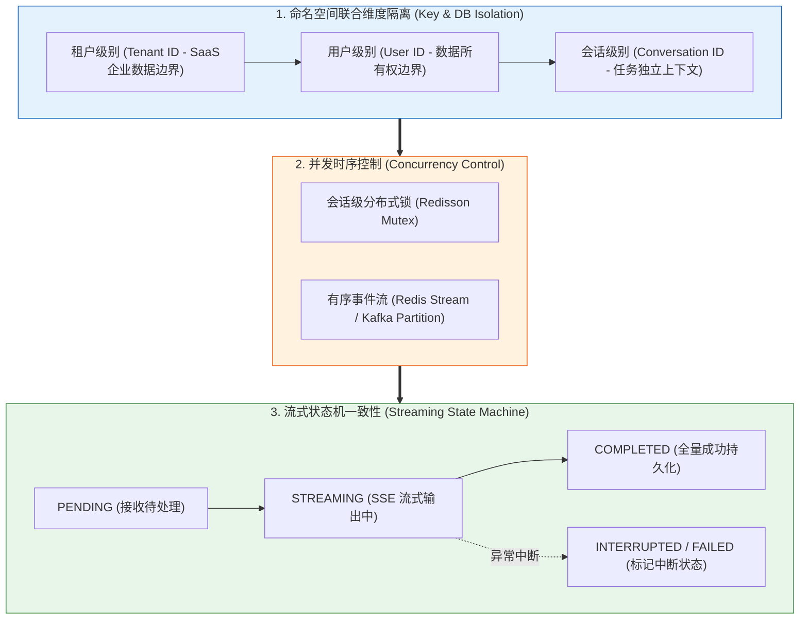
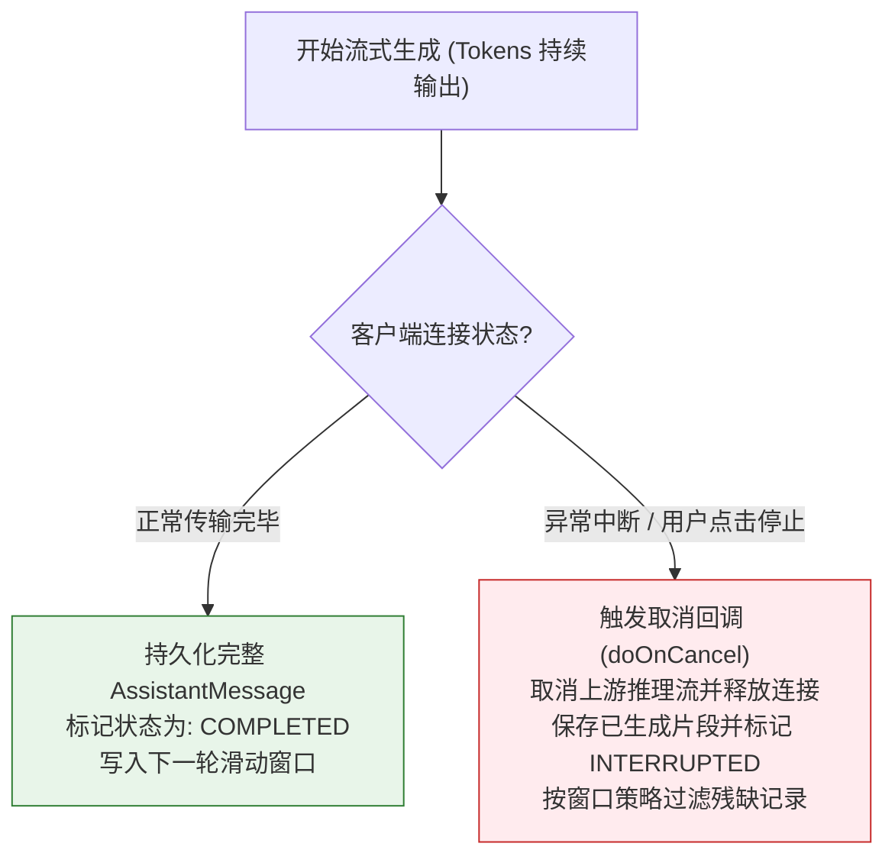

# 🔒 会话隔离与并发安全：高可用企业级对话治理

> [!abstract] 一句话总结
> 企业级多轮会话安全依托三大核心机制：**服务端强身份鉴权与多维命名空间隔离**、**会话级分布式并发串行控制**，以及**流式传输中断（SSE Drop）的状态机一致性治理**。

---

## 🗣️ 白话版（先建立直觉）

在多租户并发环境下，会话治理需解决两个核心问题：一是严防不同租户或用户之间发生历史记录“串台”，必须通过服务端鉴权与联合主键隔离数据边界；二是防止同一会话内的并发请求同时读取旧历史并互相覆盖，在多实例集群下需引入分布式会话锁或有序消息队列实现串行化处理。

---

## 📌 第一性原理：四层立体隔离与安全防线



### 1. Redis Key 的工业级命名规范
在完成服务端会话归属鉴权的基础上，Redis 存储键统一采用包含租户、用户与会话维度的联合命名空间：
$$\text{Redis Key} = \text{chat:}\{\text{tenantId}\}\text{:}\{\text{userId}\}\text{:}\{\text{conversationId}\}\text{:messages}$$

### 2. 向量检索的强制标量过滤
在任何向 `VectorStore` 发起的多轮情节召回中，**Filter 表达式必须强制注入当前用户身份**：
```sql
tenantId == 'TENANT_01' && userId == 'USER_9988' && deleted == false
```
其中 `tenantId` 与 `userId` 必须由服务端从已认证的登录上下文（如 JWT / Session）中提取并注入过滤表达式。

---

## 💻 代码示例：Spring Boot + Redisson 会话锁闭环

```java
package com.example.ai.concurrency;

import lombok.extern.slf4j.Slf4j;
import org.redisson.api.RLock;
import org.redisson.api.RedissonClient;
import org.springframework.ai.chat.client.ChatClient;
import org.springframework.ai.chat.client.advisor.MessageChatMemoryAdvisor;
import org.springframework.ai.chat.memory.ChatMemory;
import org.springframework.stereotype.Service;

import java.util.concurrent.TimeUnit;

@Slf4j
@Service
public class SecureChatExecutionService {

    private final RedissonClient redissonClient;
    private final ChatClient chatClient;

    public SecureChatExecutionService(RedissonClient redissonClient, ChatClient.Builder builder, ChatMemory chatMemory) {
        this.redissonClient = redissonClient;
        this.chatClient = builder
                .defaultAdvisors(MessageChatMemoryAdvisor.builder(chatMemory).build())
                .build();
    }

    /**
     * 具备租户鉴权、防串台与分布式并发锁的安全对话入口
     */
    public String executeSafeChat(String tenantId, String currentUserId, String conversationId, String userMessage) {
        // 1. 严格业务属主鉴权校验（严防水平越权）
        validateConversationOwnership(tenantId, currentUserId, conversationId);

        // 2. 获取会话级精细化分布式锁（粒度细化到具体的 conversationId）
        String lockKey = "lock:ai:chat:" + tenantId + ":" + conversationId;
        RLock sessionLock = redissonClient.getLock(lockKey);

        try {
            // 最多等待 2 秒；未显式指定 leaseTime 时由 Redisson Watchdog 自动续期
            boolean acquired = sessionLock.tryLock(2, TimeUnit.SECONDS);
            if (!acquired) {
                log.warn("检测到并发请求竞争，拒绝执行 -> 会话ID: {}", conversationId);
                throw new IllegalStateException("当前会话正在处理上一条消息，请稍后再试！");
            }

            log.info("成功获取会话锁，开始安全处理对话 -> 会话: {}", conversationId);

            // 3. 执行安全的记忆装配与模型调用
            return chatClient.prompt()
                    .user(userMessage)
                    .advisors(a -> a.param(ChatMemory.CONVERSATION_ID,
                            tenantId + ":" + currentUserId + ":" + conversationId))
                    .call()
                    .content();

        } catch (InterruptedException e) {
            Thread.currentThread().interrupt();
            throw new RuntimeException("处理被意外中断", e);
        } finally {
            // 4. 安全释放锁（仅持有当前锁的线程才能释放，防误解锁）
            if (sessionLock.isHeldByCurrentThread()) {
                sessionLock.unlock();
                log.debug("会话锁安全释放 -> 会话: {}", conversationId);
            }
        }
    }

    private void validateConversationOwnership(String tenantId, String userId, String conversationId) {
        // 查询数据库或缓存校验 conversationId 确实归属于当前 (tenantId, userId)
    }
}
```

> [!NOTE] 分布式部署要点
> 1. **共享存储底座**：多实例集群部署下，`ChatMemory` 必须对接 Redis 或关系型数据库等共享存储，避免使用单机内存（`InMemoryChatMemory`）导致跨节点状态丢失。
> 2. **乐观锁版本兜底**：分布式锁配合数据库写入时的会话版本号（`version`）校验，可防止极端网络抖动或进程暂停导致旧请求覆盖新状态。

---

## ⚡ 流式断流（SSE Drop）的一致性治理

在生产环境中，用户经常在模型流式生成到一半时**关闭浏览器网页、点击“停止生成”或遭遇网络断开**：



> [!IMPORTANT] 流式中断处理规范
> 1. **生命周期回调闭环**：在响应式流中分别注册完成（`doOnComplete`）、异常（`doOnError`）与取消（`doOnCancel`）回调，及时向底层 HTTP 连接传播取消信号，并通过幂等状态流转确保单次消息状态只结算一次。
> 2. **残缺消息与工具调用隔离**：被中断的半截回复标记为 `INTERRUPTED`（或 `ABORTED`），可在组装下一轮窗口时过滤剔除或附加明确的中断标记；若中断发生在工具调用（Tool Call）期间，严禁将未完成的工具调用写入下一轮上下文，确保上下文中的 `tool_calls` 与 `tool_result` 严格配对。

---

## ⚠️ 常见问题与边界

### 1. 致命漏洞：信任前端传入的 `userId`
- **问题现象**：前端在请求 Body 里传 `{ userId: "1001", conversationId: "c_99" }`，服务端直接使用该参数拼装 Redis Key。攻击者只需抓包篡改 `userId`，即可越权读取其他用户的历史会话。
- **治理原则**：`userId` 与 `tenantId` 必须从网关认证后的 **JWT Token 或服务端 Session** 中提取，并校验当前用户对 `conversationId` 的所有权。

### 2. 合理配置分布式锁续期与模型调用超时
- 若为分布式锁设置过短的固定 `leaseTime`，当大模型长文本生成耗时超过锁租期时，锁会提前释放引发并发写冲突；而使用 Redisson Watchdog 自动续期时，必须同步为底层大模型 HTTP 客户端配置严格的连接与读取超时（Timeout），防止上游请求挂起导致锁长期被占用。

---

## 🎯 高频面试问题

> [!question] 面试高频问题 3 连击
> 
> **Q1：在高并发多租户环境下，如何从架构层面彻底杜绝大模型会话“串台”（拿错别人历史）？**
> - **答**：
>   构建四道隔离防线：
>   1. **身份来源防伪造**：租户 ID 与用户 ID 严禁从请求体直接获取，必须由网关鉴权从签名的 JWT 或服务端 Session 中提取；
>   2. **存储键命名空间隔离**：Redis 缓存 Key 统一采用 `chat:{tenantId}:{userId}:{conversationId}` 的联合命名空间；
>   3. **向量检索强制过滤**：在 VectorStore 相似度检索时，强制注入标量过滤表达式（`tenantId == T && userId == U`），阻断跨用户召回；
>   4. **会话属主事前校验**：在加载任何历史记忆前，先校验当前会话确实归属于当前登录用户，否则直接拒绝访问。
>
> **Q2：用户手抖快速连续点击发送，同一会话的并发请求如何做保序与防覆盖？**
> - **答**：
>   根据业务场景有两种主流设计模式：
>   - **模式一（会话级分布式互斥锁）**：基于 Redisson 对 `conversationId` 加细粒度分布式锁，设置短暂的等待窗口（如 1~2 秒）。若上一条消息正在生成，后一条并发请求直接快速失败并提示用户“上一条消息正在生成中”，并在数据落库时配合会话 `version` 乐观锁防止覆盖；
>   - **模式二（有序事件流队列）**：将用户消息按 `conversationId` 哈希路由至 Redis Stream 或 Kafka 的同一分区（Partition），由消费者按 FIFO 顺序串行驱动模型调用与状态更新。
>
> **Q3：在 SSE 流式长连接传输中，用户中途关闭浏览器导致连接中断，后端如何保障状态一致性？**
> - **答**：
>   引入 `PENDING → STREAMING → COMPLETED / INTERRUPTED / FAILED` 消息状态机，在响应式流的完成、异常和取消回调中幂等更新消息状态，并向上游传播取消信号以释放连接资源。对于被中断的半截文本消息，在数据库中标记为 `INTERRUPTED` 并在组装下一轮窗口时按策略过滤；若中断发生在工具调用过程中，则确保不向历史窗口写入孤立的 `tool_calls`，保证上下文结构合法。

---

## 🪝 一分钟复盘记忆卡

```
┌────────────────────────────────────────────────────────┐
│               会话隔离与并发安全 复盘卡             │
├────────────────────────────────────────────────────────┤
│  1. 隔离四要素：Tenant + User + Conversation 联合主键  │
│  2. 向量防渗透：Vector 检索必须强制注入 userId 标量过滤│
│  3. 并发防覆盖：会话锁负责互斥，队列负责保序，版本防旧写   │
│  4. 流式断流防线：中断回答标记状态，按策略装配下轮上下文   │
│  5. 安全红线：鉴权只信 JWT/Session，绝不信前端入参    │
└────────────────────────────────────────────────────────┘
```

---

## 🔗 关联笔记

- [[00-多轮对话与记忆全景心智模型]] - 记忆工程宏观心智
- [[06-分层记忆]] - 分层记忆装配中的隔离实战
- [[08-对话持久化]] - 消息历史的状态持久化与归档设计
- [[11-会话状态机]] - 基于状态流转管理复杂长会话
- [[_index]] - 返回多轮对话专题索引
