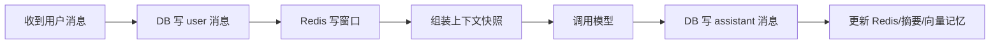

# 对话持久化

> [!abstract] 一句话总结
> 对话持久化把消息原文、模型输入快照、回复结果和记忆更新记录下来，让多轮对话可以恢复、审计、评测和排查。

## 📌 这是什么

持久化不只是保存聊天气泡。AI 应用至少要保存四类数据：用户和助手消息、会话元数据、模型调用 trace、记忆变更记录。Redis 适合短期在线读取，数据库负责长期事实和审计。

- 输入：用户消息、assistant 回复、工具调用结果、模型配置、上下文快照。
- 输出：可恢复的会话记录和可复盘的调用链。
- 目标：用户刷新页面不丢记录，线上回答异常能追到 Prompt 和记忆来源。

## 🤔 解决什么问题 / 为什么需要

- **会话恢复**：用户关闭页面后还能继续之前任务。
- **问题排查**：能确认模型到底看到了哪些消息和检索片段。
- **离线评测**：用真实历史构造回归样例，验证新 prompt 或新模型。
- **合规审计**：在允许范围内记录关键操作、删除请求和模型输出。

## 🧩 核心表设计

| 表 | 关键字段 | 用途 |
| ---- | ---- | ---- |
| `chat_conversation` | `id, tenant_id, user_id, title, status, created_at` | 会话列表和权限校验。 |
| `chat_message` | `id, conversation_id, role, content, token_count, sequence_no, status` | 原始消息和窗口来源。 |
| `chat_request_trace` | `request_id, conversation_id, model, prompt_tokens, context_snapshot` | 单次模型调用复盘。 |
| `memory_change_log` | `id, user_id, memory_id, action, source_message_id` | 记忆新增、更新、删除审计。 |

Redis key：

- `chat:{cid}:messages`：最近窗口。
- `chat:{cid}:summary`：当前摘要。
- `chat:{cid}:stream:{requestId}`：流式输出临时缓冲。

## ⚙️ 工作原理 / 流程



1. 用户消息先落库，拿到 `messageId`，再开始模型调用。
2. 构造 Prompt 时生成 `context_snapshot`，记录 message ids、summaryId、memory ids。
3. assistant 回复完成后落库，并写入 Redis 窗口。
4. 如果流式输出失败，把消息状态标记为 `failed` 或 `partial`。
5. 记忆更新与消息保存最好通过事务或最终一致事件串起来。

## 💻 Spring AI / Redis 落地点

```java
ChatMessageEntity userMsg = messageRepository.save(
    new ChatMessageEntity(conversationId, "user", userText, nextSeq())
);
redis.opsForList().rightPush("chat:" + conversationId + ":messages", userMsg.toMemoryDto());

ContextSnapshot snapshot = memoryAssembler.build(conversationId, userText);
String answer = chatClient.prompt()
    .messages(snapshot.messages())
    .call()
    .content();

ChatMessageEntity assistantMsg = messageRepository.save(
    new ChatMessageEntity(conversationId, "assistant", answer, nextSeq())
);
traceRepository.save(new TraceEntity(requestId, conversationId, snapshot.toJson()));
```

生产中要把模型名、temperature、tool calls、token 用量、错误码一起写入 trace。

## 🔍 VectorStore 关系

对话原文不一定全部进 VectorStore。推荐策略：

- DB 保存全量原文，用于展示和审计。
- Redis 保存最近窗口，用于在线调用。
- VectorStore 只保存抽取后的稳定记忆或高价值片段。
- `sourceMessageIds` 指回 DB 原文，便于解释和删除。

## ⚠️ 踩坑与注意事项

- 只存 assistant 最终答案，不存 Prompt 快照，线上问题很难复盘。
- Redis 不能替代数据库，TTL 过期后会话恢复会丢数据。
- 流式输出逐字落库会造成大量写放大，建议缓冲后分段或完成后落库。
- 用户删除会话时，要同步处理摘要、Redis 窗口、VectorStore 记忆和审计策略。
- 保存工具结果时要区分展示文本和原始 payload，避免敏感信息泄漏。

## 🎯 面试问题

> [!question] 高频问题
> - Q: 对话系统为什么既用 Redis 又用数据库？
>   - A: Redis 负责低延迟读取最近窗口和临时流式状态；数据库负责长期保存、恢复、审计和离线评测。
> - Q: trace 里应该记录什么？
>   - A: requestId、模型参数、上下文片段 ID、token 用量、工具调用、错误信息和输出状态。
> - Q: 如何处理用户删除会话？
>   - A: 删除或脱敏 DB 消息，清 Redis key，让相关 VectorStore 文档失效，并记录合规允许的删除审计。

## ✅ 精通检查清单

- 能设计 conversation、message、trace、memory log 四张表。
- 能说明 Redis 和 DB 的职责边界。
- 能处理流式输出成功、失败、取消三种状态。
- 能把 VectorStore 片段和源消息关联起来。
- 能基于历史记录构建离线回归样例。

## 🔗 关联笔记

- [[_index]]
- [[01-滑动窗口记忆]]
- [[03-摘要记忆]]
- [[07-会话隔离与并发安全]]
- [[10-AI应用开发/00-总览/学习仪表盘]]

## 📚 参考资料

- [Spring AI Reference](https://docs.spring.io/spring-ai/reference/)
- [Redis Streams](https://redis.io/docs/latest/develop/data-types/streams/)
