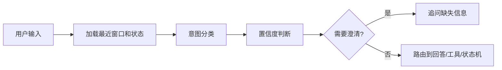

# 意图识别

> [!abstract] 一句话总结
> 意图识别把用户当前输入分类成问答、继续上文、修改约束、执行工具、闲聊、结束会话等动作，用来决定读取哪些记忆、走哪个状态和调用哪些服务。

## 🎯 本节定位

- **本章第 9 课，对话路由**。前置 [[05-结构化记忆]]（槽位从哪来）、[[06-分层记忆]]（按意图决定读哪层记忆）；本篇判断“用户现在想做什么”。
- **延伸阅读（本课不展开）**：是否换任务见 [[10-话题切换检测]]，路由后的流程控制见 [[11-会话状态机]]。

## 📌 这是什么

多轮对话里的意图识别不是单句分类这么简单，它要结合最近窗口和会话状态判断“用户现在想让系统做什么”。例如“换成 Redis 方案”只有结合上文才知道是在修改存储选型。

- 输入：当前用户消息、最近窗口、会话状态、已填槽位。
- 输出：`intent`、`confidence`、`slots`、`requiresTool`、`memoryPolicy`。
- 用途：路由 Prompt、选择工具、更新状态机、决定是否检索长期记忆。

## 🤔 解决什么问题 / 为什么需要

- **减少错误工具调用**：先判断是不是查订单、改配置、继续解释，再决定是否调用工具。
- **提高多轮连续性**：识别“继续”“换一个”“按刚才的来”等依赖上文的指令。
- **驱动槽位补全**：识别缺少哪些字段，决定追问而不是胡乱回答。
- **控制记忆读取**：闲聊不需要向量检索，偏好修改需要更新结构化记忆。

## 🧩 核心数据结构

```json
{
  "intent": "modify_constraint",
  "confidence": 0.86,
  "slots": {
    "storage": "Redis",
    "scope": "short_term_memory"
  },
  "needsClarification": false,
  "requiresTool": false,
  "memoryPolicy": {
    "readWindow": true,
    "readProfile": true,
    "searchVectorStore": false,
    "updateStructuredMemory": true
  }
}
```

常见 intent：`new_task`、`continue_task`、`modify_constraint`、`ask_explanation`、`tool_action`、`smalltalk`、`end_conversation`、`forget_memory`。

## ⚙️ 工作原理 / 流程



1. 先用规则捕捉强信号，例如“忘掉”“重新开始”“取消”。
2. 再用模型做结构化分类，输出固定 JSON。
3. 低置信度或槽位冲突时追问用户。
4. 将识别结果写入 trace，后续状态机和记忆层都引用它。
5. 对高风险工具调用做二次确认。

## 💻 Spring AI / Redis 落地点

```java
record IntentResult(
    String intent,
    double confidence,
    Map<String, Object> slots,
    boolean needsClarification,
    boolean requiresTool
) {}

IntentResult result = chatClient.prompt()
    .system("你是多轮对话意图识别器，只输出 JSON，不回答用户问题。")
    .user("""
当前会话状态：{state}
最近对话：{recentMessages}
用户输入：{userText}
可选意图：new_task, continue_task, modify_constraint, tool_action, smalltalk, end_conversation, forget_memory
""")
    .call()
    .entity(IntentResult.class);

redis.opsForValue().set("chat:" + conversationId + ":last_intent", result, Duration.ofHours(2));
```

识别结果可作为 `ChatClient` 前置路由：`tool_action` 进入工具编排，`forget_memory` 进入删除流程，`continue_task` 加载摘要和窗口。

## 🔍 VectorStore 关系

不是每个问题都要检索向量记忆：

- `continue_task`：优先滑动窗口和摘要。
- `ask_explanation`：可检索知识库，不一定检索用户长期记忆。
- `modify_constraint`：读取结构化记忆并准备覆盖字段。
- `forget_memory`：查找相关 memory ids，执行删除或失效。
- `new_task`：根据问题决定是否检索长期偏好。

## ⚠️ 踩坑与注意事项

- 只看当前句会误判短指令，例如“换成第二个”必须结合窗口。
- 模型分类可能不稳定，关键意图要有规则兜底。
- 置信度不是事实，低置信度要追问，不要强行路由。
- 意图识别 Prompt 里不要暴露可被用户操控的内部工具权限。
- 分类结果必须写 trace，否则无法解释为什么调用了某个工具。

## 🎯 面试问题

> [!question] 高频问题
> - Q: 意图识别在多轮对话里起什么作用？
>   - A: 它把用户输入路由到回答、追问、工具调用、记忆更新或状态流转，避免所有请求都走同一个 Prompt。
> - Q: 如何处理“继续”“换一个”这类省略表达？
>   - A: 加载最近窗口和会话状态，让分类器结合上文判断；必要时追问用户确认。
> - Q: 规则和模型分类怎么配合？
>   - A: 强规则处理取消、删除记忆等高确定意图，模型处理语义复杂意图，低置信度进入澄清。

## ✅ 精通检查清单

- 能定义业务意图枚举和输出 JSON。
- 能说明意图识别如何影响记忆读取和工具调用。
- 能处理低置信度和槽位缺失。
- 能把识别结果写入 Redis 和 trace。
- 能为关键意图设计规则兜底。

## 🔗 关联笔记

- [[_index]]
- [[10-话题切换检测]]
- [[11-会话状态机]]
- [[05-结构化记忆]]
- [[../00-总览/学习仪表盘]]

## 📚 参考资料

- [Spring AI Structured Output](https://docs.spring.io/spring-ai/reference/api/structured-output-converter.html)
- [Spring AI Reference](https://docs.spring.io/spring-ai/reference/)
