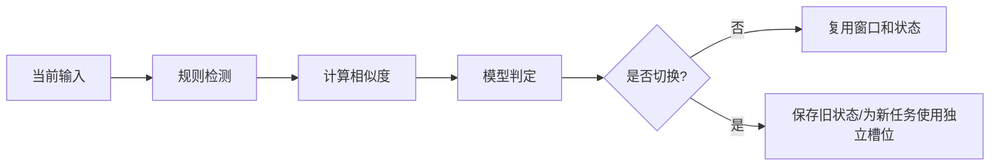

# 话题切换检测

> [!abstract] 一句话总结
> 话题切换检测判断用户是在延续当前任务、局部改约束，还是开启新话题，从而决定是否复用窗口、刷新摘要、重置槽位或新建会话。

## 🎯 本节定位

本篇在 [[09-意图识别]] 和 [[06-分层记忆]] 的基础上判断输入是否仍属于当前任务。切换后的状态流转见 [[11-会话状态机]]，跨话题回跳可结合 [[04-语义检索记忆]]。

## 📌 这是什么

话题切换检测关注“当前输入和现有上下文是否仍属于同一任务”。它比意图识别更偏上下文边界判断：用户说“再便宜点”是同话题，用户说“顺便帮我写个请假条”就是新话题。
- 输入：当前用户消息、最近窗口摘要、当前任务状态、embedding 相似度。
- 输出：`topicDecision`、`confidence`、`reason`、`stateAction`。
- 决策：`same_topic`、`subtopic`、`topic_shift`、`ambiguous`。

## 🤔 解决什么问题 / 为什么需要

- 新任务不必继承无关的旧约束和工具结果。
- 用户只做局部修改时，应保留原任务目标。
- 话题结束时可以保存摘要，方便之后恢复。
- 可以按产品需要为新话题创建会话或生成标题。

## 🧩 核心数据结构

```json
{
  "topicDecision": "topic_shift",
  "confidence": 0.81,
  "previousTopic": "设计 Redis 会话记忆",
  "currentTopic": "写请假邮件",
  "stateAction": "start_new_conversation",
  "memoryAction": "do_not_reuse_task_slots",
  "reason": "当前输入目标、领域和输出形式均与上一任务无关"
}
```

Redis 可保存当前话题快照：`chat:{conversationId}:topic_state`，包含 `topicEmbeddingId`、`topicTitle`、`activeSlots`。

## ⚙️ 工作原理 / 流程



1. 规则先识别显式信号：“换个话题”“重新开始”“另一个问题”。
2. 用当前输入和当前话题摘要计算 embedding 相似度。
3. 对相似度中间区间用模型判断，输出结构化结果。
4. `same_topic` 继续复用窗口、摘要和槽位。
5. `topic_shift` 生成旧话题摘要，重置任务槽位，必要时新建会话。

## 💻 Spring AI / Redis / VectorStore 落地点

下面是流程示意片段；相关类型和方法由应用自行实现，省略配置与错误处理。

```java
double similarity = topicSimilarity(currentTopic, userText);
TopicDecision decision = decideTopicChange(similarity, recentHistory);
```

如果选择新建会话，可以保存旧任务摘要和状态，并让新任务使用独立的临时槽位。是否删除旧缓存取决于恢复需求与保留策略；不能把话题切换直接等同于删除旧任务。

## 🔍 VectorStore 关系

话题切换可借助 embedding，但不要只靠相似度：
- 相似度高：多半是延续，但可能是同领域新任务。
- 相似度低：多半是切换，但短句“继续”会低相似，必须看窗口。
- 切换后：VectorStore 长期偏好仍可用，当前任务槽位不应直接复用。

可把每个话题摘要写入 VectorStore，用于“回到刚才那个部署方案”这类跨话题回跳。

## ⚠️ 踩坑与注意事项

- 短句没有语义信息，必须结合最近窗口判断。
- 话题切换不等于用户切换会话；有些产品更适合在同一会话里开新 task segment。
- 过度重置会让用户觉得系统失忆，过度复用会把旧约束带进新任务。
- embedding 阈值需要用真实对话调参，不同模型分数不可直接迁移。
- 切换时要处理正在进行的工具调用，避免旧任务结果写入新话题。

## 🎯 面试问题

> [!question]- 话题切换检测和意图识别有什么区别？
> 意图识别判断用户要做什么，话题切换检测判断是否还属于当前任务边界；两者通常一起驱动状态机。

> [!question]- 如何判断“换一个”是不是新话题？
> 结合最近窗口，如果上文是候选方案列表，多半是同话题修改；如果没有明确指代，要追问确认。

> [!question]- 话题切换后要清哪些状态？
> 新话题使用独立的任务槽位和临时结果；旧状态按恢复策略保留，不直接删除。长期偏好按相关性和权限使用。

## ✅ 精通检查清单

- 能定义 `same_topic/subtopic/topic_shift/ambiguous` 决策。
- 能组合规则、embedding 相似度和模型判断。
- 能说明切换后哪些记忆保留、哪些状态清理。
- 能处理短句、显式切换和跨话题回跳。
- 能为阈值调优准备标注样例。

## 🔗 关联笔记

- [[_index]]
- [[09-意图识别]]
- [[11-会话状态机]]
- [[06-分层记忆]]
- [[../00-总览/学习仪表盘]]

## 📚 参考资料

- [Spring AI Embeddings](https://docs.spring.io/spring-ai/reference/api/embeddings.html)
- [Spring AI Reference](https://docs.spring.io/spring-ai/reference/)
