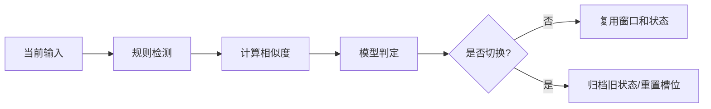

# 话题切换检测

> [!abstract] 一句话总结
> 话题切换检测判断用户是在延续当前任务、局部改约束，还是开启新话题，从而决定是否复用窗口、刷新摘要、重置槽位或新建会话。

## 🎯 本节定位

- **本章第 10 课，上下文边界判断**。前置 [[09-意图识别]]（“要做什么”与“是否同任务”的分工）、[[06-分层记忆]]（切换后哪些层保留、哪些层清理）。
- **延伸阅读（本课不展开）**：切换后的状态流转见 [[11-会话状态机]]，跨话题回跳依赖 [[04-语义检索记忆]]。

## 📌 这是什么

话题切换检测关注“当前输入和现有上下文是否仍属于同一任务”。它比意图识别更偏上下文边界判断：用户说“再便宜点”是同话题，用户说“顺便帮我写个请假条”就是新话题。

- 输入：当前用户消息、最近窗口摘要、当前任务状态、embedding 相似度。
- 输出：`topicDecision`、`confidence`、`reason`、`stateAction`。
- 决策：`same_topic`、`subtopic`、`topic_shift`、`ambiguous`。

## 🤔 解决什么问题 / 为什么需要

- **防止旧上下文污染新任务**：新话题不应继承上一轮约束和工具结果。
- **避免过早丢上下文**：局部修改仍应保留原任务目标。
- **改善摘要质量**：话题结束时生成摘要，新话题从干净状态开始。
- **支持会话列表体验**：明显新话题可新建 conversation 或生成新标题。

## 🧩 核心数据结构

```json
{
  "topicDecision": "topic_shift",
  "confidence": 0.81,
  "previousTopic": "设计 Redis 会话记忆",
  "currentTopic": "写请假邮件",
  "stateAction": "start_new_conversation",
  "memoryAction": "do_not_reuse_task_slots",
  "reason": "当前输入目标、领域和输出形式均与上一任务无关"
}
```

Redis 可保存当前话题快照：`chat:{conversationId}:topic_state`，包含 `topicEmbeddingId`、`topicTitle`、`activeSlots`。

## ⚙️ 工作原理 / 流程



1. 规则先识别显式信号：“换个话题”“重新开始”“另一个问题”。
2. 用当前输入和当前话题摘要计算 embedding 相似度。
3. 对相似度中间区间用模型判断，输出结构化结果。
4. `same_topic` 继续复用窗口、摘要和槽位。
5. `topic_shift` 生成旧话题摘要，重置任务槽位，必要时新建会话。

## 💻 Spring AI / Redis / VectorStore 落地点

```java
double score = embeddingSimilarity(currentTopicSummary, userText);
TopicDecision decision;
if (userText.contains("重新开始") || userText.contains("换个话题")) {
    decision = TopicDecision.shift("explicit_user_signal");
} else if (score > 0.78) {
    decision = TopicDecision.same(score);
} else {
    decision = chatClient.prompt()
        .system("判断用户输入是否延续当前话题，只输出结构化 JSON。")
        .user("当前话题：" + currentTopicSummary + "\n用户输入：" + userText)
        .call()
        .entity(TopicDecision.class);
}
redis.opsForValue().set("chat:" + conversationId + ":topic_decision", decision, Duration.ofHours(1));
```

如果选择新建会话，要把旧会话摘要落库，并清理 `chat:{cid}:active_slots` 这类任务态 Redis key。

## 🔍 VectorStore 关系

话题切换可借助 embedding，但不要只靠相似度：

- 相似度高：多半是延续，但可能是同领域新任务。
- 相似度低：多半是切换，但短句“继续”会低相似，必须看窗口。
- 切换后：VectorStore 长期偏好仍可用，当前任务槽位不应直接复用。

可把每个话题摘要写入 VectorStore，用于“回到刚才那个部署方案”这类跨话题回跳。

## ⚠️ 踩坑与注意事项

- 短句没有语义信息，必须结合最近窗口判断。
- 话题切换不等于用户切换会话；有些产品更适合在同一会话里开新 task segment。
- 过度重置会让用户觉得系统失忆，过度复用会把旧约束带进新任务。
- embedding 阈值需要用真实对话调参，不同模型分数不可直接迁移。
- 切换时要处理正在进行的工具调用，避免旧任务结果写入新话题。

## 🎯 面试问题

> [!question] 高频问题
> - Q: 话题切换检测和意图识别有什么区别？
>   - A: 意图识别判断用户要做什么，话题切换检测判断是否还属于当前任务边界；两者通常一起驱动状态机。
> - Q: 如何判断“换一个”是不是新话题？
>   - A: 结合最近窗口，如果上文是候选方案列表，多半是同话题修改；如果没有明确指代，要追问确认。
> - Q: 话题切换后要清哪些状态？
>   - A: 清当前任务槽位、临时工具结果和未完成状态；保留长期偏好和用户画像。

## ✅ 精通检查清单

- 能定义 `same_topic/subtopic/topic_shift/ambiguous` 决策。
- 能组合规则、embedding 相似度和模型判断。
- 能说明切换后哪些记忆保留、哪些状态清理。
- 能处理短句、显式切换和跨话题回跳。
- 能为阈值调优准备标注样例。

## 🔗 关联笔记

- [[_index]]
- [[09-意图识别]]
- [[11-会话状态机]]
- [[06-分层记忆]]
- [[../00-总览/学习仪表盘]]

## 📚 参考资料

- [Spring AI Embeddings](https://docs.spring.io/spring-ai/reference/api/embeddings.html)
- [Spring AI Reference](https://docs.spring.io/spring-ai/reference/)
