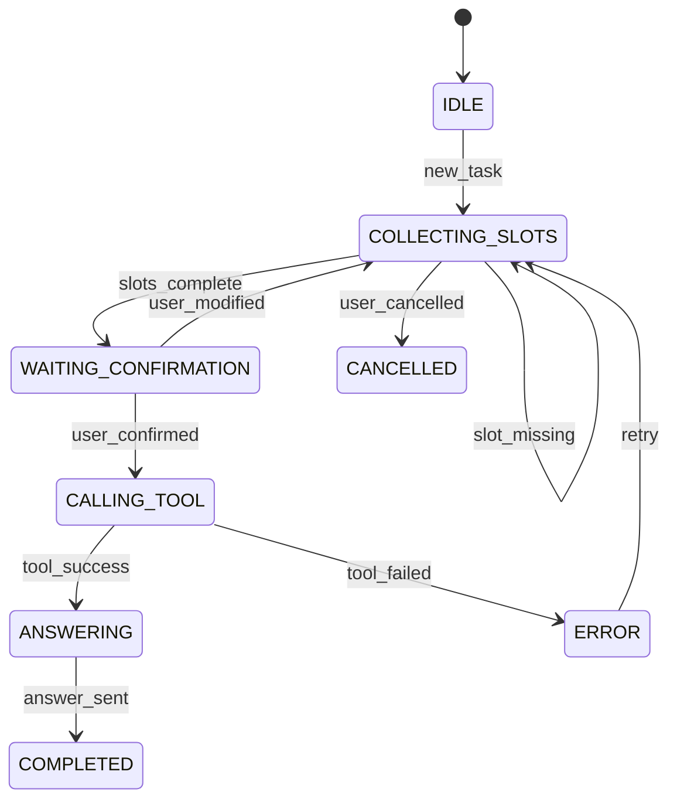

# 会话状态机

> [!abstract] 一句话总结
> 会话状态机把多轮对话拆成可控状态和事件，明确什么时候追问、什么时候调用工具、什么时候等待用户确认、什么时候结束或转人工。

## 🎯 本节定位

- **本章第 11 课，流程控制收官**。前置 [[09-意图识别]]、[[10-话题切换检测]]（事件来源）、[[05-结构化记忆]]（槽位载体）、[[07-会话隔离与并发安全]]（版本控制）；本篇把对话变成确定性流程。
- **延伸阅读（本课不展开）**：把状态机与记忆扩展到工具编排与 Agent 是下一章 [[10-AI应用开发/05-Agent-MCP-Skills/_index|05 · Agent · MCP · Skills]] 的内容。

## 📌 这是什么

会话状态机是多轮对话的流程控制层。它不负责生成自然语言，而是决定当前会话处于哪个阶段、下一步允许发生什么。对复杂业务来说，只靠 Prompt 让模型“自己记得流程”很不稳定。

- 输入：当前状态、用户意图、槽位、工具结果、异常事件。
- 输出：下一状态、要执行的 action、要追问的问题或模型调用策略。
- 适用：表单收集、工单创建、预订流程、审批助手、Agent 工具链。

## 🤔 解决什么问题 / 为什么需要

- **流程可控**：缺少必要信息时先追问，不让模型直接编答案。
- **并发安全**：状态版本可防止旧请求覆盖新状态。
- **异常可恢复**：工具失败、用户取消、超时都能进入明确状态。
- **便于测试**：状态转移可以用单元测试覆盖，不依赖模型随机输出。

## 🧩 核心数据结构

```json
{
  "conversationId": "c_123",
  "state": "COLLECTING_SLOTS",
  "version": 7,
  "slots": {
    "product": "Redis 会话记忆",
    "budget": null
  },
  "pendingQuestion": "预算上限是多少？",
  "lastIntent": "modify_constraint",
  "updatedAt": "2026-07-04T10:00:00"
}
```

常见状态：`IDLE`、`COLLECTING_SLOTS`、`WAITING_CONFIRMATION`、`CALLING_TOOL`、`ANSWERING`、`COMPLETED`、`CANCELLED`、`ERROR`。

## ⚙️ 工作原理 / 流程



1. 意图识别产出事件，例如 `new_task`、`slot_filled`、`user_confirmed`。
2. 状态机根据当前状态和事件决定下一步。
3. action 可能是追问、调用工具、加载记忆、生成回答、结束会话。
4. 状态更新使用 `version` 做乐观锁，避免并发覆盖。
5. 每次转移写入状态日志，便于排查。

## 💻 Spring AI / Redis 落地点

```java
record ConversationState(
    String conversationId,
    String state,
    long version,
    Map<String, Object> slots,
    String pendingQuestion
) {}

ConversationState current = stateRepository.find(conversationId);
IntentResult intent = intentService.classify(userText, current);
Transition transition = stateMachine.next(current, intent);

stateRepository.updateWithVersion(
    conversationId,
    current.version(),
    transition.nextState(),
    transition.updatedSlots()
);

if (transition.action() == Action.ASK_CLARIFICATION) {
    return transition.question();
}
return chatClient.prompt().messages(transition.messages()).call().content();
```

Redis 可缓存热状态：`chat:{conversationId}:state`；数据库保存状态版本和转移日志。复杂流程可引入 Spring StateMachine，但简单业务用枚举和转移表更直接。

## 🔍 VectorStore / 记忆关系

状态机决定什么时候读取或更新记忆：

- `COLLECTING_SLOTS`：读取结构化记忆补默认值，但要让用户确认。
- `WAITING_CONFIRMATION`：不应写长期记忆，等用户确认后再写。
- `COMPLETED`：抽取稳定结论写入摘要或 VectorStore。
- `CANCELLED`：清临时槽位，不写长期偏好。
- `ERROR`：保留错误 trace，不把失败工具结果当事实。

## ⚠️ 踩坑与注意事项

- 状态过细会难维护，状态过粗又控制不住流程，要围绕业务动作划分。
- 让模型直接输出下一状态有风险，最好由代码校验可达转移。
- 并发请求必须带状态版本，否则旧请求可能覆盖新槽位。
- 用户随时可能改需求，状态机要支持从确认态退回收集态。
- 流式回答中如果用户取消，要把状态从 `ANSWERING` 转到 `CANCELLED` 或 `IDLE`。

## 🎯 面试问题

> [!question] 高频问题
> - Q: 为什么多轮对话需要状态机？
>   - A: 状态机把流程控制交给代码，让缺槽追问、确认、工具调用、异常恢复都有确定规则，而不是完全依赖模型临场发挥。
> - Q: 状态机和 Prompt 怎么分工？
>   - A: 状态机决定流程和动作，Prompt 负责生成自然语言内容；模型输出要经过状态机允许的转移校验。
> - Q: 如何处理并发状态更新？
>   - A: 状态记录加 `version`，更新时使用乐观锁；冲突时重新加载状态并决定重试或提示用户。

## ✅ 精通检查清单

- 能定义状态、事件、action、槽位和版本字段。
- 能画出一个工具调用流程的状态转移图。
- 能说明何时读写摘要、结构化记忆和 VectorStore。
- 能处理取消、超时、工具失败和用户修改需求。
- 能为状态转移写单元测试。

## 🔗 关联笔记

- [[_index]]
- [[09-意图识别]]
- [[10-话题切换检测]]
- [[05-结构化记忆]]
- [[07-会话隔离与并发安全]]
- [[10-AI应用开发/00-总览/学习仪表盘]]

## 📚 参考资料

- [Spring StateMachine](https://spring.io/projects/spring-statemachine)
- [Spring AI Reference](https://docs.spring.io/spring-ai/reference/)
