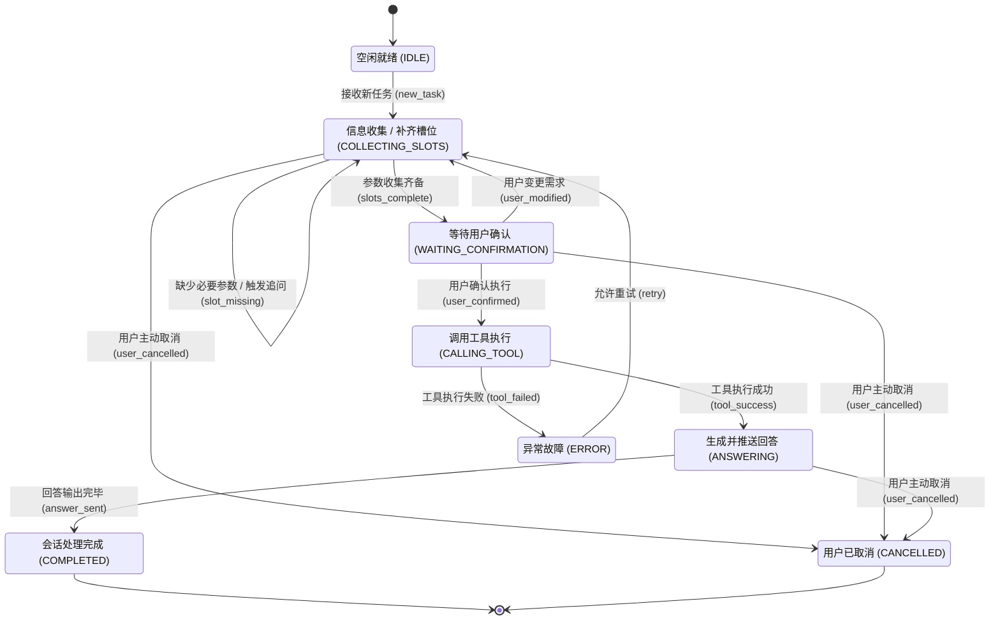

# 会话状态机

> [!abstract] 一句话总结
> 会话状态机把多轮对话拆成可控状态和事件，明确什么时候追问、什么时候调用工具、什么时候等待用户确认、什么时候结束或转人工。

## 🎯 本节定位

本篇结合 [[09-意图识别]]、[[10-话题切换检测]]、[[05-结构化记忆]] 和 [[07-会话隔离与并发安全]]，介绍如何用代码控制会话流程。工具编排和 Agent 见下一章 [[../05-Agent-MCP-Skills/_index|05 · Agent · MCP · Skills]]。

## 📌 这是什么

会话状态机是多轮对话的流程控制层。它不负责生成自然语言，而是决定当前会话处于哪个阶段、下一步允许发生什么。对复杂业务来说，只靠 Prompt 让模型“自己记得流程”很不稳定。
- 输入：当前状态、用户意图、槽位、工具结果、异常事件。
- 输出：下一状态、要执行的 action、要追问的问题或模型调用策略。
- 适用：表单收集、工单创建、预订流程、审批助手、Agent 工具链。

## 🤔 解决什么问题 / 为什么需要

- 缺少必要信息时先追问，避免模型直接猜答案。
- 用状态版本检查避免旧请求覆盖新状态。
- 为工具失败、用户取消和超时定义明确的处理状态。
- 用单元测试覆盖状态转移，减少对模型随机输出的依赖。

## 🧩 核心数据结构

```json
{
  "conversationId": "c_123",
  "state": "COLLECTING_SLOTS",
  "version": 7,
  "slots": {
    "product": "Redis 会话记忆",
    "budget": null
  },
  "pendingQuestion": "预算上限是多少？",
  "lastIntent": "modify_constraint",
  "updatedAt": "2026-07-04T10:00:00"
}
```

常见状态：`IDLE`（空闲就绪）、`COLLECTING_SLOTS`（收集槽位/追问）、`WAITING_CONFIRMATION`（等待确认）、`CALLING_TOOL`（执行工具）、`ANSWERING`（生成回答）、`COMPLETED`（会话完成）、`CANCELLED`（已取消）、`ERROR`（异常重试）。

## ⚙️ 工作原理 / 流程



1. **事件触发**：意图识别与槽位抽取产出结构化事件，例如 `new_task`（新任务）、`slot_missing`（缺槽追问）、`user_confirmed`（用户确认）。
2. **转移决策**：状态机根据“当前状态 + 触发事件”严格查表，决定唯一的下一状态。
3. **动作执行（Action）**：转移时触发副作用动作，如追问缺省参数、调用后端服务接口、读取长短期记忆、流式推送回答。
4. **并发控制**：状态更新使用 `version` 做乐观锁（CAS），防止用户并发连续点击导致状态错乱覆盖。
5. **审计留痕**：每次状态流转写入持久化转移日志，便于排障追溯与会话断点恢复。

## 💻 Spring AI / Redis 落地点

下面是流程示意片段；相关类型和方法由应用自行实现，省略配置与错误处理。

```java
boolean updated = repository.updateIfVersion(conversationId, nextState, version);
if (!updated) throw new ConcurrentModificationException("会话状态已变化");
```

Redis 可缓存热状态：`chat:{conversationId}:state`；数据库保存状态版本和转移日志。复杂流程可引入 Spring StateMachine，但简单业务用枚举和转移表更直接。

## 🔍 VectorStore / 记忆关系

状态机决定什么时候读取或更新记忆：
- `COLLECTING_SLOTS`：读取结构化记忆补默认值，但要让用户确认。
- `WAITING_CONFIRMATION`：不应写长期记忆，等用户确认后再写。
- `COMPLETED`：抽取稳定结论写入摘要或 VectorStore。
- `CANCELLED`：清临时槽位，不写长期偏好。
- `ERROR`：保留错误 trace，不把失败工具结果当事实。

## ⚠️ 踩坑与注意事项

- 状态过细会难维护，状态过粗又控制不住流程，要围绕业务动作划分。
- 让模型直接输出下一状态有风险，最好由代码校验可达转移。
- 并发请求必须带状态版本，否则旧请求可能覆盖新槽位。
- 用户随时可能改需求，状态机要支持从确认态退回收集态。
- 流式回答中如果用户取消，要把状态从 `ANSWERING` 转到 `CANCELLED` 或 `IDLE`。

## 🎯 面试问题

> [!question]- 为什么多轮对话需要状态机？
> 状态机把流程控制交给代码，让缺槽追问、确认、工具调用、异常恢复都有确定规则，而不是完全依赖模型临场发挥。

> [!question]- 状态机和 Prompt 怎么分工？
> 状态机决定流程和动作，Prompt 负责生成自然语言内容；模型输出要经过状态机允许的转移校验。

> [!question]- 如何处理并发状态更新？
> 状态记录加 `version`，更新时使用乐观锁；冲突时重新加载状态并决定重试或提示用户。

## ✅ 精通检查清单

- 能定义状态、事件、action、槽位和版本字段。
- 能画出一个工具调用流程的状态转移图。
- 能说明何时读写摘要、结构化记忆和 VectorStore。
- 能处理取消、超时、工具失败和用户修改需求。
- 能为状态转移写单元测试。

## 🔗 关联笔记

- [[_index]]
- [[09-意图识别]]
- [[10-话题切换检测]]
- [[05-结构化记忆]]
- [[07-会话隔离与并发安全]]
- [[../00-总览/学习仪表盘]]

## 📚 参考资料

- [Spring StateMachine](https://spring.io/projects/spring-statemachine)
- [Spring AI Reference](https://docs.spring.io/spring-ai/reference/)
