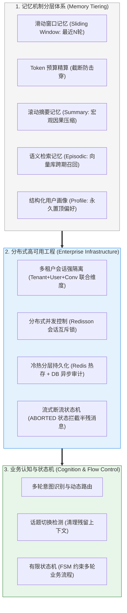

# 🎯 多轮对话与上下文工程：本章通关总结与复习

> [!abstract] 一句话总结
> 多轮对话工程的核心不是“无脑堆砌历史聊天”，而是**“深刻理解大模型无状态本质，依托分层记忆体系（画像/摘要/向量/窗口）动态精算 Token 预算，并通过分布式锁、鉴权隔离与状态机实现确定性企业级会话治理”**。

---

## 🗺️ 全章知识拓扑大一统

---

## 📊 核心模块关键结论总览

| 模块分层 | 核心攻坚问题 | 第一性原理关键结论 | 对应笔记精读 |
| :--- | :--- | :--- | :--- |
| **00 记忆本质** | 大模型是如何维持多轮上下文的？ | 大模型推理接口本身无状态，多轮记忆依赖宿主应用在每次请求时动态组装并传入历史上下文；全量堆砌会导致 Token 消耗随轮数急剧膨胀并引发注意力分散。 | [[00-多轮对话与记忆全景心智模型]] |
| **01 基础窗口** | 怎么保留短期代词指代（“它”、“刚才那个”）？ | Redis List 保留最近 $N$ 条（`LTRIM`）；必须按实际 Token 预算从最新消息向前裁剪，而非仅按消息条数截断。 | [[01-滑动窗口记忆]] [[02-Token窗口裁剪]] |
| **03 长程压缩** | 长周期多轮对话如何跨越上下文窗口限制？ | 滚动摘要由后台轻量小模型定期浓缩早期对话主线；向量检索记忆按语义相似度跨会话召回历史事实；结构化画像精确读写已确认的用户偏好与约束。 | [[03-摘要记忆]] [[04-语义检索记忆]] [[05-结构化记忆]] |
| **06 分层架构** | 四类记忆如何协同组装进单次 Prompt？ | 结构化画像与滚动摘要前置，语义召回片段居中，近期滑动窗口紧贴当前提问；**状态优先级：用户当前明确指令优先于历史画像偏好，系统安全与权限规则保持最高优先级**。 | [[06-分层记忆]] |
| **07 并发安全** | 用户连续点击或多节点并发如何保序与隔离？ | 采用 `tenant:user:conv` 联合命名空间隔离数据；Redisson 对 `conversationId` 加细粒度分布式锁；流式中断消息标记状态并确保工具调用配对完整。 | [[07-会话隔离与并发安全]] [[08-对话持久化]] |
| **11 流程控制** | 生成式模型如何执行严密的多步业务向导？ | 复杂表单与交易流程引入 **有限状态机（FSM）**：大模型负责意图分类与槽位抽取，状态机负责校验槽位完整性并决定状态转移。 | [[11-会话状态机]] |

---

## ⚡ 高频面试 10 连问

> [!important] 高频核心问题直击要害
>
> 1. **大模型的记忆机制底层原理是什么？为什么长会话不能直接保留全部历史？**
>    - 答：大模型在线推理过程不会改变模型参数权重，本身不具备跨请求的状态保存能力；所谓“多轮记忆”，是由宿主应用在每次调用时将历史对话重新拼接到 Prompt 中发送给模型。若不加裁剪地保留全量历史，第 $N$ 轮请求需携带前 $N-1$ 轮的全部 Token，累计输入 Token 消耗随对话轮数呈 $O(N^2)$ 阶数增长，同时长上下文中的陈旧噪声会拉高首字延迟（TTFT）并引发“迷失在中间”（Lost in the Middle）现象。
>
> 2. **按消息条数（如固定取最近 10 条）做滑动窗口有什么缺陷？如何正确设计？**
>    - 答：单条消息的长度方差极大（用户可能在一轮中粘贴数千字的代码或报错日志），仅限制消息条数仍可能导致总 Token 超出模型上下文窗口。正确做法是实施基于 Token 预算的滑动裁剪：以模型最大窗口为上限，先扣除 System Prompt、当前问题、检索片段、预留输出空间（`max_tokens`）及安全余量，再利用与目标模型匹配的 Tokenizer 从最新消息向前累加，并确保工具调用（`tool_calls` 与 `tool_result`）成对保留。
>
> 3. **滚动摘要记忆（Summary Memory）是如何实现的？它有什么优劣势？**
>    - 答：当会话轮数或累计 Token 达到阈值时，在后台异步调用轻量模型，基于旧摘要与新增未覆盖消息增量提炼出包含“核心目标、已确认约束、待办事项”的新版摘要，并在后续请求中替代早期原始消息。**优势**：以少量 Token 开销维持长会话的宏观因果连续性；**局限**：摘要压缩容易丢失具体数字、编码或精确细节，工程上常配合结构化画像与原文归档一起使用。
>
> 4. **分层记忆装配时，不同层级在 Prompt 中的组织顺序应如何排列？**
>    - 答：遵循“由稳定到动态、由宏观到局部”的组装顺序：
>      $$\text{System指令} \to \text{结构化用户画像} \to \text{当前会话滚动摘要} \to \text{语义向量召回片段} \to \text{近期短期滑动窗口} \to \text{当前用户输入}$$
>      这种布局使核心系统约束与最新用户提问分别位于模型注意力最集中的首尾两端。
>
> 5. **当长期的用户画像与用户当下的最新提问冲突时，系统如何在架构上处理？**
>    - 答：① **提示词优先级规则**：在 System 模板中明确声明“用户画像与历史记忆仅作背景参考，若与用户当前最新指令冲突，以当前最新输入为准”；② **异步状态更新**：当识别到用户明确修改偏好或约束时，通过后台异步任务或工具调用更新 Redis Hash 与数据库中的 Profile 字段，实现长期记忆的动态刷新。
>
> 6. **在微服务集群中，用户快速连续点击发送两条消息，后端如何防范并发覆盖导致历史错乱？**
>    - 答：采用基于 Redisson 的会话级分布式锁（锁 Key 细化至 `lock:chat:{tenantId}:{conversationId}`）。第一条消息到达后获取锁并执行上下文装配与生成，第二条并发请求在等待超时（如 1~2 秒）后快速失败并返回友好提示；对于高吞吐异步场景，可通过 Redis Stream 或 Kafka 将同一会话的消息路由至同一队列串行消费，并在落库时配合会话 `version` 乐观锁防止旧状态覆盖。
>
> 7. **在流式 SSE 输出过程中，用户点击“停止生成”或关闭网页，后端如何保证会话历史不被污染？**
>    - 答：引入消息流式状态机。在响应式流的 `.doOnCancel()` 回调中及时向上游传播取消信号并释放连接。数据库中将该条未完整生成的回复标记为 `status = 'INTERRUPTED'`（或 `ABORTED`），并在组装下一轮滑动窗口时按策略过滤残缺消息，同时严禁将未执行完毕的工具调用写入历史窗口。
>
> 8. **会话隔离的“联合命名空间”原则是什么？为什么只用 conversationId 存在安全隐患？**
>    - 答：在多租户 SaaS 体系下，若缓存 Key、数据库查询或向量检索仅使用 `conversationId` 过滤，一旦 ID 规律可预测或前端传参被篡改，极易引发跨用户或跨租户的水平越权泄漏。必须从服务端认证上下文（JWT / Session）中提取身份，强制采用 `tenantId + userId + conversationId` 联合维度进行缓存命名、数据库属主校验与 VectorStore 标量过滤。
>
> 9. **什么是话题切换检测（Topic Shift Detection）？它在上下文工程中有何价值？**
>    - 答：话题切换检测用于判断用户当前输入是在延续原任务、修改局部约束，还是开启了全新的无关任务。当检测到显著的话题切换时，系统可及时归档旧话题摘要并清空当前任务的临时槽位与滑动窗口，防止旧任务的约束条件与工具结果干扰新任务的推理生成。
>
> 10. **在严格的业务办理场景中（如金融分期、退改签办理），为什么需要引入会话状态机（FSM）？**
>     - 答：大语言模型本质是概率生成模型，若完全依赖 Prompt 引导长链路多步业务，容易出现跳过必填项校验、提前触发外部接口或陷入循环追问等问题。引入确定性的有限状态机（FSM）后，由代码严格掌控所处阶段与允许的状态转移（如：收集槽位 $\to$ 待用户确认 $\to$ 调用工具 $\to$ 完成），大模型仅负责语义理解、槽位提取与回复润色，从而保障核心业务流程的确定性与可控性。

---

## 🚨 生产落地十项工程规范

1. **按 Token 预算动态裁剪**：以目标模型上下文窗口为基准，优先扣除 System 指令与输出预留空间（`max_tokens`），按优先级与 Token 数量裁剪历史消息。
2. **身份参数强制服务端提取**：`tenantId` 与 `userId` 必须由网关或服务端从已认证的 JWT / Session 中提取，严禁直接信任前端请求体中的身份字段。
3. **分布式环境使用共享存储**：多实例部署时会话记忆必须存储于 Redis 或关系型数据库，避免使用单机内存导致负载均衡切换时丢失上下文。
4. **流式中断消息状态隔离**：异常中断或用户主动取消的流式回复需标记为 `INTERRUPTED`，防止残缺文本或未配对的工具调用污染下一轮上下文。
5. **会话级并发串行控制**：同一 `conversationId` 的写操作需挂载分布式会话锁或进入有序队列，配合数据库乐观锁版本号防止并发写覆盖。
6. **向量记忆强制注入租户过滤**：检索跨会话长期向量记忆时，必须下推当前用户的 `tenantId` 与 `userId` 标量过滤条件。
7. **严谨业务流由状态机驱动**：涉及资金、审批、订单修改等多步交互由有限状态机（FSM）控制状态流转，大模型专注意图识别与槽位抽取。
8. **实施冷热分层持久化**：活跃会话驻留 Redis 保障低延迟读写并配置合理 TTL，全量消息与状态变更异步持久化至关系型数据库供恢复与审计。
9. **明确当前输入优先原则**：在提示词与记忆合并逻辑中明确“用户当前最新指令优先于历史画像”，并建立偏好变更的异步回写机制。
10. **持久化单次请求上下文快照**：每次调用模型时记录实际传入的 `context_snapshot`（包含消息 ID 列表、摘要版本与召回记忆 ID），确保线上问题可精准复盘。

---

## 🔗 下一章通关衔接

掌握多轮对话与上下文工程后，接下来我们将从被动响应的对话系统跨入具备**自主规划、工具调用与环境交互能力的智能体（Agent）架构**：

👉 进入下一章：[[../05-Agent-MCP-Skills/_index|05 · Agent · MCP · Skills]]
- 从基础对话跃迁至具备“感知-规划-行动-反思”闭环的自主智能体（Agent）；
- ReAct 范式、Plan-and-Solve 任务拆解与 Reflection 自省机制；
- 工业级开放协议：**MCP（Model Context Protocol）** 架构解析与 Skills 扩展体系！
