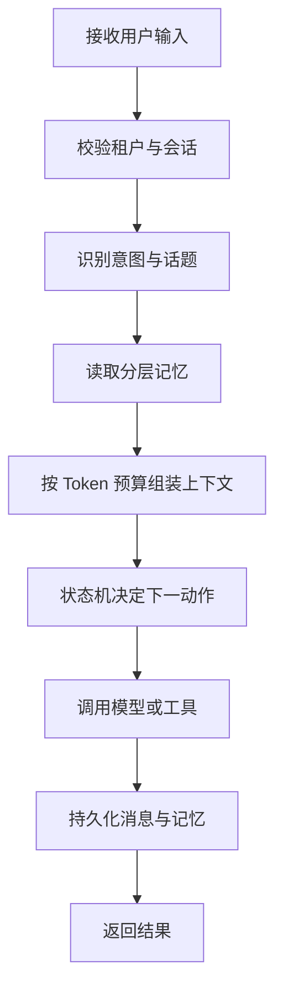

# 04 · 多轮对话与上下文工程 · 本章总结与复习

本章的主线是：先按信息生命周期设计分层记忆，再用隔离、持久化、意图识别、话题检测和状态机把多轮对话变成可控、可恢复、可测试的工程系统。

## 🎯 本节定位

- **本章总结与复习篇**，前置 [[01-滑动窗口记忆]] 至 [[11-会话状态机]] 全部 11 课，用于学完后串知识链路、自测查漏。
- **延伸阅读**：学完本章后进入 [[10-AI应用开发/05-Agent-MCP-Skills/_index|05 · Agent · MCP · Skills]]，把多轮记忆与状态控制扩展到 Agent 编排。

## 核心知识概览表

| 编号 | 核心主题 | 复习要点 |
| ---- | -------- | -------- |
| [[01-滑动窗口记忆]] | 短期上下文 | 保留最近 N 轮或 K 个 token，解决近期指代与连续追问。 |
| [[02-Token窗口裁剪]] | 上下文预算 | 为输出预留 token，并按系统约束、当前问题、工具结果和历史价值分配预算。 |
| [[03-摘要记忆]] | 会话压缩 | 将较早历史压缩为目标、约束、结论和待办，维持长对话连续性。 |
| [[04-语义检索记忆]] | 长期召回 | 将可复用事实向量化，按当前问题的语义相关性跨会话召回。 |
| [[05-结构化记忆]] | 精确事实 | 用字段保存预算、偏好、身份和任务状态，支持校验、覆盖与业务判断。 |
| [[06-分层记忆]] | 组合架构 | 协调短期窗口、摘要、结构化事实和长期向量记忆的存储与注入位置。 |
| [[07-会话隔离与并发安全]] | 状态安全 | 以租户、用户、会话和请求隔离数据，并控制同一会话的并发顺序。 |
| [[08-对话持久化]] | 恢复与审计 | 保存消息、上下文快照、模型调用和记忆变更，支撑恢复、排障与评测。 |
| [[09-意图识别]] | 对话路由 | 结合当前输入、最近上下文和会话状态，决定工具、记忆与后续流程。 |
| [[10-话题切换检测]] | 上下文边界 | 区分延续、局部修改和新话题，决定复用、重置摘要或新建会话。 |
| [[11-会话状态机]] | 流程控制 | 用状态、事件和动作约束追问、确认、工具调用、异常恢复与结束。 |

## 端到端流程

## 快速复习

1. 滑动窗口解决短期连续性，不能代替跨会话长期记忆。
2. Token 裁剪应按消息价值和角色分配预算，并提前预留输出空间。
3. 摘要保存会话状态，结构化记忆保存可校验事实，语义记忆保存可召回片段。
4. 分层记忆的关键不是多建几种存储，而是明确每层的写入、更新、召回和遗忘规则。
5. 所有 Redis、数据库和 VectorStore 查询都必须带租户、用户与会话边界。
6. 意图识别决定用户要做什么，话题切换检测判断是否仍属于同一任务。
7. 状态机负责确定性流程，LLM 负责理解与生成；消息快照和 trace 负责复盘。

## 自测问题

1. 为什么只保留最近十轮消息仍可能超过模型窗口？应如何修正？
2. 用户偏好、当前任务槽位、较早对话结论和最近三轮原文分别适合放在哪一层记忆？
3. 同一会话的两个请求并发到达时，如何避免状态乱序和旧回复覆盖新状态？
4. 意图识别、话题切换检测和会话状态机各自负责什么，它们如何协作？

## 下一章衔接

完成上下文与会话状态管理后，下一章 [[10-AI应用开发/05-Agent-MCP-Skills/_index|05 · Agent · MCP · Skills]] 会把模型从多轮回答扩展为能够规划、调用工具、加载程序化知识并接受权限治理的 Agent。分层记忆和状态机也会成为 Agent 编排、恢复与审计的基础。

## 相关编号双链

- 记忆基础：[[01-滑动窗口记忆]] → [[02-Token窗口裁剪]] → [[03-摘要记忆]] → [[04-语义检索记忆]] → [[05-结构化记忆]] → [[06-分层记忆]]
- 对话工程：[[07-会话隔离与并发安全]] → [[08-对话持久化]] → [[09-意图识别]] → [[10-话题切换检测]] → [[11-会话状态机]]
- 本章索引：[[_index|04 · 多轮对话与上下文工程]]
