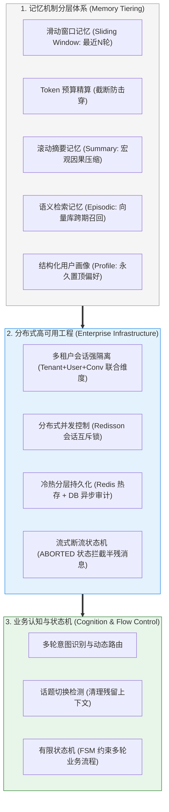

# 🎯 多轮对话与上下文工程：本章通关总结与复习

> [!abstract] 一句话总结
> 多轮对话工程的核心不是“无脑堆砌历史聊天”，而是**“深刻理解大模型无状态本质，依托分层记忆体系（画像/摘要/向量/窗口）动态精算 Token 预算，并通过分布式锁、鉴权隔离与状态机实现确定性企业级会话治理”**。

---

## 🗺️ 全章知识拓扑大一统

---

## 📊 核心模块关键结论总览

| 模块分层 | 核心攻坚问题 | 第一性原理关键结论 | 对应笔记精读 |
| :--- | :--- | :--- | :--- |
| **00 记忆本质** | 大模型到底是如何记住上下文的？ | 大模型请求后大脑彻底格式化；多轮记忆全靠宿主程序每轮把历史打包重新喂入；无脑堆砌会导致费用平方级暴增与注意力迷失。 | [[00-多轮对话与记忆全景心智模型]] |
| **01 基础窗口** | 怎么保留短期代词指代（“它”、“刚才那个”）？ | Redis List 保留最近 $N$ 条（`LTRIM`）；必须按实际 Token 物理预算从后向前裁剪，绝不能仅凭消息条数粗暴限制。 | [[01-滑动窗口记忆]] [[02-Token窗口裁剪]] |
| **03 长程压缩** | 几百轮长对话如何跨越上下文天花板？ | 滚动摘要让后台轻量小模型定期浓缩前情提要；向量检索记忆跨天召回；结构化画像永久固化偏好与禁忌。 | [[03-摘要记忆]] [[04-语义检索记忆]] [[05-结构化记忆]] |
| **06 分层架构** | 四种记忆混在一起如何优雅组装？ | 画像置顶在 System，摘要承上，召回片段居中，最近窗口启后；**裁决铁律：当前最新输入权重 > 窗口 > 摘要 > 画像**。 | [[06-分层记忆]] |
| **07 并发安全** | 用户双击连发或集群多节点并发如何保序？ | 联合维度 `tenant:user:conv` 隔离 Key；Redisson 对 `conversationId` 加细粒度分布式锁；未完成流式消息标 `ABORTED` 禁入窗口。 | [[07-会话隔离与并发安全]] [[08-对话持久化]] |
| **11 流程控制** | 自由发散的大模型如何走完严密的业务向导？ | 复杂表单办理（如贷款、开卡）必须引入 **有限状态机（FSM）**：大模型负责理解提取槽位，状态机负责决定当前状态能否流转到下一阶段。 | [[11-会话状态机]] |

---

## ⚡ 大厂面试 30 秒绝杀 10 连问

> [!important] 高频核心问题直击要害
>
> 1. **大模型的记忆机制底层原理是什么？为什么长会话不能无脑保留全部历史？**
>    - 答：大模型是纯粹无状态的自回归前向神经网络，跨 HTTP 请求不保留任何显存状态。多轮记忆本质是由服务端每次将历史对话序列化为上下文拼入 Prompt。无脑保留全部历史会导致三大生产灾难：① Token 费用呈 $O(N^2)$ 平方级膨胀；② 触发预填充延迟（TTFT）暴涨；③ 遭遇 Lost in the Middle 效应，使模型注意力严重稀释而产生幻觉。
>
> 2. **按消息条数（如固定取最近 10 条）做滑动窗口有什么致命缺陷？如何正确设计？**
>    - 答：消息条数与 Token 长度完全不成正比。如果用户在某一条中粘贴了一篇数万字的代码或长文档，哪怕只取 10 条也会瞬间撑爆模型上下文上限（Context Window Overflow）。正确设计必须基于 **Token 物理预算硬裁剪**：从最新一条消息向前累加真实的 Token 数（使用 JTokkit 精确计算），直到达到预设预算上限（如 4000 Token）为止，并永远为大模型最终输出预留充足配额。
>
> 3. **滚动摘要记忆（Summary Memory）是如何实现的？它有什么优劣势？**
>    - 答：当会话轮数或 Token 达到阈值时，在后台异步调用轻量小模型，将较早的历史消息提炼为一段包含“核心目标、已确认约束、待办事项”的前情提要，并在后续对话中替换掉原始长消息。**优势**：以极低 Token 消耗维持长程会话因果连续性；**劣势**：抽象总结必然会丢失具体数字、特殊编码或精确细节，需配合实体画像补足。
>
> 4. **分层记忆装配时，不同层级在 Prompt 中的组织顺序应如何排列？**
>    - 答：遵循“由宏观到微观、由稳定到易变”的黄金排序：
>      $$\text{System基石} \to \text{用户永久画像} \to \text{当前会话滚动摘要} \to \text{语义向量召回片段} \to \text{最近短期滑动窗口} \to \text{当前用户输入}$$
>      这种布局能够让固化偏好与最新提问分别处于注意力最敏感的首尾两端。
>
> 5. **当长期的用户画像与用户当下的最新提问冲突时，系统如何在架构上避免模型“认死理”？**
>    - 答：① **提示词优先级硬断言**：在 System 模板中明确声明：“用户画像与历史背景仅供参考，若与用户当下最新指令存在任何抵触，无条件以最新输入为绝对准绳”；② **状态反哺覆盖**：当识别到用户意图变更时，通过后台工具或消息队列异步更新 Redis 中的用户 Profile Hash 字段，完成记忆自愈。
>
> 6. **在微服务集群中，用户快速连续点击发送两条消息，后端如何防范并发覆盖导致历史错乱？**
>    - 答：采用基于 Redisson 的会话级分布式锁（锁 Key 细化至 `lock:chat:{tenantId}:{conversationId}`）。第一条消息到达后抢锁成功并执行生成，第二条并发请求在等待超时（如 1~2 秒）后直接被阻断并返回友好提示；对于高吞吐场景，可通过 Redis Stream 将消息推入有序队列，由单消费线程保证 FIFO 顺序执行。
>
> 7. **在流式 SSE 输出过程中，用户点击“停止生成”或关闭网页，后端如何保证会话历史不被污染？**
>    - 答：引入流式状态机。在 WebFlux / MVC 的 `.doOnCancel()` 回调中及时终止上游大模型调用。数据库中将该条未完整生成的回复标记为 `status = 'ABORTED'`，并在组装下一轮滑动窗口时严格过滤 `WHERE status = 'COMPLETED'`，坚决不让只吐出半句话的碎片消息进入下一轮上下文。
>
> 8. **会话隔离的“联合命名空间”原则是什么？为什么只用 conversationId 是极其危险的？**
>    - 答：在多租户 SaaS 体系下，`conversationId` 可能是递增 ID 或由客户端生成。如果存储 Key 和检索过滤仅凭 `conversationId`，攻击者只需遍历 ID 或通过水平越权漏洞就能偷窥甚至篡改其他企业或用户的私密聊天记录。必须强制采用 `tenantId + userId + conversationId` 三位一体联合维度进行所有 Redis Key、数据库行与 Vector 标量的硬隔离。
>
> 9. **什么是话题切换检测（Topic Shift Detection）？它在上下文工程中有何价值？**
>    - 答：话题切换检测是判断用户当前提问是否与前文任务脱钩的技术。价值在于：当用户明确说“换个话题”或突然询问完全不相干的事物时，系统能主动重置短期滑动窗口或开启全新上下文，彻底清除前序业务残留的干扰与噪音，避免模型在新任务中继续带着旧包袱自作多情。
>
> 10. **在严格的业务办理场景中（如信用卡分期、退票退款），为什么不能完全依赖大模型做多轮引导，而必须引入会话状态机（FSM）？**
>     - 答：大模型是概率自回归模型，不具备强逻辑保证，在复杂的业务状态流转中容易发生跳步、死循环追问、未收齐必要参数就提前确认等致命失误。必须实施**“外紧内松”架构**：由确定性的有限状态机（FSM）牢牢掌控业务阶段（如：身份验证 $\to$ 方案推荐 $\to$ 费用告知 $\to$ 用户授权 $\to$ 扣款落地），大模型仅作为“意图理解与槽位提取器”向状态机喂入数据，状态机核准后才放行进入下一阶段。

---

## 🚨 生产落地十诫（Architectural Commandments）

1. **一戒无脑全量堆叠历史**：严格实施 Token 物理预算滑动窗口，永远为大模型生成留足至少 1000~2000 Token 净空。
2. **二戒信任前端传递的 userId**：多租户身份与用户 ID 必须由网关从加密 JWT/Session 中提取，坚决杜绝水平越权。
3. **三戒单实例内存承载生产会话**：分布式环境下多轮会话存储必须使用 Redis 集群或数据库，单机 InMemory 必将导致串台与丢失。
4. **四戒半残流式消息进上下文**：异常中断或用户主动取消的 Assistant 回答必须标记为 `ABORTED`，绝对不能塞入下一轮历史。
5. **五戒同一会话裸奔无并发锁**：同一 `conversationId` 必须挂载分布式互斥锁或顺序队列，严惩多端并发写冲突。
6. **六戒向量检索记忆漏加租户过滤**：多轮长期记忆召回时，VectorStore 必须硬编码当前用户的 `tenantId` 与 `userId` 标量过滤。
7. **七戒大模型全权掌控严肃业务流**：金融转账、保险核保等多轮交互必须由有限状态机（FSM）硬控制流转，大模型只做槽位抽取。
8. **八戒全量历史无冷热分层存储**：活跃会话放 Redis（配 TTL 自动回收），全量明细异步持久化 MySQL/ES 供追溯与审计。
9. **九戒忽视长期画像与当下指令冲突**：提示词中必须明确“当下最新指令优先权”，并建立偏好动态覆盖闭环。
10. **十戒不记单次请求上下文快照**：每次调用大模型前，必须对最终拼装的完整 Prompt 记录 Trace 快照，否则线上答错时根本无法复盘推责。

---

## 🔗 下一章通关衔接

你已经掌握了多轮长程对话的顶尖上下文工程治理！接下来我们将从**“只会对话的聊天顾问”**正式跨入能够**“自主规划、调用现实工具、替人类干活的数字员工”**时代：

👉 进入下一章：[[10-AI应用开发/05-Agent-MCP-Skills/_index|05 · Agent · MCP · Skills]]
- 从 Chatbot 跃迁到具备“感知-规划-行动-反思”闭环的自主智能体（Agent）；
- ReAct 范式、Plan-and-Solve 任务拆解与 Reflection 自省机制；
- Anthropic 掀起的工业级开放协议：**MCP（Model Context Protocol）** 深度实战与 Skills 扩展体系！
