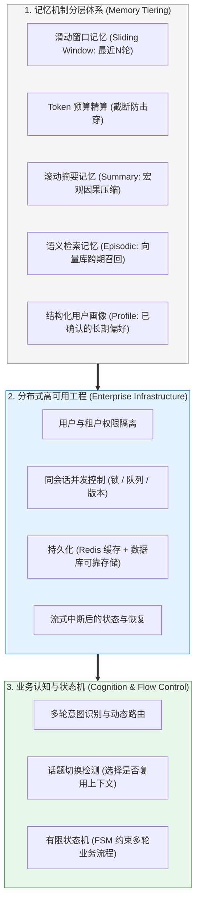

# 🎯 多轮对话与上下文工程：本章通关总结与复习

> [!abstract] 一句话总结
> 多轮对话需要选择并提供相关历史，管理上下文预算，同时处理记忆更新、用户隔离、并发和会话恢复。

---

## 🗺️ 全章知识拓扑大一统

---

## 📊 核心模块关键结论总览

| 模块 | 要解决的问题 | 关键结论 | 对应笔记 |
| :--- | :--- | :--- | :--- |
| **00 记忆本质** | 大模型是如何维持多轮上下文的？ | 多轮记忆需要由应用维护历史，或通过服务提供的会话机制保持上下文；全量堆砌会导致 Token 消耗随轮数急剧膨胀并引发注意力分散。 | [[00-多轮对话与记忆全景心智模型]] |
| **01 基础窗口** | 怎么保留短期代词指代（“它”、“刚才那个”）？ | Redis List 保留最近 $N$ 条（`LTRIM`）；必须按实际 Token 预算从最新消息向前裁剪，而非仅按消息条数截断。 | [[01-滑动窗口记忆]] [[02-Token窗口裁剪]] |
| **03 长程压缩** | 长周期多轮对话如何跨越上下文窗口限制？ | 滚动摘要由后台轻量小模型定期浓缩早期对话主线；向量检索记忆按语义相似度跨会话召回历史事实；结构化画像精确读写已确认的用户偏好与约束。 | [[03-摘要记忆]] [[04-语义检索记忆]] [[05-结构化记忆]] |
| **06 分层架构** | 四类记忆如何协同组装进单次 Prompt？ | 根据任务和预算选择画像、摘要、召回片段和近期消息；历史记忆只能作为参考，系统安全与服务端权限规则仍需遵守。 | [[06-分层记忆]] |
| **07 并发安全** | 用户连续点击或多节点并发如何保序与隔离？ | 服务端校验用户对会话的访问权限；根据需要采用队列、锁或版本检查处理并发；中断消息记录状态并保持工具调用配对。 | [[07-会话隔离与并发安全]] [[08-对话持久化]] |
| **11 流程控制** | 生成式模型如何执行严密的多步业务向导？ | 复杂表单与交易流程引入 **有限状态机（FSM）**：大模型负责意图分类与槽位抽取，状态机负责校验槽位完整性并决定状态转移。 | [[11-会话状态机]] |

---

## ⚡ 高频面试 10 连问

> [!question]- 1. 大模型的记忆机制底层原理是什么？为什么长会话不能直接保留全部历史？
> 模型推理通常不会因一次对话直接更新权重；多轮上下文可由应用自己组装，也可由服务提供的会话机制保存。假设每轮增加相近数量的内容且每次都重传全部历史，累计输入量会随轮数近似按 $O(N^2)$ 增长。长上下文还可能增加延迟或干扰回答，实际效果取决于模型、内容和缓存方式。

> [!question]- 2. 按消息条数（如固定取最近 10 条）做滑动窗口有什么缺陷？如何正确设计？
> 单条消息的长度方差极大（用户可能在一轮中粘贴数千字的代码或报错日志），仅限制消息条数仍可能导致总 Token 超出模型上下文窗口。正确做法是实施基于 Token 预算的滑动裁剪：以模型最大窗口为上限，先扣除 System Prompt、当前问题、检索片段、预留输出空间（`max_tokens`）及安全余量，再利用与目标模型匹配的 Tokenizer 从最新消息向前累加，并确保工具调用（`tool_calls` 与 `tool_result`）成对保留。

> [!question]- 3. 滚动摘要记忆（Summary Memory）是如何实现的？它有什么优劣势？
> 当会话轮数或累计 Token 达到阈值时，在后台异步调用轻量模型，基于旧摘要与新增未覆盖消息增量提炼出包含“核心目标、已确认约束、待办事项”的新版摘要，并在后续请求中替代早期原始消息。**优势**：以少量 Token 开销维持长会话的宏观因果连续性；**局限**：摘要压缩容易丢失具体数字、编码或精确细节，工程上常配合结构化画像与原文归档一起使用。

> [!question]- 4. 分层记忆装配时，不同层级在 Prompt 中的组织顺序应如何排列？
> 下面是一种可以测试的组装顺序：
> $$\text{System指令} \to \text{结构化用户画像} \to \text{当前会话滚动摘要} \to \text{语义向量召回片段} \to \text{近期短期滑动窗口} \to \text{当前用户输入}$$
> 这是一种组织方案，不是唯一正确顺序；不同模型和任务的表现需要评测。历史摘要和用户画像属于背景资料，不能升级成系统指令。

> [!question]- 5. 当长期的用户画像与用户当下的最新提问冲突时，系统如何在架构上处理？
> 历史记忆只是参考资料；用户的新要求可能只对当前任务有效，不能自动视为长期偏好变更。明确需要更新时，按照产品规则确认并更新存储；系统规则和服务端权限仍然生效。

> [!question]- 6. 在微服务集群中，用户快速连续点击发送两条消息，后端如何防范并发覆盖导致历史错乱？
> 可以按会话排队，或使用会话锁并结合状态版本检查，避免旧请求覆盖新状态。锁可能过期，队列也可能重复消费；工具调用等副作用还需独立处理授权、幂等和执行状态。

> [!question]- 7. 在流式 SSE 输出过程中，用户点击“停止生成”或关闭网页，后端如何保证会话历史不被污染？
> 取消时向上游传播取消信号，并把未完成的回复标记为 `INTERRUPTED` 或其他明确状态。下一轮按产品策略决定是否提供部分回复；工具调用和结果应保持配对，执行记录可以单独保留用于恢复与审计。

> [!question]- 8. 会话隔离的“联合命名空间”原则是什么？为什么只用 conversationId 存在安全隐患？
> 仅凭 `conversationId` 查历史无法证明访问者有权读取。服务端应从认证上下文取得身份，并按资源的租户、用户和共享范围校验访问权限；缓存键和向量检索过滤也要与这套权限规则一致。

> [!question]- 9. 什么是话题切换检测（Topic Shift Detection）？它在上下文工程中有何价值？
> 话题切换检测用于判断用户当前输入是在延续原任务、修改局部约束，还是开启了全新的无关任务。当检测到显著的话题切换时，系统可归档旧任务状态，新任务使用独立槽位并按需选择历史；是否保留窗口和旧状态要看恢复需求，不能把话题切换直接视为删除历史。

> [!question]- 10. 在严格的业务办理场景中（如金融分期、退改签办理），为什么需要引入会话状态机（FSM）？
> 大语言模型本质是概率生成模型，若完全依赖 Prompt 引导长链路多步业务，容易出现跳过必填项校验、提前触发外部接口或陷入循环追问等问题。引入确定性的有限状态机（FSM）后，由代码严格掌控所处阶段与允许的状态转移（如：收集槽位 $\to$ 待用户确认 $\to$ 调用工具 $\to$ 完成），大模型仅负责语义理解、槽位提取与回复润色，从而保障核心业务流程的确定性与可控性。

---

## 🚨 生产落地十项工程规范

1. 为系统指令、当前问题和输出预留 Token，再按任务选择历史消息。
2. 从服务端认证信息获取用户身份，校验其对会话和资料的访问权限。
3. 多实例部署时选择适合的共享存储，避免切换实例后丢失所需历史。
4. 标记中断的流式回复，按策略处理部分内容和未完成的工具调用。
5. 根据并发需求使用会话队列、锁或版本检查，并处理超时和重复请求。
6. 检索长期记忆时按实际授权范围过滤租户、用户及其他资源条件。
7. 对资金、审批等多步流程，使用代码校验状态、权限和可执行动作。
8. 消息与状态变更应可靠落库；异步更新缓存时还要处理重试和对账。
9. 区分本次用户要求和长期偏好变更，不能让历史偏好覆盖当前明确要求。
10. 按需要记录消息 ID、摘要版本和召回来源，便于复盘一次模型调用。

---

## 🔗 下一章通关衔接

继续阅读 [[../05-Agent-MCP-Skills/_index|Agent、MCP 与 Skills]]，了解工具调用、任务规划和智能体的上下文管理。
