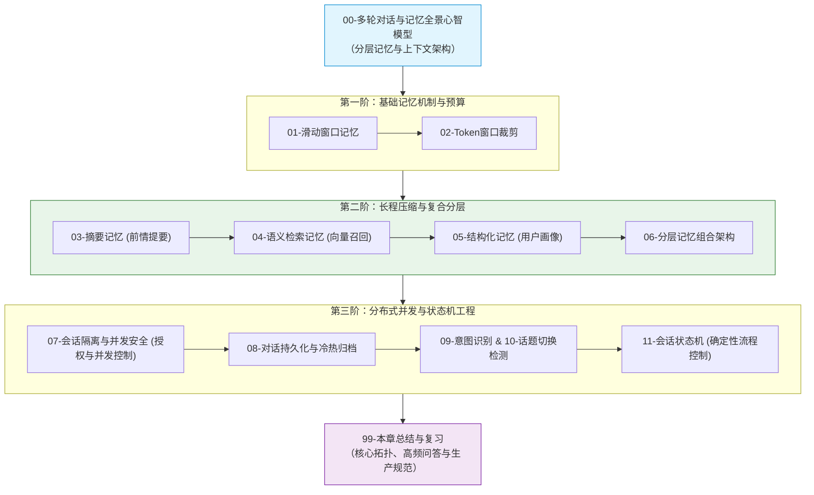

# 💬 04 · 多轮对话与上下文工程

> [!info] 本区说明
> 本章介绍多轮对话如何选择历史、管理 Token 预算，以及如何处理记忆更新、会话隔离、并发和状态流转。

---

## 🗺️ 通关全景学习路线

---

## 📚 知识笔记清单

### 00 · 全景心智

- [ ] [[00-多轮对话与记忆全景心智模型]] 🌟（会话上下文、各类记忆及组合边界）

### 01 · 基础记忆与预算

- [ ] [[01-滑动窗口记忆]]（Redis List、最近 N 轮消息与代词指代保留）
- [ ] [[02-Token窗口裁剪]]（按角色与价值分配 Token 预算，预留输出空间）

### 02 · 压缩与复合分层

- [ ] [[03-摘要记忆]]（压缩较早历史，并记录摘要覆盖范围）
- [ ] [[04-语义检索记忆]]（按权限召回需要长期保存的事实）
- [ ] [[05-结构化记忆]]（用户偏好、标签、槽位状态精确读写）
- [ ] [[06-分层记忆]]（按任务和预算组合窗口、摘要、结构化事实与检索记忆）

### 03 · 并发控制与会话状态机

- [ ] [[07-会话隔离与并发安全]]（用户与会话授权、并发控制和流式中断）
- [ ] [[08-对话持久化]]（Redis 热缓存 + MySQL 冷归档与审计快照）
- [ ] [[09-意图识别]]（动态路由、工具挂载与分支判断）
- [ ] [[10-话题切换检测]]（上下文边界识别、防前文残留污染）
- [ ] [[11-会话状态机]]（用有限状态机 FSM 约束复杂业务向导）

### 99 · 本章通关总结

- [ ] [[99-本章总结与复习]]（全章核心拓扑、高频面试 10 连问、生产落地规范）

---

## 🔗 相关链接

- 上级总览：[[../00-总览/学习仪表盘]]
- 前置章节：[[../03-知识库技术-RAG/_index|03 · 知识库技术：RAG]]
- 下一章节：[[../05-Agent-MCP-Skills/_index|05 · Agent · MCP · Skills]]
