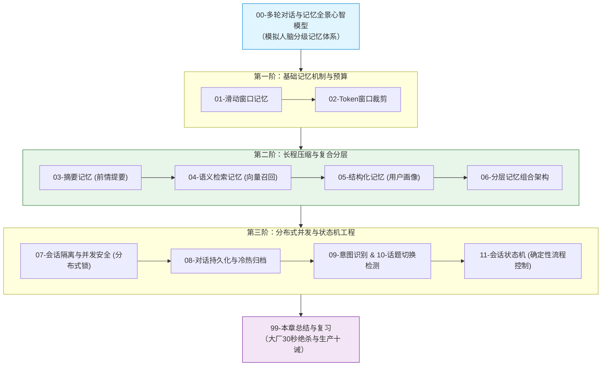

# 💬 04 · 多轮对话与上下文工程

> [!info] 本区说明
> 对应学习路径 **阶段四**。系统攻坚大模型在企业长会话、复杂业务交互中的状态治理：从滑动窗口、Token 预算、滚动摘要到分层记忆，从多租户并发安全到会话状态机。

---

## 🗺️ 通关全景学习路线

---

## 📚 知识笔记清单

### 00 · 全景心智
- [[00-多轮对话与记忆全景心智模型]] 🌟（大模型无状态本质、存储分级映射与五阶演进全景）

### 01 · 基础记忆与预算
- [[01-滑动窗口记忆]]（Redis List、最近 N 轮消息与代词指代保留）
- [[02-Token窗口裁剪]]（按角色与价值分配 Token 预算，预留输出空间）

### 02 · 压缩与复合分层
- [[03-摘要记忆]]（异步小模型提炼长对话摘要，保持宏观因果）
- [[04-语义检索记忆]]（对话片段入向量库，跨天跨月按意图召回）
- [[05-结构化记忆]]（用户偏好、标签、槽位状态精确读写）
- [[06-分层记忆]]（四层多宝盒：画像置顶 + 摘要承前 + 向量兜底 + 窗口启后）

### 03 · 并发控制与会话状态机
- [[07-会话隔离与并发安全]]（联合维度隔离、Redisson 会话锁与流式断流状态机）
- [[08-对话持久化]]（Redis 热缓存 + MySQL 冷归档与审计快照）
- [[09-意图识别]]（动态路由、工具挂载与分支判断）
- [[10-话题切换检测]]（上下文边界识别、防前文残留污染）
- [[11-会话状态机]]（用有限状态机 FSM 约束复杂业务向导）

### 99 · 本章通关总结
- [[99-本章总结与复习]]（全章核心拓扑、大厂 30 秒必杀 10 连问、生产落地十诫）

---

## 🔗 相关链接

- 上级总览：[[10-AI应用开发/00-总览/学习仪表盘]]
- 前置章节：[[10-AI应用开发/03-知识库技术-RAG/_index|03 · 知识库技术：RAG]]
- 下一章节：[[10-AI应用开发/05-Agent-MCP-Skills/_index|05 · Agent · MCP · Skills]]
