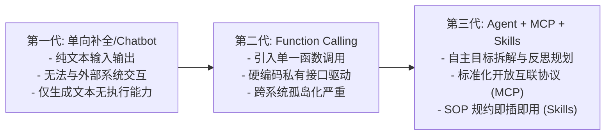
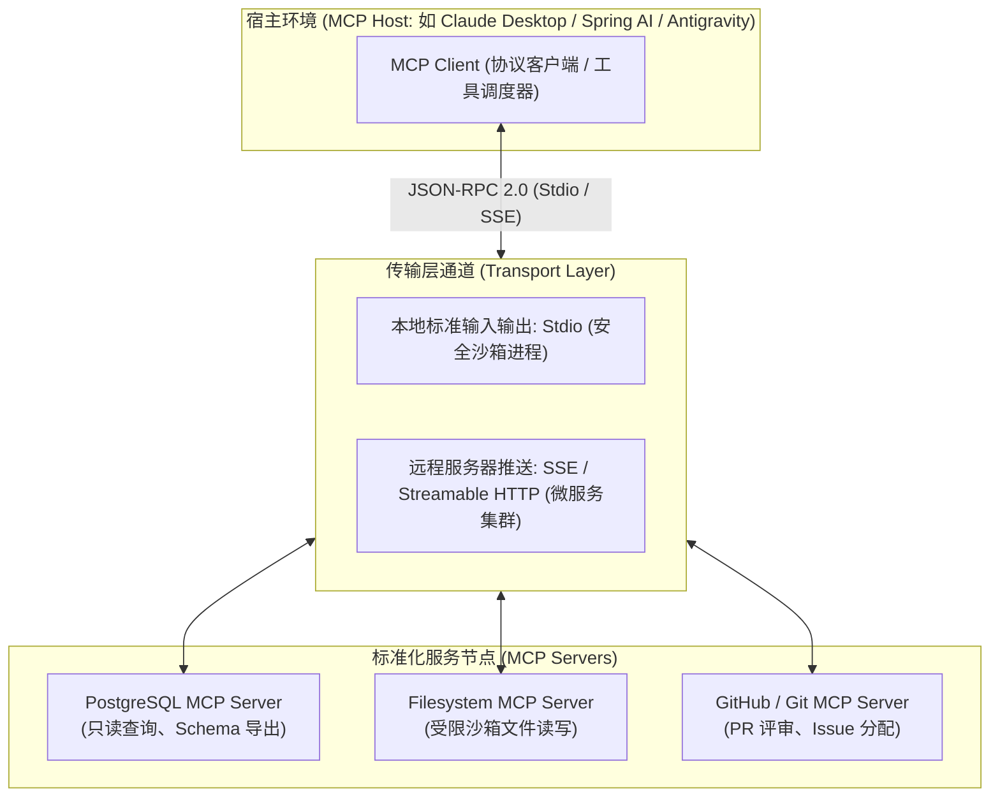
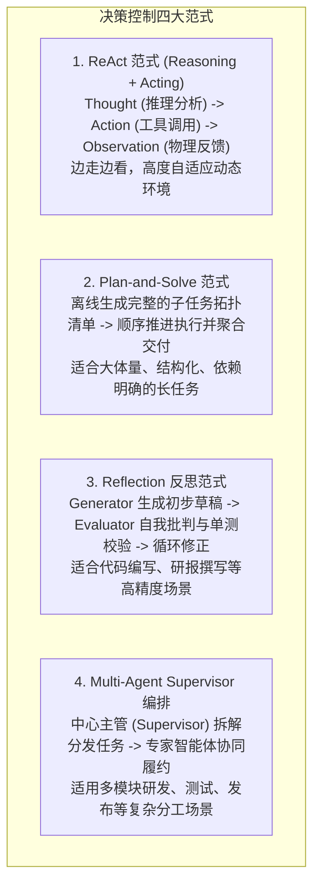
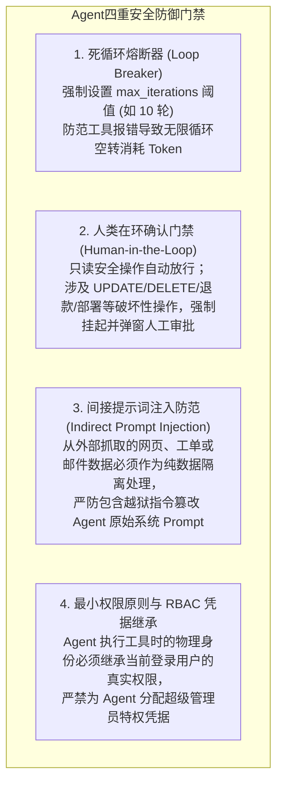

# 00 · Agent、MCP 与 Skills 全景心智模型与技术架构体系

> **导读**：大语言模型（LLM）的应用形态正在经历从“文本补全与单向问答”向“自主环境交互与确定性业务闭环”的演进。单纯的提示词工程与单轮 Function Calling 难以应对跨系统异构集成与复杂长链路业务。以自主智能体（Agent）为决策与调度核心，以模型上下文协议（MCP）为标准化开放通信协议，以专业技能包（Skills）为领域标准化作业程序（SOP），共同构成了现代 AI 应用工程化的核心架构体系。本文拆解这三大核心模块的架构边界、决策循环时序、安全治理机制与工程落地模式。

---

## 一、自主智能体（Agent）范式演进与核心定义

### 1. 范式演进路径
在工业级 AI 应用探索中，系统形态经历了三次关键代际跃迁：



### 2. 现代 Agent 系统的四大核心技术支柱
根据认知计算与自主系统模型，一个完备的工业级 Agent 系统包含四大有机模块：
1. **规划引擎（Planning）**：负责将高抽象层级的业务目标（Goal）拆解为具备时序依赖关系的子任务图，并在执行异常时执行动态自纠错与重规划；
2. **记忆体系（Memory）**：包含当前会话窗口的工作记忆（Working Memory）与基于向量数据库或知识图谱的长期情景记忆（Episodic / Semantic Memory）；
3. **工具与行动接口（Action / Tools）**：通过标准化网络总线调用外部计算资源、数据库、操作系统命令或三方 SaaS API；
4. **反思与验证（Reflection & Evaluation）**：在交付最终产物前，对中间推理结果与工具执行反馈执行合规校验（Self-Correction 与质量门禁）。

---

## 二、模型上下文协议（MCP）架构与通信规范

在 Anthropic 推出 **MCP（Model Context Protocol）** 之前，每个 Agent 框架与宿主工具均采用私有协议对接各类外部系统，工具链生态呈现严重的 $M \times N$ 笛卡尔积碎片化。

### 1. 架构拓扑：Client-Host-Server 模型
MCP 构建在 **JSON-RPC 2.0** 协议之上，提供了开放的、跨语言的标准化客户端/服务器通信规范：



### 2. MCP 协议的三大核心原语

| 协议原语 | 语义定义 | 交互模式 | 核心技术价值 |
| :--- | :--- | :--- | :--- |
| **Resources（资源）** | 只读的上下文数据载体（类似于 REST API 的 GET 语义），代表文件、数据库表元数据、日志等静态或动态内容。 | Client 通过 URI（如 `postgres://db/table`）主动订阅或读取。 | 为大模型提供零计算副作用的高效背景知识装载通道。 |
| **Prompts（提示词模板）** | 由 Server 端集中维护的参数化交互模板和专业指令集。 | Client 动态拉取模板并填充用户入参。 | 统一管理特定业务场景的最佳实践提示词，降低客户端硬编码成本。 |
| **Tools（工具调用）** | 具备物理副作用的可执行函数接口（类似于 POST/PUT 语义），由模型自主决定何时调用并传入参数。 | Client 请求调用，Server 运行物理指令并回传结构化结果。 | 赋予 Agent 真实的外部世界读写能力（查询数据库、执行部署、发送消息）。 |

---

## 三、Skills 领域专业技能包工程标准

如果说 **MCP 解决了外部数据源与工具能力的标准化通信接入**，那么 **Skills 解决的则是面向特定垂直领域的专业方法论与标准化作业程序（SOP）封装**。

### 1. Skills 的目录组织与规范标准
在 Antigravity 及现代 Agent 工程规范中，一个标准的 Skill 采用轻量化、高可移植性的文件结构组织：

```text
my-domain-skill/
├── SKILL.md              # 核心规约入口：YAML Frontmatter 元数据 + 角色指令 + 推理策略
├── scripts/              # 辅助自动化脚本：包含确定性代码、数据清洗器或高频批处理脚本
├── references/           # 领域参考规约：包含行业规范、API Schema、反模式错误清单
└── examples/             # 标杆示例（Few-Shot）：正向履约样例与负向避坑对照
```

### 2. MCP 与 Skills 的分工协作关系

| 维度 | MCP（Model Context Protocol） | Skills（领域专业技能包） |
| :--- | :--- | :--- |
| **定位范畴** | 通信协议标准、物理 API 暴露规范 | 业务方法论、上下文引导、SOP 流程规约 |
| **关注核心** | “**怎么连**”：连接鉴权、入参校验、JSON-RPC 数据传输 | “**怎么做**”：业务决策顺序、质检标准、边界防范 |
| **运行时态** | 独立的后台服务进程（MCP Server） | 注入 Agent 上下文的结构化资源与执行逻辑 |
| **协同形态** | 提供原始工具（如：提供一个执行 SQL 的函数接口） | 规范工具使用（如：规定必须先 EXPLAIN、严禁全表扫描、给出索引建议） |

---

## 四、Agent 核心决策控制流演进

在 Agent 内部，控制循环编排着推理（Reasoning）与行动（Acting）的协同。业界演进出了四大核心决策范式：



---

## 五、工业级落地四大控制红线：安全、权限、成本与死循环

赋予大模型自主调用外部工具的权力，必然伴随系统脆弱性与安全隐患。企业级落地必须建立严格的防御门禁：



---

### 场景演示：线上慢查询自主排障

- **排障调度核心（Agent 决策控制）**：接收“排查近 1 小时慢查询”目标，启动 ReAct 循环分解执行步骤；
- **数据库与服务通信通道（模型上下文协议 MCP）**：通过 MySQL MCP Server 调用 `query_slow_logs` 抓取慢 SQL，无需硬编码私有连接驱动；
- **数据库慢查询调优规范（领域专业技能包 Skills）**：加载 `db-slowquery-tuner` 技能包，依据规范先执行 `EXPLAIN` 分析执行计划，避免盲目修改索引；
- **动态排查与验证（ReAct 循环：Thought-Action-Observation）**：分析索引需求 $\to$ 调用命令查看 Extra 字段 $\to$ 观察反馈定位全表扫描；
- **生成 DDL 提交人工审批（人类在环门禁 Human-in-the-Loop）**：因涉及写操作，系统挂起执行并推送审批，人工确认后方可落地。

---

## 🧭 下一步

在全面建立 Agent、MCP 与 Skills 的架构全景认知后，我们需要深入代码与算法层面，剖析 Agent 内部是如何基于 Prompt 格式化驱动大模型输出结构化 Tool Calls 的。
从 Function Calling 的底层原理到常用设计模式，具体如何工程化落地？
请进入下一篇核心专题：[[01-Agent设计模式详解]]！
