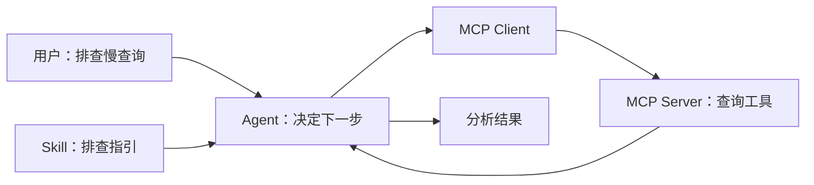

# 🗺️ Agent、MCP 与 Skills 全景

> [!abstract] 一句话理解
> Agent 根据目标和执行结果决定下一步；MCP 为应用连接外部能力提供统一协议；Skill 把特定任务的做法整理成可按需使用的指引。

## 🎯 从一次慢查询排查说起

假设用户提出：“帮我排查订单服务最近的慢查询。”我们希望系统能先查日志，根据查到的 SQL 再决定是否查看执行计划，最后给出分析结果。这时三者各有分工：
- Agent 负责判断当前要做什么，比如先查询慢日志，看到可疑 SQL 后再分析执行计划。
- MCP Server 可以提供查询慢日志、查看执行计划等工具；应用通过 MCP Client 发现和调用这些工具。
- 慢查询 Skill 可以告诉 Agent 先关注哪些指标、如何整理结论，以及遇到修改索引的建议时要注意什么。

它们不是绑定关系：Agent 可以直接调用应用提供的工具，不一定经过 MCP；没有 Skill 也可以完成任务。Skill 是给模型或应用使用的任务指引，是否支持按需加载，取决于使用它的系统。

## ⚙️ 一次工具调用是怎样发生的？

接着上面的例子，假设模型决定查询订单服务的慢日志。模型不会因为写出工具名就直接访问数据库，真正的调用由应用负责：
1. 应用把用户问题、可用工具及其参数说明提供给模型。
2. 模型返回一个工具调用请求，例如 `querySlowLog(service="order")`。
3. 应用检查请求，并调用对应工具；如果工具来自 MCP Server，就通过 Client 发送调用。
4. 工具返回查询结果，应用把结果交给模型；模型再决定继续查询还是回答用户。

例如，日志里发现一条耗时很长的 SQL，模型可能接着请求查看执行计划；如果没有发现可疑记录，也可能说明当前证据不足。工具结果和模型结论都需要结合实际情况核验。

> [!question]- 工具调用和 MCP 是一回事吗？
> 不是。工具调用描述模型提出调用请求、应用执行并回传结果的过程；MCP 解决应用与外部 Server 之间如何发现和调用能力的问题。应用也可以不使用 MCP，直接调用本地工具或自己的服务。

## 🧩 三者分工

| 概念 | 解决什么问题 | 要注意什么 |
| :--- | :--- | :--- |
| Agent | 根据目标和反馈选择行动、组织结果 | 选择和结论不一定正确，需要验证 |
| MCP | 让 Host / Client 与 Server 按协议交换能力和数据 | 协议不代替业务授权和租户隔离 |
| Skill | 提供特定任务的步骤、约定和相关资源 | 指引不等于工具权限，也不是强制执行的安全策略 |

MCP Server 可以提供 Tools、Resources 和 Prompts，实际能用哪些取决于 Server 和客户端的支持，详见 [[09-MCP协议详解]]。固定流程也可以按顺序调用工具；Agent 的侧重点是根据目标及中间结果选择后续行动，二者在实际系统中也可以组合。

## 🧭 Agent 还能怎样组织任务？

简单任务可以直接调用工具；复杂任务则可以选择不同的组织方式，具体取决于任务是否需要动态决策、规划或分工。
- [[03-ReAct-Spring-AI实现|ReAct]]：根据每次工具返回的结果调整下一步。
- [[04-Plan-and-Execute-实现|Plan-and-Execute]]：先拆解计划，再逐步执行。
- [[06-Multi-Agent-Supervisor实现|多 Agent]]：让不同角色分工，由协调者汇总。

## 🛡️ 运行时需要守住什么？

慢查询分析可能只需要读取日志，但“修改数据库索引”会改变生产环境。是否允许执行，应由服务端根据可信身份、对象和业务规则判断；高风险操作还可能需要审批。外部文档和工具返回内容也可能包含误导性指令，不能因为它们进入了上下文就直接信任。权限和安全问题分别见 [[21-Agent权限治理与分级自治]]、[[20-Agent安全与防注入]]。

> [!question]- 有了 Skill 和 MCP Server，为什么仍需要服务端鉴权？
> Skill 提供做事指引，MCP 负责通信，都不能代替业务服务判断当前用户能否读取或修改某个对象。

## 🔗 关联与资料

- [[01-Agent设计模式详解]]、[[02-Tool-Use工具调用-代码实践]]、[[09-MCP协议详解]]、[[13-Skills详解]]
- [MCP 架构](https://modelcontextprotocol.io/docs/learn/architecture)；[Agent Skills 规范](https://agentskills.io/specification)
