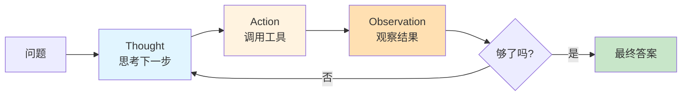
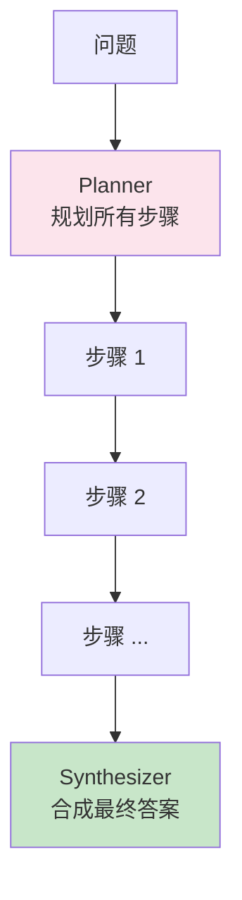
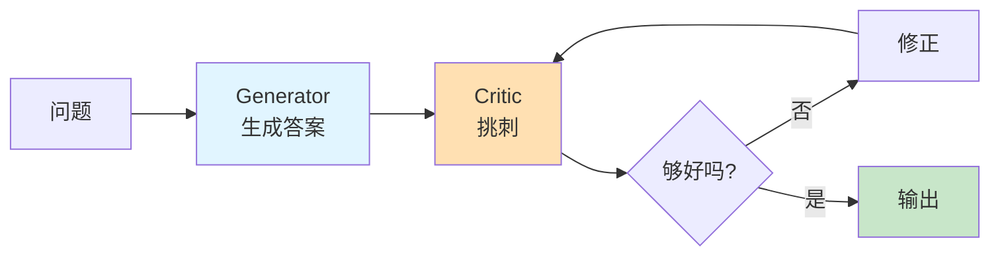
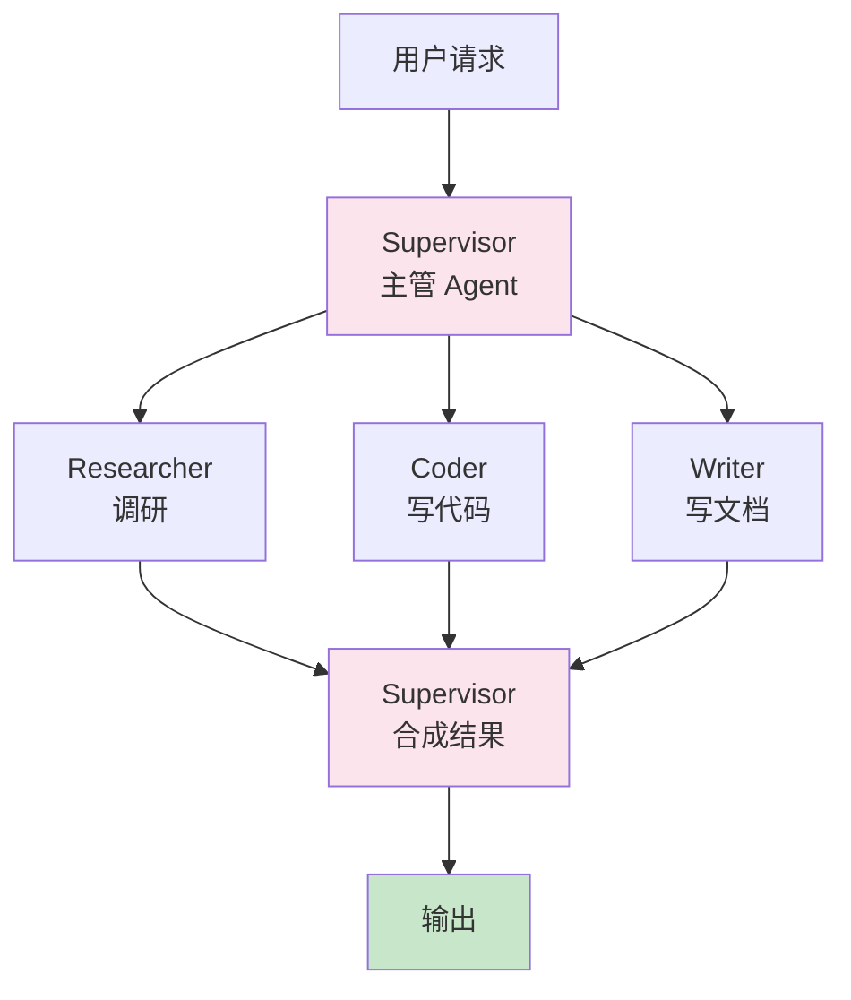
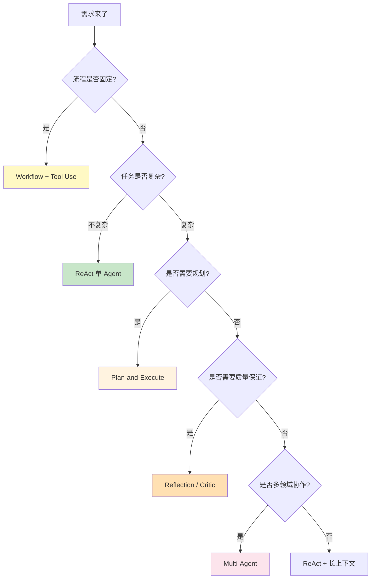

# 🤖 Agent 设计模式详解

> [!abstract] 一句话总结
> Agent 让 LLM 不只是"回答"，而是能 **思考 → 调用工具 → 观察结果 → 自我修正 → 协作**，自主完成复杂任务。本文讲清所有主流设计模式及选型。

## 📌 这是什么

**AI Agent（智能体）** = LLM（大脑） + 工具（手脚） + 记忆（经验） + 编排逻辑（决策流程）。

普通 LLM 调用是「一问一答」；Agent 是「给定目标，自己规划步骤、调用工具、循环执行直到完成」。

## 🤔 解决什么问题

| 普通 LLM 调用     | Agent      |
| ------------- | ---------- |
| 一次问答，无法获取实时数据 | 能调工具查实时数据  |
| 不能执行多步任务      | 能拆解并逐步执行   |
| 出错无法纠正        | 能观察结果并自我修正 |
| 单一视角          | 能多角色协作     |

---

## 🧩 七大设计模式总览

| 模式 | 中文 | 一句话核心 | 复杂度 | 学习优先级 |
| ---- | ---- | ---------- | ------ | ---------- |
| **Tool Use** | 工具调用 | LLM 调用你定义的函数 | ⭐ | ⭐⭐⭐⭐⭐ |
| **ReAct** | 推理-行动 | Thought → Action → Observation 循环 | ⭐⭐ | ⭐⭐⭐⭐⭐ |
| **Plan-and-Execute** | 先规划后执行 | 先列计划，再逐步执行 | ⭐⭐⭐ | ⭐⭐⭐⭐⭐ |
| **Reflection** | 反思 | 输出后自检并修正 | ⭐⭐⭐ | ⭐⭐⭐⭐ |
| **Reflexion** | 强化反思 | 反思 + 持久化记忆 + 重试 | ⭐⭐⭐⭐ | ⭐⭐⭐ |
| **REWOO** | 无观察推理 | 一次性规划批量执行，省 Token | ⭐⭐⭐ | ⭐⭐⭐ |
| **Multi-Agent** | 多智能体协作 | 多个 Agent 分工合作 | ⭐⭐⭐⭐⭐ | ⭐⭐⭐⭐ |

---

## ⚙️ 模式一：Tool Use（工具调用）

> 一切 Agent 的基础，也叫 Function Calling。

```text
LLM 接收问题 → 决定调用哪个工具 + 传什么参数 → 执行工具 → 用结果生成答案
```

**适用**：所有需要外部能力（查 DB、调 API、计算、发邮件）的场景。

> 详见 [[09-MCP协议详解]] 里 Function Calling 与 MCP 的关系。

---

## ⚙️ 模式二：ReAct（推理-行动循环）⭐ 最常用

> 论文《ReAct: Synergizing Reasoning and Acting》提出，已成 LangChain / Spring AI 默认范式。



#### 示例

```text
问：阿里巴巴最新一季营收多少？

Thought: 我需要查最新财报数据
Action: web_search("阿里巴巴 2026 Q1 营收")
Observation: 搜到 2470 亿人民币
Thought: 数据足够回答了
Final Answer: 阿里巴巴 2026 财年第一季度营收 2470 亿元
```

> [!note] 示例数字为教学虚构，非真实财报数据。

**适用**：动态调用工具的对话、边想边做、不确定步骤数量的场景。

---

## ⚙️ 模式三：Plan-and-Execute（先规划后执行）

> 先一次性规划完整步骤，再逐步执行。适合明确多步的任务。



#### 与 ReAct 对比

| 维度 | ReAct | Plan-and-Execute |
| ---- | ----- | ---------------- |
| 决策时机 | 每步动态决定 | 一次性规划 |
| Token 成本 | 高（每步都调 LLM） | 中 |
| 灵活性 | 高 | 中 |
| 适合场景 | 探索性任务 | 明确多步任务 |

---

## ⚙️ 模式四：Reflection（反思）

> 输出后让 LLM 自检 → 发现问题 → 修正。Anthropic《Building Effective Agents》经典模式。



**适用**：代码生成、长文写作、高质量要求的总结。

---

## ⚙️ 模式五：Reflexion（强化反思）

> Reflection 的强化版：让 Agent **记住**批判，重试时带着教训去做。HumanEval 编程通过率从 80% 提到 91%。

| 维度 | Reflection | Reflexion |
| ---- | ---------- | --------- |
| 记忆 | 当次会话内 | 持久化跨 episode |
| 反思格式 | 自由文本 | 结构化"教训" |
| 重试方式 | 单次修正 | 完整重跑 + 教训作为输入 |
| 成本 | 中 | 高（多次完整运行） |

---

## ⚙️ 模式六：REWOO（无观察推理）

> Reasoning WithOut Observation，把 ReAct 拆成 Plan + Worker + Solver，只在最后调一次大 LLM 整合。

```text
1. Planner（用大 LLM）：规划所有步骤和工具调用
2. Worker（无 LLM，直接批量执行工具调用）：按计划逐条执行，不做推理
3. Solver（用大 LLM）：用所有结果合成答案
```

**省钱原理**：避免每步都用大模型推理——Planner 一次性生成完整计划，Worker 只是机械执行器，工具调用结果也不回灌 LLM 循环。

---

## ⚙️ 模式七：Multi-Agent（多智能体协作）

> 复杂业务系统的最终形态。2026 年企业落地主流架构。

| 模式 | 中文 | 一句话核心 | 代表框架 |
| ---- | ---- | ---------- | -------- |
| **Supervisor-Worker** | 主管-工人 | 主 Agent 调度子 Agent | LangGraph |
| **Hierarchical** | 分层 | 树状主-子-孙结构 | LangGraph |
| **Role-based** | 角色化 | Researcher / Writer / Reviewer | CrewAI |
| **Debate** | 辩论 | 多 Agent 互相质疑 | AutoGen |
| **Verifier-Critic** | 验证者-批评者 | 一个干活一个挑刺 | 自实现 |
| **Swarm** | 蜂群 | 去中心化协作 | OpenAI Swarm |



---

## 🎯 模式选择决策树



---

## 💻 代码实践（Spring AI）

> Spring AI 不直接提供"Agent 类"，而是提供原语，由开发者组合：

```text
☑ ChatClient + Tools          = ReAct
☑ ChatClient + Advisor 链      = Workflow
☑ 多 ChatClient + 状态机        = Multi-Agent
☑ 结合 Spring StateMachine     = 复杂流程
```

> 完整项目见：[[10-AI应用开发/08-项目实战/07-项目-业务Agent系统]]

---

## 💡 Anthropic 经典原则

> [!quote] 来自《Building Effective Agents》
> 1. **优先用 Workflow（固定流程），复杂场景才用 Agent（自主）**
> 2. **简单可控比"自主"更重要**
> 3. **工具描述要清晰、参数要明确**
> 4. **给 Agent 充足的"思考空间"，不要硬塞**
> 5. **错误恢复机制要设计好**
> 6. **可观测性比功能本身更重要**

---

## ⚠️ 踩坑与注意事项

- [ ] **无限循环**：ReAct 没有终止条件会一直循环，必须设最大步数
- [ ] **Token 爆炸**：多 Agent 每个都带完整上下文，成本飙升
- [ ] **工具描述模糊**：LLM 选错工具的根源，描述要精确
- [ ] **过度设计**：能用 Workflow 解决的别上 Multi-Agent

---

## 🎯 面试问题

> [!question] 高频问题
> - **Q: ReAct 和 Plan-and-Execute 的区别？**
>   - A: ReAct 每步动态决策、灵活但贵；Plan-Execute 先规划再执行、适合明确多步任务、Token 更省。
> - **Q: 什么时候用 Workflow，什么时候用 Agent？**
>   - A: 流程固定用 Workflow（可控、便宜、可测），流程不确定才用 Agent（自主、灵活但难控）。
> - **Q: 多 Agent 怎么避免无限循环？**
>   - A: 设最大轮数、设终止条件、加 Supervisor 判断是否完成、监控重复行为。

---

## 🔗 关联笔记

- [[09-MCP协议详解]] —— Agent 调用外部工具的标准协议
- [[13-Skills详解]] —— Agent 的程序化知识
- [[17-Agent-MCP-Skills组合实战]] —— 三者如何协同
- [[_index]]

## 📚 参考资料

- [Building Effective Agents - Anthropic](https://www.anthropic.com/research/building-effective-agents)
- [ReAct 论文](https://arxiv.org/abs/2210.03629)
