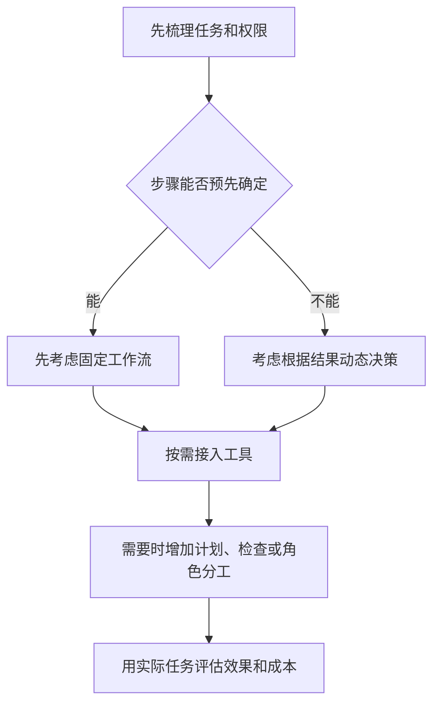

# 🤖 Agent 设计模式详解

> [!abstract] 一句话总结
> Agent 在给定目标和权限下，可以根据观察选择工具并执行多步任务。本文介绍常见设计模式及其适用边界。

## 📌 这是什么

一个常见的 AI Agent 由模型、工具和编排逻辑组成，也可能使用记忆保存上下文与任务状态；具体组件不必每次都齐全。
普通模型调用也可以通过程序连接工具或执行多步流程；Agent 的特点是允许模型在一定边界内选择下一步动作。

## 🤔 解决什么问题

| 普通 LLM 调用     | Agent      |
| ------------- | ---------- |
| 单次调用通常只使用已提供的上下文 | 可选择工具获取外部数据 |
| 固定流程由程序预先指定步骤 | 可根据结果选择下一步 |
| 是否检查结果取决于应用设计 | 可以根据观察尝试修正 |
| 可以组合多个固定处理步骤 | 可以按需分配不同角色 |

## 🧩 七大设计模式总览

先用“查询订单 A1001，延误时协助处理”理解它们的区别：Tool Use 负责查订单或物流，ReAct 根据查询结果决定下一步，Plan-and-Execute 先列出处理步骤，Reflection 检查答复是否与查询结果一致；任务涉及多个业务域时，再考虑 Multi-Agent 分工。这些模式可以组合，不是只能选一种。

| 模式 | 中文 | 一句话核心 | 复杂度 | 学习优先级 |
| ---- | ---- | ---------- | ------ | ---------- |
| **Tool Use** | 工具调用 | 模型提出工具调用，应用执行函数 | ⭐ | ⭐⭐⭐⭐⭐ |
| **ReAct** | 推理-行动 | Thought → Action → Observation 循环 | ⭐⭐ | ⭐⭐⭐⭐⭐ |
| **Plan-and-Execute** | 先规划后执行 | 先形成计划，再执行并按需调整 | ⭐⭐⭐ | ⭐⭐⭐⭐⭐ |
| **Reflection** | 反思 | 输出后自检并修正 | ⭐⭐⭐ | ⭐⭐⭐⭐ |
| **Reflexion** | 强化反思 | 反思并将经验用于后续尝试 | ⭐⭐⭐⭐ | ⭐⭐⭐ |
| **REWOO** | 无观察推理 | 先规划工具使用，再执行并汇总 | ⭐⭐⭐ | ⭐⭐⭐ |
| **Multi-Agent** | 多智能体协作 | 多个 Agent 分工合作 | ⭐⭐⭐⭐⭐ | ⭐⭐⭐⭐ |

## ⚙️ 模式一：Tool Use（工具调用）

> Tool Use 指模型提出工具调用请求，应用执行工具并返回结果；Function Calling 是常见实现方式。

```text
LLM 接收问题 → 提出工具名和参数 → 应用校验并执行工具 → 模型根据结果回答
```

**适用**：需要外部能力（查 DB、调 API、计算、发邮件）的场景。具体请求、工具执行和结果返回过程见 [[02-Tool-Use工具调用-代码实践]]。

> 详见 [[09-MCP协议详解]] 里 Function Calling 与 MCP 的关系。

## ⚙️ 模式二：ReAct（推理-行动循环）⭐ 最常用

> 论文《ReAct: Synergizing Reasoning and Acting》介绍了交替推理与行动的模式；框架是否采用它取决于具体组件和配置。

### 示例

```text
问：订单 A1001 什么时候送到？
行动：查询订单，得到物流单号 S001
行动：查询 S001 的物流，得到预计送达时间
回答：根据物流工具结果说明预计送达时间
```

> [!note] 这是示意流程。第二次行动使用了第一次的结果；信息不足时可以继续查询，达到限制时应停止并说明。模型不一定公开内部推理过程，应用仍要校验用户是否有权查询订单。工具循环示例见 [[03-ReAct-Spring-AI实现]]。

**适用**：动态调用工具的对话、边想边做、不确定步骤数量的场景。

## ⚙️ 模式三：Plan-and-Execute（先规划后执行）

> 先形成计划，再逐步执行；遇到失败或新信息时，可以按系统设计调整计划。适合需要拆解和跟踪多步任务的场景。

例如处理延误订单，可以先计划“查订单 → 查物流 → 判断是否创建工单”；物流单号需要等第一步执行后才能确定，最后根据实际执行结果汇总。执行失败时是否重试、停止或重新规划，由应用规则和当前结果共同决定，详见 [[04-Plan-and-Execute-实现]]。

### 与 ReAct 对比

| 维度 | ReAct | Plan-and-Execute |
| ---- | ----- | ---------------- |
| 决策时机 | 常根据当前观察决定下一步 | 通常先形成步骤，必要时重新规划 |
| 成本 | 取决于循环次数、上下文和模型 | 取决于规划、执行及重规划次数 |
| 灵活性 | 适合边观察边调整 | 计划更易检查，也可能因预设步骤而受限 |
| 适合场景 | 探索性任务 | 明确多步任务 |

## ⚙️ 模式四：Reflection（反思）

> 输出后让 LLM 自检 → 发现问题 → 修正。Anthropic《Building Effective Agents》经典模式。

这种做法适合代码生成、长文写作等需要检查的任务。例如工具返回“运输中”，初稿却写成“已送达”，检查步骤应指出矛盾并据此修订。修订后可以再次检查，但需要设置上限；仍不通过时转人工或保守返回。测试、规则和可靠来源可以提供外部反馈，模型自检也会误判，不能把“自检通过”视为正确性证明。详见 [[05-Reflection-实现]]。

## ⚙️ 模式五：Reflexion（强化反思）

> 一种带经验记录的反思方式：让 Agent 保存反馈，在重试时利用这些经验。效果依赖任务、模型和评测方式。

| 维度 | Reflection | Reflexion |
| ---- | ---------- | --------- |
| 信息使用 | 检查当前产物并修正 | 保留反馈与反思，供后续尝试使用 |
| 反馈来源 | 可来自模型、规则或外部测试 | 可以使用环境反馈或评价结果 |
| 模型参数 | 通常不要求更新 | 原论文通过文本反馈调整后续行为，不更新模型权重 |
| 成本 | 随检查和修正次数变化 | 多轮尝试通常增加调用与执行成本 |

例如代码测试失败后，把失败信息和“需要处理空输入”的经验带到下一次尝试。是否跨进程持久保存、保存多久取决于具体实现，不能由模式名称直接推断。

## ⚙️ 模式六：REWOO（无观察推理）

> Reasoning WithOut Observation 将流程分为 Planner、Worker 和 Solver；先规划工具使用，再执行并汇总结果。

```text
1. Planner：预先规划步骤和工具调用，允许引用先前步骤的结果。
2. Worker：按计划执行工具，将结果填入后续步骤的输入。
3. Solver：根据规划和工具结果生成最终回答。
```

**为什么可能节省成本？** 规划阶段不必每拿到一次工具结果就重新让规划模型推理；Solver 最后仍要读取结果。工具本身也可能调用模型，因此实际成本要计算所有步骤。预先制定的计划遇到意外结果时灵活性有限。
例如先规划“查订单得到物流单号，再用该单号查物流”，Worker 执行时把第一步的真实结果传给第二步，Solver 最后汇总。如果第一步没有返回单号，后续步骤需要按实现中止或处理，不能假设预先生成的计划一定能完成。

## ⚙️ 模式七：Multi-Agent（多智能体协作）

> 适用于可以清晰分工的任务，但协调、通信和验证会增加成本；先评估单 Agent 或固定流程能否满足需求。

例如订单 Agent 查订单，物流 Agent 查物流，Supervisor 汇总并检查结果；查询得到物流单号之后才能发起依赖它的物流查询。完整例子见 [[06-Multi-Agent-Supervisor实现]]。

| 模式 | 中文 | 一句话核心 | 代表框架 |
| ---- | ---- | ---------- | -------- |
| **Supervisor-Worker** | 主管-工人 | 主 Agent 调度子 Agent | LangGraph |
| **Hierarchical** | 分层 | 树状主-子-孙结构 | LangGraph |
| **Role-based** | 角色化 | Researcher / Writer / Reviewer | CrewAI |
| **Debate** | 辩论 | 多 Agent 互相质疑 | AutoGen |
| **Verifier-Critic** | 验证者-批评者 | 一个干活一个挑刺 | 自实现 |
| **Swarm** | 蜂群 | Agent 之间交接任务 | 不同框架的交接机制 |

## 🎯 模式选择决策树



## 💻 代码实践（Spring AI）

Spring AI 提供模型调用、工具和 Advisor 等组件，可以用来构建 Agent 流程；不同版本的实现方式有差异。

```text
☑ ChatClient + Tools          → 可组成工具调用流程，是否构成 ReAct 取决于编排
☑ ChatClient + Advisor 链      → 可参与请求处理与流程编排
☑ 多模型调用 + 状态机          → 可用于构建多角色协作
☑ 结合 Spring StateMachine     = 复杂流程
```

假设 `chatClient` 和 `orderTools` 已配置，下面是工具调用片段；省略依赖、认证和实际工具实现，未连接模型运行。

```java
String answer = chatClient.prompt()
        .user("订单 A123 到哪了？")
        .tools(orderTools)
        .call().content();
```

Spring AI 2.x 的 `ChatClient` 可以通过 `ToolCallingAdvisor` 组织工具调用循环；应用仍需控制工具权限、超时及循环次数。仅凭这一段代码不能判断模型是否输出了可见的 Thought。项目实践见 [[../08-项目实战/07-项目-业务Agent系统]]。

以上决策树只是帮助建立起点：固定流程也可以有条件分支和重试，多种模式也可以组合，具体选择应通过真实任务评测。

## 💡 Anthropic 经典原则

> [!note] 实践时可参考的原则
> 1. **优先比较固定流程能否满足需求，再评估 Agent 是否有必要**
> 2. **简单可控比"自主"更重要**
> 3. **工具描述要清晰、参数要明确**
> 4. **让后续步骤拿到必要的工具结果和上下文**
> 5. **错误恢复机制要设计好**
> 6. **记录关键步骤，便于验证和排查**

## ⚠️ 踩坑与注意事项

- [ ] 为工具调用设置最大步数、超时和停止条件。
- [ ] 控制每个 Agent 接收的上下文，避免重复传递增加成本。
- [ ] 写清工具用途与参数，并测试模型是否能正确选择。
- [ ] 先评估固定工作流或单 Agent 是否足够。

## 🎯 面试问题

> [!question]- ReAct 和 Plan-and-Execute 的区别？
> ReAct 依据每步观察动态调整；Plan-and-Execute 先形成计划再执行，适合需要检查计划的多步任务。实际成本需要结合任务与模型测量。

> [!question]- 什么时候用 Workflow，什么时候用 Agent？
> 先考虑固定流程能否满足需求；需要根据中间结果选择工具或路径时，再评估 Agent。两者也可以组合，成本和效果应实际测量。

> [!question]- 多 Agent 怎么避免无限循环？
> 设最大轮数、设终止条件、加 Supervisor 判断是否完成、监控重复行为。

## 🔗 关联笔记

- [[09-MCP协议详解]] —— Agent 调用外部工具的标准协议
- [[13-Skills详解]] —— Agent 的程序化知识
- [[17-Agent-MCP-Skills组合实战]] —— 三者如何协同
- [[_index]]

## 📚 参考资料

- [Building Effective Agents - Anthropic](https://www.anthropic.com/research/building-effective-agents)
- [ReAct 论文](https://arxiv.org/abs/2210.03629)
- [Reflexion 论文](https://arxiv.org/abs/2303.11366)；[ReWOO 论文](https://arxiv.org/abs/2305.18323)
- [Spring AI：工具调用](https://docs.spring.io/spring-ai/reference/api/tools.html)
