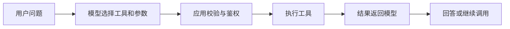

# 🛠️ Tool Use 工具调用

> [!abstract] 一句话总结
> 模型提出工具名和参数，应用校验并执行工具，把结果返回给模型；模型本身不会直接执行 Java 方法。

## 🎯 先看一次订单查询

用户问“订单 A1001 的状态是什么？”应用先把问题和工具描述交给模型。模型选择 `queryOrder` 并给出订单号，应用检查当前用户是否有权查看该订单，再查询并返回状态；模型根据结果组织回答。工具可能不被调用，也可能被多次调用，具体由模型输出和应用控制。



下面是一种可能的往返过程，状态和内容都是演示数据：
1. 应用把用户问题和 `queryOrder(orderId)` 的说明一起发给模型。
2. 模型返回调用请求，例如工具名 `queryOrder`、参数 `{"orderId":"A1001"}`；此时订单服务还没有被调用。
3. 应用确认参数有效、当前用户有权查看该订单，再执行查询；假设工具返回“已发货，物流单号 S001”。
4. 应用把工具结果交回模型，模型再回答“订单 A1001 已发货”。

若订单不存在或无权访问，工具应返回适当的失败结果，模型不能把猜测当作查询结果。订单归属检查由服务端完成，不能仅靠模型判断。

## 🧩 工具定义包含什么？

| 部分 | 作用 | 例子 |
| :--- | :--- | :--- |
| 名称与描述 | 告诉模型工具能做什么 | 查询订单状态 |
| 参数 Schema | 描述输入的字段和类型 | `orderId` 是字符串 |
| 执行器 | 由应用运行实际业务逻辑 | 调用订单服务 |
| 工具结果 | 模型继续决策的依据 | 已发货或无权访问 |

描述和 Schema 可以帮助模型选工具、填参数，但不能替代服务端的参数校验和权限检查。用户与租户身份应从可信的认证上下文取得，不能相信模型生成的身份参数。

## 💻 Spring AI 最小片段

假设 `orderService` 已注入，并在服务端根据认证上下文校验订单权限。此片段省略依赖和认证实现，未连接模型运行。

```java
@Tool(description = "查询当前用户指定订单的状态和物流单号")
public String queryOrder(@ToolParam(description = "订单编号") String orderId) {
    return orderService.queryAuthorizedOrder(orderId);
}
```

假设该方法所在对象为 `orderTools`，`chatClient` 已配置支持工具调用的模型：

```java
String answer = chatClient.prompt()
    .user("查询订单 A1001 的状态")
    .tools(orderTools)
    .call().content();
```

Spring AI 的 `@Tool` 描述方法，框架从工具定义生成模型可用的描述；具体默认执行循环和配置取决于所用版本，见官方文档。上面的代码没有实现审批、重试或调用次数限制。
这里的 `orderService.queryAuthorizedOrder` 是项目自己实现的业务方法，不是 Spring AI API；它需要从可信的服务端上下文取得用户身份，并检查订单归属。如果需要把身份传给工具，也可考虑由服务端构造 `ToolContext`，不要让模型生成身份作为授权依据。

> [!tip] 工具名和参数由谁决定？
> 工具由开发者注册，模型从可用工具中提出调用及参数，应用决定是否执行。工具描述越清楚越利于模型选择，但参数仍可能填错或被恶意构造。

## ⚠️ 执行工具时要控制什么？

- 在服务端校验用户、租户和参数，不能依赖提示词阻止越权。
- 限制工具调用次数、总耗时和成本；权限拒绝不应盲目重试。
- 写操作按需审批，用业务幂等键避免超时重试产生重复副作用。
- 只返回模型需要的数据，记录工具名、授权结果、执行状态和耗时，避免日志包含敏感原文。

验证时可以先独立测试订单服务：本人订单能查到、他人订单被拒绝、订单不存在时有明确结果；再接入模型检查它能否正确选择工具和填写订单号。

> [!question]- 模型输出了工具调用，业务方法是否已经执行？
> 没有。应用收到请求后仍要查找工具、检查参数和权限，执行后才能返回结果。模型的选择只是建议，不代表获得了执行权限。

## 🔗 关联与资料

- 交替使用工具与观察结果：[[03-ReAct-Spring-AI实现]]；跨应用接入：[[09-MCP协议详解]]。
- [Spring AI：Tool Calling](https://docs.spring.io/spring-ai/reference/api/tools.html)
