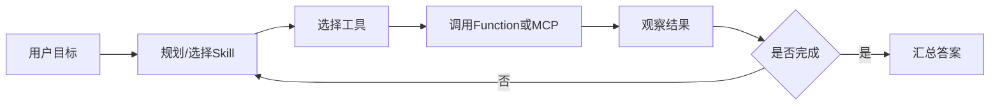

# Tool-Use工具调用-代码实践

> [!abstract] 一句话总结
> Tool-Use工具调用-代码实践是 AI 应用开发中的核心主题，重点在于理解概念边界、掌握工程落地方式，并能把它放进 Spring AI / LangChain4j / RAG / Agent 的真实链路里。

## 📌 这是什么

本篇按定位、实现和工程落地来学习：

1. **概念层**：它在 Agent 体系中负责什么，和相邻概念边界在哪里。
2. **实现层**：它落到代码、配置、数据结构或运行时机制时长什么样。
3. **工程层**：它在真实系统里如何被验证、监控、优化和复盘。

学习时不要只记定义，至少要能回答：输入是什么、输出是什么、失败时会怎样、有哪些参数或边界会改变结果。

## 🤔 解决什么问题 / 为什么需要

- **明确边界**：先区分适用场景、输入输出、失败路径和验收标准。
- **提高可靠性**：明确边界条件后，代码和方案更容易被测试、观测和复盘。
- **支撑面试表达**：能从“是什么”讲到“为什么这样设计”，再讲到“项目里怎么落地”。
- **连接项目实战**：本主题通常会出现在接口设计、性能优化、故障排查或 AI 应用链路中。

## 🧩 核心概念

| 概念 | 含义 | 精通要点 |
| ---- | ---- | -------- |
| 任务分解 | Agent 把目标拆成多步行动。 | 复杂任务才值得上 Agent。 |
| 工具连接 | Function Calling / MCP 暴露可执行能力。 | 工具描述、权限、审计要清楚。 |
| 程序化知识 | Skills/AGENTS.md 把流程写成可加载指令。 | 让 Agent 按组织经验做事。 |
| 治理机制 | 最大步数、错误恢复、成本预算、可观测。 | 没有治理的 Agent 很难生产化。 |

## ⚙️ 工作原理 / 流程



1. **明确场景**：先判断本主题用于记忆、检索、工具调用、评估、平台工程还是业务交付。
2. **再定输入输出**：列出输入数据、关键参数、输出结果和失败返回。
3. **中间过程可观测**：关键步骤要有日志、指标、trace、测试样例或可视化结果。
4. **最后做取舍**：说明为什么不用另一种方案，以及当前方案的代价。

## 💻 代码实践

```java
@Service
class OrderTools {
    @Tool(description = "根据订单号查询订单状态")
    String queryOrder(String orderId) {
        return orderService.queryStatus(orderId);
    }
}

// Agent 循环要限制 maxSteps，并记录每次工具调用结果。
```

## 🔍 源码 / 原理深挖

- 阅读官方文档的概念章节，确认术语不要只靠二手文章。
- 把参数、限制、错误码、计费方式写进自己的调用封装。
- 对比至少两种方案，记录什么时候选 A、什么时候选 B。
- 为生产环境补上超时、重试、降级、观测和权限控制。

## ⚠️ 踩坑与注意事项

- 只看模型回答是否像样，不做结构化校验和回归样例。
- 把上下文越塞越长，却没有做排序、压缩和预算控制。
- 工具描述模糊，导致模型该调用时不调用或调用错参数。
- 没有记录 trace，线上失败后无法复盘模型输入。

## 🎯 面试问题

> [!question] 高频问题
> - Q: Tool-Use工具调用-代码实践 解决的核心问题是什么？
>   - A: Tool-Use工具调用-代码实践是 AI 应用开发中的核心主题，重点在于理解概念边界、掌握工程落地方式，并能把它放进 Spring AI / LangChain4j / RAG / Agent 的真实链路里。
> - Q: 它和相邻概念的区别是什么？
>   - A: 先讲适用边界，再讲实现差异，最后给一个项目里的选择理由。
> - Q: 如果线上效果不好，你怎么排查？
>   - A: 先看输入、配置、日志/trace、指标，再用最小样例复现，最后修改参数或实现并做回归。

## ✅ 精通检查清单

- 能用 1 分钟讲清 Tool-Use工具调用-代码实践 的核心价值。
- 能画出主流程图，并指出关键失败点。
- 能写出最小 demo 或代码模板。
- 能说出 2 个常见坑和 1 个真实项目落地点。
- 能把本主题和相邻主题做对比选型。

## 🔗 关联笔记

- [[_index]]
- [[10-AI应用开发/00-总览/学习仪表盘]]

## 📚 参考资料

- [OpenAI Platform Docs](https://platform.openai.com/docs/)
