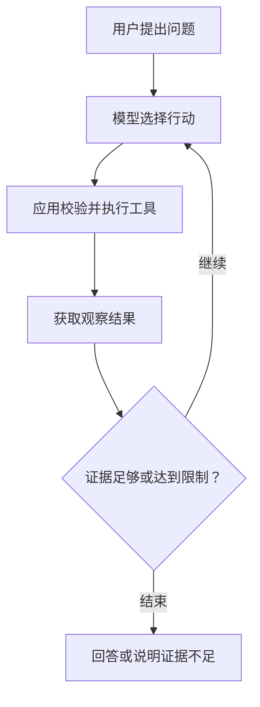

# 🔄 ReAct 与 Spring AI 工具循环

> [!abstract] 一句话总结
> ReAct 把决策、行动和观察结果交替组织：先选择行动，得到工具反馈，再决定继续查询还是回答。

## 🎯 先看一次订单查询

用户问“订单 A1001 什么时候送到？”只查订单可能拿不到预计送达时间，需要拿到物流单号后再查物流。Agent 先看第一次工具返回了什么，再决定是否需要下一次查询；如果订单查询失败，也不应凭空编一个物流单号。
下面是一次模拟过程，实际调用顺序由模型输出和应用控制：
1. 模型请求 `queryOrder("A1001")`，应用鉴权后返回“已发货，物流单号 S001”。
2. 模型根据这个结果请求 `queryShipping("S001")`，工具返回“运输中，预计明天送达”。
3. 模型依据工具结果回答；如果工具只返回“运输中”，就说明暂时无法确定送达时间。



普通工具调用本身也可以包含多轮调用；ReAct 强调利用行动反馈调整后续决策。这里的“观察”是工具结果，不是要求模型公开内部推理；实际系统可以记录工具请求和结果，但不能假设能获取完整的隐藏思维链。

## 💻 Spring AI 示例

假设 `orderTools` 和 `shippingTools` 已实现上面的只读工具，`chatClient` 已配置支持工具调用的模型。下面是调用片段，并未实际连接业务服务或模型。

```java
String result = chatClient.prompt()
    .user("订单 A1001 什么时候送到？")
    .tools(orderTools, shippingTools)
    .call().content();
```

在 Spring AI 2.x 的 `ChatClient` 中，默认注册的 `ToolCallingAdvisor` 负责工具调用循环：模型请求工具后，框架执行工具并把结果交还模型，直到模型不再请求工具或触发限制。不同版本的组织方式可能不同，参见 [[../02-框架-SpringAI与LangChain4j/SpringAI/10-2.x工具调用循环与动态工具发现|Spring AI 工具调用循环与动态工具发现]]。这段调用展示的是工具循环，是否按示例的两步执行仍取决于模型、工具结果和应用配置。
`ToolCallingAdvisor` 负责组织调用，不会替业务判断当前用户能否查看订单；工具内部仍需做参数校验和鉴权。也不要在框架已自动循环时再无条件包一层自己的循环，以免重复调用。

## 🛡️ 怎样避免循环失控？

- 设置工具调用次数、总耗时与成本预算；达到限制时返回已有结果和未完成原因。
- 执行前校验工具参数、用户身份和授权；高风险操作需要独立审批。
- 对可恢复故障有界重试，权限拒绝等确定性错误不盲目重试；写入需考虑幂等。
- 保留可审计的工具名、参数摘要、结果和耗时；结果过大时按需求裁剪，避免丢掉关键证据。

> [!warning] 示例边界
> 上面的调用片段没有自行实现审批、超时或次数上限。不要因为使用了 `.tools(...)` 就认为这些治理已经完成。

> [!question]- 订单工具没有返回物流单号，Agent 能直接查询物流并回答送达时间吗？
> 不能凭空生成单号或结果。应根据已有信息选择可用的补查方式；没有足够证据时，说明暂时无法确定。

## 🔗 关联与资料

- 工具调用：[[02-Tool-Use工具调用-代码实践]]；先规划再执行：[[04-Plan-and-Execute-实现]]；观测：[[18-Agent可观测]]。
- [ReAct 原论文](https://arxiv.org/abs/2210.03629)；[Spring AI：工具调用循环](https://docs.spring.io/spring-ai/reference/api/tools/tool-calling-advisor.html)
