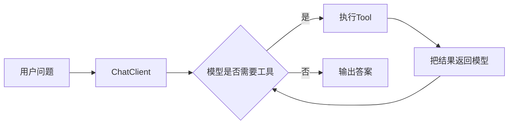

# ReAct-Spring-AI实现

> [!abstract] 一句话总结
> ReAct 在工程里不是暴露“思考过程”，而是让 Agent 在“观察问题 -> 调用工具 -> 读取结果 -> 继续判断”的循环中完成需要外部事实的任务。

## 📌 这是什么

ReAct = Reasoning + Acting。落到 Spring AI，核心是：

1. 用 `ChatClient` 承载模型调用。
2. 用 Java `@Tool` 或 MCP tools 暴露可执行能力。
3. 让 Spring AI 的 tool calling 流程接收模型的工具调用请求并执行。
4. 用最大步数、超时、trace 和降级控制循环。

不要在生产 prompt 中要求模型输出完整 chain-of-thought；工程上记录的是工具调用轨迹和可验证事实。

## 🤔 解决什么问题 / 为什么需要

- 用户问题需要查实时数据，如订单、库存、账号状态。
- 一次工具结果不足以回答，需要继续查下一步。
- 需要模型在多个工具中选择最合适的能力。
- 希望把业务 API 作为工具接入，而不是把所有数据塞进 prompt。

## 🧩 核心组件

| 组件 | Spring AI 对应 | 要点 |
| ---- | -------------- | ---- |
| Agent Prompt | `system()` / prompt template | 说明角色、工具使用规则、失败处理。 |
| Tool | `@Tool`、`ToolCallbackProvider`、MCP Tool | 描述具体，参数可校验。 |
| Observation | 工具返回和模型响应 | 写 trace，供复盘和评估。 |
| Loop Control | 最大步数、超时、预算 | 防止无限调用和成本失控。 |

## ⚙️ 实现步骤



1. 先把业务 API 封装成小而明确的工具，不要暴露万能工具。
2. 在 system prompt 中要求：涉及订单状态必须调用订单工具；工具失败要说明无法确认。
3. 注册工具到 `ChatClient`，并设置模型、温度、输出 token 等参数。
4. 为每次工具调用记录 `traceId`、工具名、参数摘要、返回摘要、耗时。
5. 写评估样例验证：应调用工具、参数正确、答案引用工具结果。

## 💻 Java / Spring AI 示例

```java
@Service
class OrderTools {
    @Tool(description = "查询当前登录用户的订单状态。orderId 是订单号，例如 A20260704001。")
    OrderStatusView queryOrderStatus(String orderId) {
        return orderService.queryOwnedOrder(orderId);
    }

    @Tool(description = "根据物流单号查询最新物流节点。trackingNo 是承运商物流单号。")
    ShippingView queryShipping(String trackingNo) {
        return shippingService.latestEvent(trackingNo);
    }
}
```

```java
@RestController
class OrderAgentController {
    private final ChatClient chatClient;

    OrderAgentController(ChatClient.Builder builder, OrderTools tools) {
        this.chatClient = builder
                .defaultSystem("""
                        你是订单客服 Agent。回答订单状态或物流问题时必须使用工具。
                        如果工具没有返回事实，不要编造；说明无法自动确认并建议转人工。
                        """)
                .defaultTools(tools)
                .build();
    }

    @GetMapping("/agent/order")
    String ask(@RequestParam String q) {
        return chatClient.prompt().user(q).call().content();
    }
}
```

## ⚠️ 工程坑

- 工具描述过短，模型不知道什么时候调用。
- 工具返回自然语言长段落，模型难以提取关键字段；优先返回结构化 DTO。
- 没有限制循环步数，工具失败后模型反复调用同一个工具。
- 将用户可控字段直接传入 SQL 或 HTTP URL，形成注入和 SSRF 风险。
- 测试只断言最终文本，没有断言工具调用轨迹。

## 🎯 面试问题

> [!question] 高频问题
> - Q: ReAct 和普通 Function Calling 的关系是什么？
>   - A: Function Calling 是一次或多次工具调用机制；ReAct 是让模型根据观察结果继续决定下一步的任务执行模式。
> - Q: 为什么不展示模型完整思考过程？
>   - A: 生产系统应展示可验证事实和工具轨迹，不依赖暴露 chain-of-thought；内部记录工具调用、输入输出和评估结果即可。
> - Q: ReAct 失败最常见的原因是什么？
>   - A: 工具描述不清、参数 schema 不准、工具返回不可用、缺少步数和超时限制。

## ✅ 精通检查清单

- 能用 Spring AI `ChatClient` 接入 `@Tool`。
- 能说明 ReAct 循环中的观察、行动和停止条件。
- 能为工具调用加 trace 和预算。
- 能写测试验证工具选择和最终答案。

## 🔗 关联笔记

- [[_index]]
- [[02-Tool-Use工具调用-代码实践]]
- [[18-Agent可观测]]
- [[10-AI应用开发/00-总览/学习仪表盘]]

## 📚 参考资料

- [Spring AI Tool Calling](https://docs.spring.io/spring-ai/reference/api/tools.html)
- [Spring AI Chat Client](https://docs.spring.io/spring-ai/reference/api/chatclient.html)
