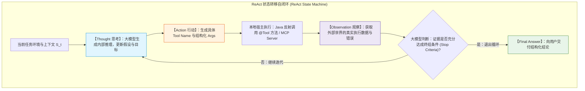

# 🔄 ReAct 范式在 Spring AI 中的工业级闭环实现

> [!abstract] 一句话总结
> ReAct（Reasoning + Acting）的核心第一性原理是**“将大模型的‘内在符号推理（Thinking）’与‘外在环境干预（Acting）’交织自洽”**，通过构建 `Thought → Action → Observation` 的状态机自闭环，让智能体在不确定的复杂动态环境中步步为营达成目标。

---

## 🗣️ 白话版（先建立直觉）

如果让你派一个手下去调查一起复杂的**“线上高危资损 Bug”**：
- **莽夫型员工（Only Acting，只有行动没有思考）**：
  一接到指令，二话不说抓起工具就乱点。看到重启键就点重启，看到删表就点删表，像个无头苍蝇一样乱撞，不仅没解决问题，反而破坏了案发现场。
- **书呆子型员工（Only Reasoning，只有推理没有行动）**：
  坐在工位上闭门造车，拿出一张白纸推演了 10 种可能的原因，但他**从来不去服务器看一眼真实日志，也不查数据库**。最后写了一篇长达万字但全无事实依据的“玄学分析报告”。
- **精明干练的高级专家（ReAct 范式：推理与行动交织）**：
  1. **【Thought 思考】**：“首先，系统报了空指针异常，我需要看一下出错那条订单的明细。”
  2. **【Action 行动】**：打开数据库工具，执行查询 `SELECT * FROM orders WHERE id = 10086;`
  3. **【Observation 观察】**：“看到结果了，`discount_price` 字段居然是 NULL！”
  4. **【Thought 思考】**：“奇怪，正常打折商品不能为空。我怀疑是昨天上线的满减优惠券活动逻辑没做判空。我需要查一下优惠券记录。”
  5. **【Action 行动】**：调用优惠券接口查询。
  6. **【Observation 观察】**：“果然！该优惠券没有关联任何折扣金额！”
  7. **【Thought 思考】**：“证据链完整，根因明确！无需继续调用工具，可以给主管汇报修复方案了。”
  8. **【Final Answer 最终交付】**：“排查完毕，根因是优惠券无折扣导致空指针，建议补齐默认值校验。”

**ReAct 的精髓就是：想一步、走一步、看一眼、再想下一步！**

---

## 📌 第一性原理：ReAct 状态机数学与推导模型

经典论文 *ReAct: Synergizing Reasoning and Acting in Language Models (Yao et al., ICLR 2023)* 指出：
人类在解决未知复杂任务时，推理轨迹（Reasoning Traces）与行动轨迹（Action Traces）是高度协同互补的。



### 为什么说纯 Function Calling 不等于 ReAct？
- **普通 Function Calling** 通常只是**单轮调用**：用户问天气 $\to$ 调一次天气 API $\to$ 结束。
- **ReAct 是一种图循环 Agent 架构**：它由大模型根据 Observation **自主决定**是“继续调工具 A”、“换工具 B 试一下”，还是“终止循环直接回答”。一次复杂任务可能会在环中流转 3 到 8 轮！

---

## 💻 工业级代码实战：Spring AI 中的 ReAct 弹性调度与熔断

Spring AI 的 `ChatClient` 原生内置了对多轮工具循环的支持。但在企业级生产中，必须对其加上**最大迭代步数熔断器（Max Iterations Breaker）**与**异常重试治理**：

### 1. 业务工具库（提供观察原材料）

```java
package com.example.ai.react.tools;

import org.springframework.ai.tool.annotation.Tool;
import org.springframework.ai.tool.annotation.ToolParam;
import org.springframework.stereotype.Service;

import java.util.Map;

@Service
public class DevOpsDiagnosticTools {

    @Tool(description = "根据微服务名称与时间范围，查询最近的错误日志堆栈")
    public String fetchErrorLogs(
            @ToolParam(description = "微服务标识，例如 order-service, payment-service") String serviceName,
            @ToolParam(description = "回溯分钟数，例如 15") int lastMinutes) {
        // 模拟调用 ELK / Loki
        if ("order-service".equals(serviceName)) {
            return "ERROR [2026-09-11 14:02:11] - ConnectionTimeoutException: Unable to connect to Redis node 192.168.1.50:6379";
        }
        return "INFO: 期间无异常日志";
    }

    @Tool(description = "检查指定 IP 节点的网络联通性与端口状态")
    public String checkNodeHealth(@ToolParam(description = "节点 IP 地址") String ip) {
        if ("192.168.1.50".equals(ip)) {
            return "Node 192.168.1.50: PING 成功, 端口 6379 拒绝连接(Connection Refused), 内存使用率 98.7% (OOM 告警)";
        }
        return "Node 正常在线";
    }
}
```

### 2. 具备熔断与可观测性的 ReAct 编排控制器

```java
package com.example.ai.react;

import com.example.ai.react.tools.DevOpsDiagnosticTools;
import lombok.extern.slf4j.Slf4j;
import org.springframework.ai.chat.client.ChatClient;
import org.springframework.ai.chat.prompt.ChatOptions;
import org.springframework.stereotype.Service;

@Slf4j
@Service
public class ReActDiagnosticAgent {

    private final ChatClient chatClient;

    public ReActDiagnosticAgent(ChatClient.Builder builder, DevOpsDiagnosticTools tools) {
        this.chatClient = builder
                // 1. 注入 ReAct 规范人设，要求模型遵循严密的因果逻辑
                .defaultSystem("""
                    你是一名资深的 SRE 运维排障专家。
                    请遵循严格的 ReAct (Reasoning + Acting) 思考准则：
                    1. 针对故障现象，每次行动前必须明确说明当前怀疑的假设（Thought）；
                    2. 调用最相关的诊断工具获取事实证据（Action）；
                    3. 严格基于观察到的证据（Observation）决定下一步排查分支；
                    4. 证据确凿后，直接给出根因与止血建议，终止工具调用。
                    """)
                // 2. 挂载本地工具集
                .defaultTools(tools)
                // 3. 严格限制单次对话的模型参数与最大递归保护
                .defaultOptions(ChatOptions.builder()
                        .temperature(0.2) // 严谨低温，避免胡乱调用
                        .build())
                .build();
    }

    /**
     * 触发自动化排障
     */
    public String diagnoseIssue(String alertEvent) {
        log.info("Agent 开始接单，故障事件: {}", alertEvent);

        // Spring AI 的 ChatClient 内部会自动处理 Thought-Action-Observation 循环
        // 直到大模型不再返回 tool_calls，返回最终结论
        String finalReport = chatClient.prompt()
                .user("发生线上告警：" + alertEvent + "，请立刻开始排查。")
                .call()
                .content();

        log.info("Agent 排查完毕，输出诊断报告！");
        return finalReport;
    }
}
```

---

## ⚡ ReAct 运行实录与底层 Token 交换透视

上面的代码在运行时，后台经历了一场精彩的**三次循环跳跃**：

```text
【用户输入】：发生线上告警：order-service 响应时间飙升至 5000ms，请排查。

[Loop 1]
  Thought: 用户反馈 order-service 延迟异常，我首先需要查看该服务最近的错误日志，寻找异常堆栈。
  Action:  fetchErrorLogs(serviceName="order-service", lastMinutes=15)
  Observation: ConnectionTimeoutException: Unable to connect to Redis node 192.168.1.50:6379

[Loop 2]
  Thought: 错误日志显示连接 Redis 节点 192.168.1.50:6379 超时。我需要进一步检查该节点的物理机健康状况。
  Action:  checkNodeHealth(ip="192.168.1.50")
  Observation: PING 成功, 端口 6379 拒绝连接, 内存使用率 98.7% (OOM 告警)

[Loop 3]
  Thought: 证据已经非常闭环：Redis 节点发生 OOM 导致进程崩溃（端口拒绝连接），进而导致 order-service 超时堆积。无需调用新工具。
  Final Answer:
  【根因分析】：Redis 缓存节点 192.168.1.50 发生物理内存打满（98.7%），进程因 OOM 异常退出，导致订单服务无法读写缓存而严重超时。
  【止血建议】：1. 立即重启拉起 Redis 实例或切换从节点分流；2. 紧急排查近期上线的 BigKey；3. 调大该节点内存规格。
```

---

## ⚠️ 生产避坑指南与致命陷阱

### 1. 致命灾难：工具报错导致 Agent 陷入“死循环自嗨”
- **真实翻车**：工具返回了 `403 Forbidden`。Agent 的 Thought 写着：“被拒绝了，那我再重试一次”。结果以每秒 5 次的频率无限循环重试，10 分钟内消耗了数百万 Token！
- **治理铁律**：
  1. 框架层必须配置 `max_iterations`（最大工具循环步数，建议设为 5~8 次），超次强制抛异常熔断；
  2. 工具返回异常时，返回体中必须明确包含：“该错误为确定性权限异常，请勿重试，直接向用户汇报！”

### 2. 工具返回自然语言“小作文”稀释上下文
- **反例**：工具返回了一个包含 3000 行完整 HTML 的抓取结果。
- **后果**：一次 Observation 直接把上下文撑爆，导致大模型遗忘了第一步的初衷。
- **正解**：**工具返回值必须做精简脱水**！只返回关键状态、核心字段与摘要，绝不塞入无关冗余字段。

---

## 🎯 大厂高频面试 30 秒绝杀

> [!question] 面试高频问题 3 连击
> 
> **Q1：什么是 ReAct 范式？为什么说“推理（Reasoning）与行动（Acting）结合”能超越单一的思维链或纯工具调用？**
> - **答（满分绝杀）**：
>   ReAct（Reasoning + Acting）将大模型的“内在思考”与“外部工具交互”编织为状态机循环。
>   - **纯推理（如 CoT）的死穴**在于缺乏外部世界的事实反馈，容易陷入知识截止与严重幻觉；
>   - **纯行动（如早期 AutoGPT 裸调工具）的死穴**在于盲目试错、缺乏长远规划与因果归纳，容易在错误路径上越走越远；
>   - **ReAct 的核心价值**在于：Thought 负责制定子目标并引导 Action 的选择；Action 带来现实世界的 Observation 反馈；新的 Observation 又作为先验条件输入下一次 Thought 从而动态修正假设，两者协同实现了自适应纠错能力。
>
> **Q2：在生产环境实现 ReAct 循环时，如何从架构层面防范死循环与 Token 账单爆炸？**
> - **答（满分绝杀）**：
>   构建“三重防御门禁”：
>   1. **硬步数熔断器（Max Steps Breaker）**：单次任务显式限制工具迭代轮数（如上限 6~8 轮），达到上限强制终止并转人工；
>   2. **重复 Action 检测器（Cycle Detector）**：记录工具调用签名哈希，若连续 2 次以完全相同的参数调用同一个工具，直接判定死循环并阻断；
>   3. **工具返回值契约清洗**：工具返回结果做严格的 Token 截断与结构化 DTO 提炼，防止单次 Observation 撑爆窗口。
>
> **Q3：ReAct 与 Plan-and-Solve（先规划后执行）在适用场景上有何本质不同？**
> - **答（满分绝杀）**：
>   - **ReAct 擅长“高动态、不可预测环境”**：如线上故障排障、即时多轮客服。因为每一步的下一步完全依赖上一步返回的未知数据，无法提前拟定完整计划，必须“走一步看一步”；
>   - **Plan-and-Solve 擅长“确定性强、长链路的大型任务”**：如撰写行业研报、生成多模块代码。它在任务开始前先做全局自顶向下的步骤拆解，由调度器依次派发子任务，执行更稳定且 Token 开销通常更可控。

---

## 🪝 一分钟复盘记忆卡

```
┌────────────────────────────────────────────────────────┐
│               ReAct 范式实现 极速通关卡                 │
├────────────────────────────────────────────────────────┤
│  1. 核心公式：Thought(思考) + Action(行动) + Observe(观察)│
│  2. 运行本质：有限状态机循环迭代，直到满足终结条件    │
│  3. 协同优势：思考引导工具，观察纠偏假设，步步为营     │
│  4. 防御三防：限制最大步数 + 重复调用拦截 + 工具返回值脱水│
│  5. 场景界线：未知排障选 ReAct，宏观任务选 Plan-Solve   │
└────────────────────────────────────────────────────────┘
```

---

## 🔗 关联笔记

- [[00-Agent-MCP-Skills全景与心智模型]] - Agent 决策中枢与心智
- [[01-Agent设计模式详解]] - 七大 Agent 架构模式横向对比
- [[02-Tool-Use工具调用-代码实践]] - 深入底层工具参数自省与反射
- [[04-Plan-and-Execute-实现]] - 对比先规划后执行的静态拆解架构
- [[18-Agent可观测]] - 监控 ReAct 工具轨迹与链路追踪
- [[_index]] - 返回 Agent 专题索引
