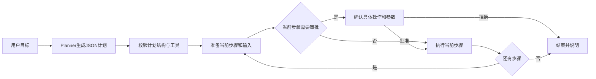

# Plan-and-Execute-实现

> [!abstract] 一句话总结
> Plan-and-Execute 先形成可检查的计划，再逐步执行并根据结果调整；计划仍需由应用校验，写操作按业务风险处理。

## 📌 这是什么

Plan-and-Execute 通常分两段：
1. **Planner**：根据用户目标生成结构化计划，例如步骤、所需工具、预期输出。
2. **Executor**：按步骤调用 Java Tool / MCP Tool，记录结果，必要时重新规划。

它适合“查订单 -> 查物流 -> 判断是否延迟 -> 创建工单”这类多步骤任务；简单问答不需要引入这个模式。

## 🤔 解决什么问题 / 为什么需要

- 多步骤任务可以先列出步骤，便于执行前检查和跟踪进度。
- 可以在执行前做权限和风险审批。
- 计划结构化后方便 UI 展示、断点续跑和失败回放。
- 支持不同步骤走不同工具、模型或人工节点。

## 🗣️ 跟着订单问题走一遍

用户说“订单 A1001 到哪了，延误的话帮我创建工单”。计划可以先查订单，再用订单结果里的物流单号查物流，最后根据物流状态决定是否创建工单。
关键是第二步的物流单号来自第一步的真实结果，Planner 不能预先知道时就编一个。执行过程中如果订单不存在或无权限，应停止或返回说明；写入工单前按业务策略确认，并使用幂等键避免重复创建。
假设执行时查到物流单号 `S001`，物流工具返回“已延误”：
1. 第一步保存订单查询结果，其中包含 `S001`。
2. 第二步从第一步结果取单号，查到物流状态为“已延误”。
3. 第三步判断条件成立，再检查当前用户是否允许创建工单、是否需要确认；允许后才执行。

如果第二步返回“正常运输”，第三步应跳过；如果查询失败，应保留失败原因，而不是把计划里的预期结果当成事实。

## 🧩 计划结构

| 字段 | 示例 | 作用 |
| ---- | ---- | ---- |
| `goal` | 查询订单并按需创建工单 | 固定用户目标。 |
| `steps[].tool` | `queryOrder` | 限定可执行工具。 |
| `steps[].input` | `{"orderId":"A1001"}` | 工具参数草稿。 |
| `steps[].risk` | `read`、`write`、`approval` | 模型给出的风险建议；最终以服务端策略为准。 |
| `steps[].expected` | `订单状态` | 便于评估步骤完成。 |

## ⚙️ 实现步骤



1. Planner 生成结构化计划，本例使用 JSON；生成计划不等于执行工具。
2. Java 端先检查结构、工具名和输入，未知或无权限步骤不能执行；`record` 映射成功也不代表业务校验通过。
3. 通过认证与授权的只读步骤可按业务策略执行；写操作应按实际参数处理审批、幂等和审计。审批后执行前还需检查权限和业务状态是否变化。
4. Executor 保存步骤结果与状态；失败后按错误类型选择重试、停止或重新规划，写操作先确认是否已生效。
5. 最终答案必须引用执行结果，而不是引用计划中的猜测。

## 💻 Java / Spring AI 示例

以下为示意片段，`toolPolicy`、`approvalService`、`toolRegistry` 等是应用自定义组件，省略了依赖与实现，未实际运行。模型提供的风险标签不可作为授权依据；服务端应根据工具定义独立判定风险和审批要求。步骤依赖、条件分支和结果绑定需要在实际计划结构中补充。

```java
record AgentPlan(String goal, List<PlanStep> steps) {}
record PlanStep(String id, String tool, Map<String, Object> input, String risk, String expected) {}
```

```java
AgentPlan plan(String userGoal) {
    return chatClient.prompt()
            .system("""
                    你是计划生成器，只输出 JSON。
                    可用工具：queryOrder(orderId), queryShipping(trackingNo), createTicket(reason)。
                    risk 只能是 read/write/approval。
                    """)
            .user(userGoal)
            .call()
            .entity(AgentPlan.class);
}
```

```java
for (PlanStep step : plan.steps()) {
    toolPolicy.assertAllowed(step.tool(), currentUser);
    approvalService.requireWhenNeeded(step, currentUser);
    Object result = toolRegistry.call(step.tool(), step.input());
    executionStore.append(step.id(), result);
}
```

代码只展示授权、审批与执行的关系，假设 `step.input()` 已由应用安全地绑定并校验前序步骤结果；示例本身没有实现依赖解析、幂等和断点续跑。

## ⚠️ 工程坑

- Planner 输出自然语言计划，Executor 难以稳定解析。
- 计划里允许模型自由发明工具名，执行时才发现不存在。
- 生成计划后不校验权限，导致高风险写操作自动执行。
- 一步失败就重跑整个任务，可能重复创建工单或重复扣款。
- 最终回答复述计划而不是执行结果。

## 🎯 面试问题

> [!question]- Plan-and-Execute 和 ReAct 怎么选？
> ReAct 根据每次观察选择下一步；Plan-and-Execute 先产出计划，便于检查和跟踪。两者都可以配合审批和持久化，是否值得引入计划取决于任务复杂度。

> [!question]- 为什么通常采用结构化计划？
> 结构化便于程序检查工具名、参数和步骤依赖，也便于展示与跟踪；它本身不会自动完成授权、持久化或恢复。

> [!question]- 重新规划什么时候触发？
> 工具返回信息不足、业务状态变化、步骤失败且可替代工具存在时触发；高风险步骤不能静默改计划执行。

## ✅ 精通检查清单

- 能定义一个可校验的计划 JSON schema。
- 能解释 Planner 和 Executor 的职责边界。
- 能为写步骤加入确认、幂等和审计。
- 能处理步骤失败、重试和断点续跑。

## 🔗 关联笔记

- [[_index]]
- [[03-ReAct-Spring-AI实现]]
- [[19-Agent评估]]
- [[../00-总览/学习仪表盘]]

## 📚 参考资料

- [Spring AI Structured Output](https://docs.spring.io/spring-ai/reference/api/structured-output-converter.html)
- [Spring AI Tool Calling](https://docs.spring.io/spring-ai/reference/api/tools.html)
