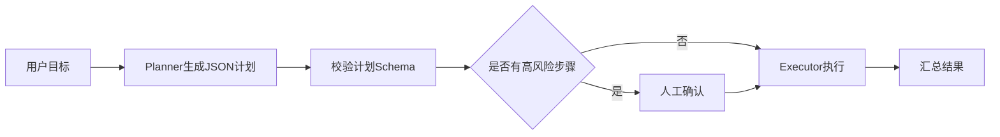

# Plan-and-Execute-实现

> [!abstract] 一句话总结
> Plan-and-Execute 把复杂任务拆成“先生成可检查计划，再逐步执行工具”，适合多步骤业务流程，但必须给计划加 schema、审批和失败恢复。

## 📌 这是什么

Plan-and-Execute 通常分两段：

1. **Planner**：根据用户目标生成结构化计划，例如步骤、所需工具、预期输出。
2. **Executor**：按步骤调用 Java Tool / MCP Tool，记录结果，必要时重新规划。

它适合“查订单 -> 查物流 -> 判断是否延迟 -> 创建工单”这类多步骤任务；简单问答不需要引入这个模式。

## 🤔 解决什么问题 / 为什么需要

- 多步骤任务直接 ReAct 容易走偏，先出计划便于检查。
- 可以在执行前做权限和风险审批。
- 计划结构化后方便 UI 展示、断点续跑和失败回放。
- 支持不同步骤走不同工具、模型或人工节点。

## 🧩 计划结构

| 字段 | 示例 | 作用 |
| ---- | ---- | ---- |
| `goal` | 查询订单并判断是否需要补偿 | 固定用户目标。 |
| `steps[].tool` | `queryOrderStatus` | 限定可执行工具。 |
| `steps[].input` | `{orderId: "A100"}` | 工具参数草稿。 |
| `steps[].risk` | `read`、`write`、`approval` | 决定是否需要确认。 |
| `steps[].expected` | `订单状态` | 便于评估步骤完成。 |

## ⚙️ 实现步骤



1. Planner 只输出 JSON，不直接执行工具。
2. Java 端用 schema/record 校验计划，过滤不存在或无权限的工具。
3. 只读步骤可自动执行；写操作需要确认、幂等和审计。
4. Executor 每完成一步都保存状态，失败时可重试当前步或重新规划。
5. 最终答案必须引用执行结果，而不是引用计划中的猜测。

## 💻 Java / Spring AI 示例

```java
record AgentPlan(String goal, List<PlanStep> steps) {}
record PlanStep(String id, String tool, Map<String, Object> input, String risk, String expected) {}
```

```java
AgentPlan plan(String userGoal) {
    return chatClient.prompt()
            .system("""
                    你是计划生成器，只输出 JSON。
                    可用工具：queryOrderStatus(orderId), queryShipping(trackingNo), createTicket(reason)。
                    risk 只能是 read/write/approval。
                    """)
            .user(userGoal)
            .call()
            .entity(AgentPlan.class);
}
```

```java
for (PlanStep step : plan.steps()) {
    toolPolicy.assertAllowed(step.tool(), step.risk(), currentUser);
    Object result = toolRegistry.call(step.tool(), step.input());
    executionStore.append(step.id(), result);
}
```

## ⚠️ 工程坑

- Planner 输出自然语言计划，Executor 难以稳定解析。
- 计划里允许模型自由发明工具名，执行时才发现不存在。
- 生成计划后不校验权限，导致高风险写操作自动执行。
- 一步失败就重跑整个任务，可能重复创建工单或重复扣款。
- 最终回答复述计划而不是执行结果。

## 🎯 面试问题

> [!question] 高频问题
> - Q: Plan-and-Execute 和 ReAct 怎么选？
>   - A: 简单实时查询用 ReAct；多步骤、可审批、需要断点续跑的流程用 Plan-and-Execute。
> - Q: 为什么计划必须结构化？
>   - A: 结构化计划才能做 schema 校验、权限检查、UI 展示、步骤追踪和失败恢复。
> - Q: 重新规划什么时候触发？
>   - A: 工具返回信息不足、业务状态变化、步骤失败且可替代工具存在时触发；高风险步骤不能静默改计划执行。

## ✅ 精通检查清单

- 能定义一个可校验的计划 JSON schema。
- 能解释 Planner 和 Executor 的职责边界。
- 能为写步骤加入确认、幂等和审计。
- 能处理步骤失败、重试和断点续跑。

## 🔗 关联笔记

- [[_index]]
- [[03-ReAct-Spring-AI实现]]
- [[19-Agent评估]]
- [[10-AI应用开发/00-总览/学习仪表盘]]

## 📚 参考资料

- [Spring AI Structured Output](https://docs.spring.io/spring-ai/reference/api/structured-output-converter.html)
- [Spring AI Tool Calling](https://docs.spring.io/spring-ai/reference/api/tools.html)
