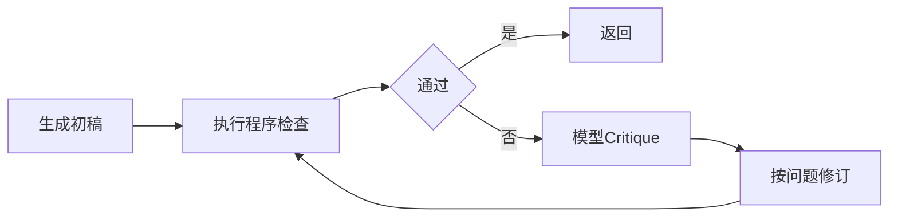

# Reflection-实现

> [!abstract] 一句话总结
> Reflection 是让 Agent 在交付前按明确检查项自检和修正，适合代码生成、长文总结、客服答复等高误差成本场景。

## 📌 这是什么

Reflection 常见结构：

1. **Draft**：先生成初稿或执行结果。
2. **Critique**：按检查清单找缺陷，例如事实缺失、格式不符、安全风险。
3. **Revise**：只根据明确问题修订。
4. **Stop**：达到阈值或最大轮数后停止。

反思不是让模型无限“再想想”，而是把质量标准写成可执行检查。

## 🤔 解决什么问题 / 为什么需要

- 最终答案需要满足格式、事实引用、安全边界。
- 一次生成容易漏掉用户约束。
- 需要在调用工具后检查答案是否真正使用了工具事实。
- 代码生成场景需要先运行测试，再让模型根据错误修复。

## 🧩 检查项设计

| 检查项 | 例子 | 自动化方式 |
| ------ | ---- | ---------- |
| 事实一致 | 答案必须引用工具返回状态 | 程序断言 + LLM judge。 |
| 格式正确 | 必须输出 JSON 或固定段落 | JSON schema / 正则。 |
| 安全合规 | 不泄露手机号、token | 脱敏检查。 |
| 完整性 | 覆盖用户的全部子问题 | checklist judge。 |
| 成本控制 | 最多反思 1 到 2 轮 | loop guard。 |

## ⚙️ 实现步骤



1. 先写程序可检查项，如 JSON schema、必填字段、敏感词、工具事实引用。
2. 程序检查不通过时，把具体错误给模型，不让它泛泛重写。
3. LLM critique 只输出问题列表，不输出新答案。
4. Revise 阶段只修复问题列表，保持原答案中正确部分。
5. 设置最大反思轮数；超过后降级为人工确认或返回保守答案。

## 💻 Java / Spring AI 示例

```java
record Critique(List<String> issues, boolean pass) {}
```

```java
String draft = chatClient.prompt()
        .system("根据工具事实回答用户，不要编造。")
        .user(question + "\n工具事实：" + toolResult)
        .call()
        .content();

Critique critique = chatClient.prompt()
        .system("""
                你是质检器，只输出 JSON。
                检查答案是否引用工具事实、是否回答全部问题、是否包含敏感信息。
                """)
        .user("问题：" + question + "\n工具事实：" + toolResult + "\n答案：" + draft)
        .call()
        .entity(Critique.class);

if (!critique.pass()) {
    draft = chatClient.prompt()
            .system("只修复质检指出的问题，不新增未经工具证明的事实。")
            .user("原答案：" + draft + "\n问题列表：" + critique.issues())
            .call()
            .content();
}
```

## ⚠️ 工程坑

- 没有检查清单，只让模型“反思一下”，结果成本增加但质量不稳定。
- Critique 和 Revise 用同一段 prompt，模型边批评边改写，难以审计。
- 反思轮数无限制，复杂问题耗时和费用不可控。
- 只用 LLM judge，不做 JSON schema、敏感信息等确定性检查。
- 反思阶段引入新事实，反而增加幻觉。

## 🎯 面试问题

> [!question] 高频问题
> - Q: Reflection 适合所有 Agent 吗？
>   - A: 不适合。简单低风险任务直接回答更便宜；Reflection 适合错误成本高、格式严格或需要质量门禁的任务。
> - Q: Reflection 和评估有什么区别？
>   - A: Reflection 是请求内的自检与修订；评估是离线或发布前对样本集做质量度量。
> - Q: 如何避免 Reflection 成本失控？
>   - A: 程序检查优先、问题列表具体化、最大轮数限制、超过阈值转人工或保守返回。

## ✅ 精通检查清单

- 能把质量要求写成 checklist。
- 能区分 Draft、Critique、Revise 三个 prompt。
- 能结合程序检查和 LLM 检查。
- 能设置最大轮数和降级策略。

## 🔗 关联笔记

- [[_index]]
- [[19-Agent评估]]
- [[22-Agent成本控制与降级]]
- [[../00-总览/学习仪表盘]]

## 📚 参考资料

- [Spring AI Structured Output](https://docs.spring.io/spring-ai/reference/api/structured-output-converter.html)
- [OpenAI Platform Docs](https://platform.openai.com/docs/)
