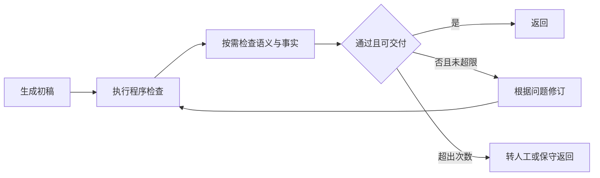

# Reflection-实现

> [!abstract] 一句话总结
> Reflection 是让 Agent 在交付前按明确检查项自检和修正，适合代码生成、长文总结、客服答复等高误差成本场景。

## 📌 这是什么

Reflection 常见结构：
1. **Draft**：先生成初稿或执行结果。
2. **Critique**：按检查清单找缺陷，例如事实缺失、格式不符、安全风险。
3. **Revise**：只根据明确问题修订。
4. **Stop**：达到阈值或最大轮数后停止。

反思不是让模型无限“再想想”，而是把质量标准写成可执行检查。

## 🤔 解决什么问题 / 为什么需要

- 最终答案需要满足格式、事实引用、安全边界。
- 一次生成容易漏掉用户约束。
- 需要在调用工具后检查答案是否真正使用了工具事实。
- 代码生成场景需要先运行测试，再让模型根据错误修复。

## 🗣️ 一次检查和修订

假设工具返回“订单 A123 仍在运输”，初稿却写成“订单 A123 已送达”。检查步骤应该指出“订单状态与工具结果不一致”，修订时只纠正这个结论，并保留仍然正确的订单号。
这次检查可以由程序对结构化状态做确定性比较，也可以由模型辅助发现自然语言中的矛盾。模型检查本身也可能漏掉问题或误判，重要事实仍要回到工具结果或原始资料核验。

## 🧩 检查项设计

| 检查项 | 例子 | 自动化方式 |
| ------ | ---- | ---------- |
| 事实一致 | 答复状态与工具结果一致 | 结构化字段比较；必要时由模型辅助检查表述。 |
| 格式正确 | 必须输出 JSON 或固定段落 | JSON schema / 正则。 |
| 安全合规 | 不泄露手机号、token | 脱敏检查。 |
| 完整性 | 覆盖用户的全部子问题 | checklist judge。 |
| 成本控制 | 最多反思 1 到 2 轮 | loop guard。 |

## ⚙️ 实现步骤



1. 先写程序可检查项，如 JSON schema、必填字段、敏感词、工具事实引用。
2. 对程序难以判断的内容，按需用模型辅助检查，例如找出答复与工具事实的矛盾；格式通过不等于事实正确。
3. 把具体问题交给修订步骤，尽量保留初稿中正确的内容，修订后重新检查。
4. 设置最大修订次数；仍不通过时转人工或保守返回。模型检查也会漏判，不能取代重要事实的可靠核验。

## 💻 Java / Spring AI 示例

```java
record Critique(List<String> issues, boolean pass) {}
```

以下是应用逻辑片段：`reviewAnswer` 与 `reviseAnswer` 由项目实现，示例省略模型配置与异常处理，未实际运行。修改次数仍应设上限，质检结论也可能出错。

```java
Critique review = reviewAnswer(question, toolResult, draft);
if (!review.pass()) {
    draft = reviseAnswer(draft, review.issues());
    review = reviewAnswer(question, toolResult, draft);
}
return review.pass() ? draft : "暂时无法确认，请转人工处理";
```

## ⚠️ 工程坑

- 没有检查清单，只让模型“反思一下”，结果成本增加但质量不稳定。
- 检查结果和修改内容混在一起，难以判断具体修复了什么。
- 反思轮数无限制，复杂问题耗时和费用不可控。
- 只用 LLM judge，不做 JSON schema、敏感信息等确定性检查。
- 反思阶段引入新事实，反而增加幻觉。

## 🎯 面试问题

> [!question]- Reflection 适合所有 Agent 吗？
> 不适合。简单低风险任务直接回答更便宜；Reflection 适合错误成本高、格式严格或需要质量门禁的任务。

> [!question]- Reflection 和评估有什么区别？
> Reflection 是单次任务内的检查与修订；评估是在一组样本或线上流量上度量系统质量，后者也能帮助判断反思步骤是否有用。

> [!question]- 如何避免 Reflection 成本失控？
> 程序检查优先、问题列表具体化、最大轮数限制、超过阈值转人工或保守返回。

## ✅ 精通检查清单

- 能把质量要求写成 checklist。
- 能区分 Draft、Critique、Revise 三个 prompt。
- 能结合程序检查和 LLM 检查。
- 能设置最大轮数和降级策略。

## 🔗 关联笔记

- [[_index]]
- [[19-Agent评估]]
- [[22-Agent成本控制与降级]]
- [[../00-总览/学习仪表盘]]

## 📚 参考资料

- [Spring AI Structured Output](https://docs.spring.io/spring-ai/reference/api/structured-output-converter.html)
- [OpenAI Platform Docs](https://platform.openai.com/docs/)
