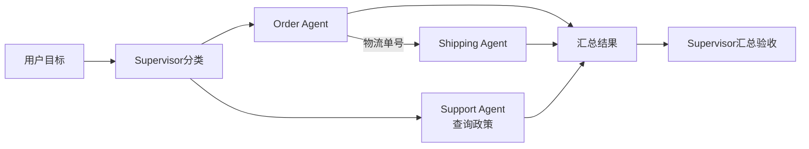

# Multi-Agent-Supervisor实现

> [!abstract] 一句话总结
> Supervisor 模式让一个主控 Agent 负责拆分、分派、验收，多个专业 Agent 只处理自己的工具和上下文，适合跨领域任务但要严格控制边界和成本。

## 📌 这是什么

Multi-Agent Supervisor 包含：
1. **Supervisor**：理解目标、选择 worker、合并结果、处理冲突。
2. **Worker Agent**：订单、售后、知识库、数据分析等专业 Agent。
3. **Shared State**：任务状态、证据、工具结果、决策记录。
4. **Policy**：谁能调用哪些工具，哪些步骤需要人工确认。

不要为了显得高级就拆多 Agent。单 Agent 能稳定完成的任务，不需要 supervisor。
可以把 Supervisor 理解为任务协调者：它不需要亲自查询订单，而是决定把什么问题交给谁，并检查结果是否足以回答用户。Worker 只处理分配给自己的子任务；是否使用独立模型、进程或服务取决于实现，不是多 Agent 的必要条件。

## 🤔 解决什么问题 / 为什么需要

- 一个任务跨多个业务域，如“查订单延迟原因并判断是否补偿”。
- 不同子任务需要不同工具、权限和 prompt。
- 需要并行执行多个只读查询，再由主控汇总。
- 需要让专业 Agent 的上下文更短、更稳定。

## 🗣️ 跟着一次订单延误处理

用户问“订单 A1001 为什么还没到，能申请补偿吗？”假设订单查询返回物流单号 `S001`，物流查询返回“运输延误”，售后政策允许符合条件的用户申请补偿。一次可能的分工如下：
1. Supervisor 把订单号交给订单 Agent；订单 Agent 在鉴权后返回订单状态和物流单号。
2. Supervisor 将物流单号交给物流 Agent，得到延误信息；政策查询可在没有依赖时并行进行。
3. Supervisor 比对订单、物流和政策结果，向用户说明已知情况；是否符合补偿条件仍需按实际政策核验。
4. 用户需要申请时，再按权限和业务规则创建申请；需要审批的操作不能因为某个 Agent 建议执行就跳过审批。

如果订单查询失败，物流 Agent 不应编造单号；如果物流状态与订单状态冲突，Supervisor 应补查、说明不确定或转人工。这些返回值都是示意数据，并非运行结果。

## 🧩 角色拆分

下面是本例的角色和权限划分，实际哪些角色可以调用工具由业务策略决定。

| 角色 | 负责 | 禁止 |
| ---- | ---- | ---- |
| Supervisor | 分派任务、合并结果、冲突判断 | 直接调用高风险业务工具。 |
| Order Agent | 订单状态、支付状态 | 查询非当前用户订单。 |
| Shipping Agent | 物流节点、预计到达 | 修改订单状态。 |
| Support Agent | 创建工单、补偿申请 | 未确认直接退款。 |
| Safety Agent | 敏感内容与越狱意图审查 | 替代服务端做最终业务权限校验。 |

## ⚙️ 实现步骤



1. 先定义 worker 能力边界和可用工具，不共享全量工具。
2. Supervisor 输出结构化分派计划：worker、任务、输入、验收标准。
3. worker 返回状态、结果及来源，并标明需要人工处理的情况；把事实与模型推测分开。
4. Supervisor 核对来源和关键结果，遇到冲突或缺失时补查、说明不确定或转人工。
5. 只并行执行互不依赖的任务，并设置总超时、单 worker 超时和成本预算。

## 💻 Java / Spring AI 示例

```java
interface WorkerAgent {
    WorkerResult run(WorkerTask task);
}

record WorkerTask(String worker, String instruction, Map<String, Object> input) {}
record Fact(String content, String source) {}
record WorkerResult(String worker, String status, List<Fact> facts, boolean needHuman) {}
```

以下是顺序派发的简化片段，`workers`、任务与结果类型由应用实现，`tasks` 假设已经按依赖顺序准备好；它没有实现任务间结果绑定、超时或重试，未在本机运行。返回的 `facts` 仍需检查来源，不能因为字段叫 facts 就直接相信。

```java
for (WorkerTask task : tasks) {
    WorkerAgent worker = workers.get(task.worker());
    if (worker == null) return "无法处理，请转人工";
    WorkerResult result = worker.run(task);
    if (!"SUCCESS".equals(result.status()) || result.needHuman()) {
        return "信息不足，请转人工处理";
    }
    results.add(result);
}
return verifyAndSummarize(userGoal, results);
```

`verifyAndSummarize` 也是应用自定义方法，用于检查关键结果并汇总，不能代替业务系统的权限校验。真实实现还需要把上一步的物流单号传给下一步，而不是提前假设单号已知。

## ⚠️ 工程坑

- 每个 worker 都拿全量上下文和全量工具，成本高且权限边界消失。
- Supervisor 不做验收，worker 返回什么就直接拼接给用户。
- 多 worker 并行写同一业务对象，没有锁、幂等和状态机。
- 共享记忆污染：一个 worker 的猜测被另一个 worker 当事实。
- 没有任务级总预算，worker 数量越多成本越不可控。

## 🎯 面试问题

> [!question]- 什么时候需要 Multi-Agent？
> 当任务确实跨领域、需要不同工具和权限、或需要并行专业处理时；普通工具调用任务用单 Agent 更简单。

> [!question]- Supervisor 的核心职责是什么？
> 分派、约束、验收和合并；谁能直接调用哪些工具，由应用和业务策略明确控制。

> [!question]- 多 Agent 怎么避免互相污染上下文？
> worker 只返回结构化 facts 和状态，Supervisor 明确区分事实、推断和待确认事项。

## ✅ 精通检查清单

- 能设计 supervisor/worker 的职责边界。
- 能为 worker 限定工具和上下文。
- 能处理并行、超时、冲突和人工接管。
- 能说明多 Agent 的成本和复杂度代价。

## 🔗 关联笔记

- [[_index]]
- [[04-Plan-and-Execute-实现]]
- [[22-Agent成本控制与降级]]
- [[../00-总览/学习仪表盘]]

## 📚 参考资料

- [Spring AI Tool Calling](https://docs.spring.io/spring-ai/reference/api/tools.html)
- [OpenAI Platform Docs](https://platform.openai.com/docs/)
