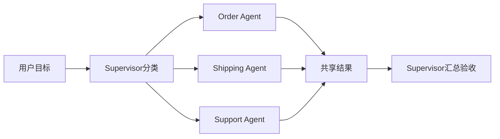

# Multi-Agent-Supervisor实现

> [!abstract] 一句话总结
> Supervisor 模式让一个主控 Agent 负责拆分、分派、验收，多个专业 Agent 只处理自己的工具和上下文，适合跨领域任务但要严格控制边界和成本。

## 📌 这是什么

Multi-Agent Supervisor 包含：

1. **Supervisor**：理解目标、选择 worker、合并结果、处理冲突。
2. **Worker Agent**：订单、售后、知识库、数据分析等专业 Agent。
3. **Shared State**：任务状态、证据、工具结果、决策记录。
4. **Policy**：谁能调用哪些 MCP tools，哪些步骤需要人工确认。

不要为了显得高级就拆多 Agent。单 Agent 能稳定完成的任务，不需要 supervisor。

## 🤔 解决什么问题 / 为什么需要

- 一个任务跨多个业务域，如“查订单延迟原因并判断是否补偿”。
- 不同子任务需要不同工具、权限和 prompt。
- 需要并行执行多个只读查询，再由主控汇总。
- 需要让专业 Agent 的上下文更短、更稳定。

## 🧩 角色拆分

| 角色 | 负责 | 禁止 |
| ---- | ---- | ---- |
| Supervisor | 分派任务、合并结果、冲突判断 | 直接调用高风险业务工具。 |
| Order Agent | 订单状态、支付状态 | 查询非当前用户订单。 |
| Shipping Agent | 物流节点、预计到达 | 修改订单状态。 |
| Support Agent | 创建工单、补偿申请 | 未确认直接退款。 |
| Safety Agent | 权限、注入、敏感信息检查 | 替业务 Agent 执行工具。 |

## ⚙️ 实现步骤



1. 先定义 worker 能力边界和可用工具，不共享全量工具。
2. Supervisor 输出结构化分派计划：worker、任务、输入、验收标准。
3. worker 返回结构化结果：status、facts、confidence、needHuman。
4. Supervisor 只基于 worker facts 汇总，遇到冲突要求补查或转人工。
5. 对并行 worker 设置总超时、单 worker 超时和成本预算。

## 💻 Java / Spring AI 示例

```java
interface WorkerAgent {
    WorkerResult run(WorkerTask task);
}

record WorkerTask(String worker, String instruction, Map<String, Object> input) {}
record WorkerResult(String worker, String status, List<String> facts, boolean needHuman) {}
```

```java
@Service
class SupervisorAgent {
    private final Map<String, WorkerAgent> workers;
    private final ExecutorService pool = Executors.newFixedThreadPool(4);  // 并行执行池

    List<WorkerResult> dispatch(List<WorkerTask> tasks) {
        // 并行执行所有 worker（只读查询场景），总超时兜底
        try {
            return pool.invokeAll(tasks.stream()
                            .map(task -> (Callable<WorkerResult>) () -> workers.get(task.worker()).run(task))
                            .toList(), 30, TimeUnit.SECONDS)
                    .stream()
                    .map(f -> {
                        try { return f.get(); }
                        catch (Exception e) { return new WorkerResult("", "error", List.of("worker 超时或失败: " + e.getMessage()), true); }
                    })
                    .toList();
        } catch (InterruptedException e) {
            Thread.currentThread().interrupt();
            throw new IllegalStateException("worker 并行执行被中断", e);
        }
    }

    String summarize(String userGoal, List<WorkerResult> results) {
        return chatClient.prompt()
                .system("只根据 worker facts 汇总答案；冲突或缺事实时要求人工处理。")
                .user("用户目标：" + userGoal + "\nworker结果：" + results)
                .call()
                .content();
    }
}
```

## ⚠️ 工程坑

- 每个 worker 都拿全量上下文和全量工具，成本高且权限边界消失。
- Supervisor 不做验收，worker 返回什么就直接拼接给用户。
- 多 worker 并行写同一业务对象，没有锁、幂等和状态机。
- 共享记忆污染：一个 worker 的猜测被另一个 worker 当事实。
- 没有任务级总预算，worker 数量越多成本越不可控。

## 🎯 面试问题

> [!question] 高频问题
> - Q: 什么时候需要 Multi-Agent？
>   - A: 当任务确实跨领域、需要不同工具和权限、或需要并行专业处理时；普通工具调用任务用单 Agent 更简单。
> - Q: Supervisor 的核心职责是什么？
>   - A: 分派、约束、验收和合并；它不应绕过 worker 边界直接执行所有工具。
> - Q: 多 Agent 怎么避免互相污染上下文？
>   - A: worker 只返回结构化 facts 和状态，Supervisor 明确区分事实、推断和待确认事项。

## ✅ 精通检查清单

- 能设计 supervisor/worker 的职责边界。
- 能为 worker 限定工具和上下文。
- 能处理并行、超时、冲突和人工接管。
- 能说明多 Agent 的成本和复杂度代价。

## 🔗 关联笔记

- [[_index]]
- [[04-Plan-and-Execute-实现]]
- [[22-Agent成本控制与降级]]
- [[10-AI应用开发/00-总览/学习仪表盘]]

## 📚 参考资料

- [Spring AI Tool Calling](https://docs.spring.io/spring-ai/reference/api/tools.html)
- [OpenAI Platform Docs](https://platform.openai.com/docs/)
