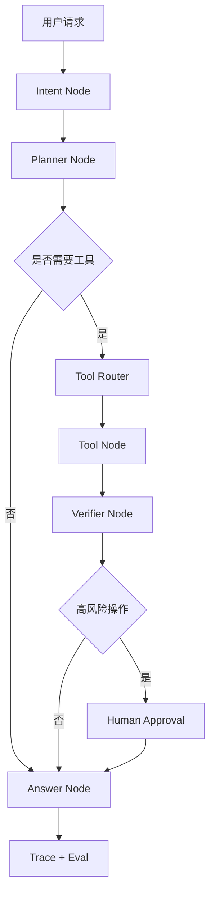

# LangGraph 生产级 Agent 编排

> [!abstract] 一句话总结
> LangGraph 的价值不是“又一个 Agent 框架”，而是把 Agent 从一次性脚本变成可恢复、可观测、可人工介入的状态机。

## 为什么 2026 要补

近期招聘里 “LangChain / LangGraph / Agent Workflow” 出现频率明显上升。原因是企业不再只要能聊天的 Demo，而是要能跑业务流程的 Agent：中途失败能恢复，关键节点能审批，线上 trace 能回放，状态能长期保存。

## 核心心智

| 能力 | 解决的问题 | 面试表达 |
| ---- | ---------- | -------- |
| StateGraph | Agent 每一步读写统一状态 | 把对话、计划、工具结果、审批状态都放进状态对象 |
| Node | 一个可执行步骤 | LLM 调用、工具调用、检索、校验、人工审批都可以是节点 |
| Edge / Conditional Edge | 决定下一步走向 | 用结构化路由代替模型自由发挥 |
| Checkpoint | 持久化中间状态 | 失败后从断点恢复，而不是整条链重跑 |
| Human-in-the-loop | 人工介入 | 高风险写操作先暂停，审批后继续 |
| Streaming | 过程输出 | 前端能看到 Agent 正在计划、调用工具、汇总结果 |

## Java 后端怎么理解

把 LangGraph 类比成“AI 版流程编排引擎”：

- `State` 类似流程实例上下文。
- `Node` 类似流程节点或 Spring Service 方法。
- `Edge` 类似状态机流转条件。
- `Checkpoint` 类似流程实例持久化。
- `Human-in-the-loop` 类似审批节点。

Java 项目不一定要用 Python LangGraph 上生产，但必须懂它代表的生产范式。你可以用 Spring Boot 自己实现状态机，也可以让 Python/TS Agent 服务承担编排，Java 保持业务权限和工具执行。

## 典型架构

## 适合用 LangGraph 的场景

- 多步骤业务流程：报销审核、客服工单、数据分析、代码修复。
- 需要人工审批：退款、发券、改订单、发外部通知。
- 需要断点恢复：任务跑几分钟甚至几十分钟，不能失败就重来。
- 多 Agent 协作：研究、规划、执行、审核分角色。
- 需要长期状态：用户目标、任务进度、工具执行历史。

## 不适合的场景

- 简单问答：普通 ChatClient + RAG 足够。
- 固定流程且规则明确：普通后端工作流更稳定。
- 强事务核心链路：不要让 LLM 决定账务、库存、权限。

## 与现有笔记的关系

- [[03-ReAct-Spring-AI实现]] 讲单 Agent 如何思考和行动。
- [[04-Plan-and-Execute-实现]] 讲先计划再执行。
- [[06-Multi-Agent-Supervisor实现]] 讲多 Agent 角色分工。
- 本文补的是生产级编排：状态、恢复、人工介入、可观测。

## 面试讲法

> 我不会把 Agent 理解成一段 prompt，而会把它设计成状态机。每一步的输入、输出、可调用工具、失败策略和权限边界都显式建模。像 LangGraph 这类框架的价值在于 checkpoint、human-in-the-loop、streaming 和 trace，能让 Agent 从 Demo 进入生产系统。

## 学习检查

- [ ] 能解释 LangGraph 为什么比简单链式调用更适合生产 Agent。
- [ ] 能画出一个包含 Planner、Tool、Verifier、Human Approval 的流程图。
- [ ] 能说清哪些节点应该由 LLM 决策，哪些必须由代码判断。
- [ ] 能设计 checkpoint 和失败恢复策略。

## 📚 参考资料

- [LangGraph 官方文档：Overview](https://docs.langchain.com/oss/python/langgraph/overview)
- [LangGraph 官方文档：Durable execution](https://docs.langchain.com/oss/python/langgraph/durable-execution)
- [LangGraph 官方文档：Human-in-the-loop](https://docs.langchain.com/oss/python/langgraph/human-in-the-loop)

